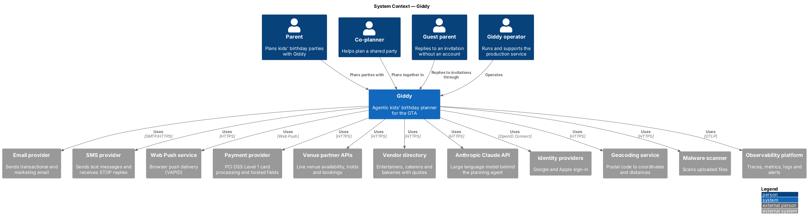
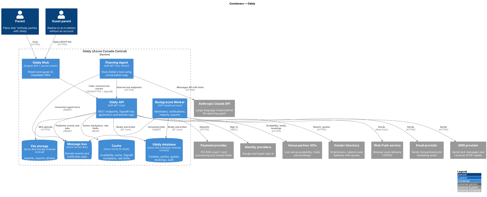

# Giddy detailed designs

## Overview

Giddy is an agentic birthday planner for kids' parties in Toronto and the Greater Toronto Area (GTA). This tree holds one detailed design per vertical feature slice. Each design traces to the L2 requirements in [`docs/specs/L2.md`](../specs/L2.md), uses the screens in [`docs/mocks`](../mocks/README.md), and follows the [`docs/design-system`](../design-system/README.md).

Every feature folder holds a `README.md` with four sections (Overview, Description, Requirements, Diagrams) and a `diagrams/` folder of PlantUML sources with their rendered images.

## Architecture in brief

- **Giddy Web**: an Angular single-page application and installable progressive web app. It serves parents, co-planners and guest parents, and keeps party-day data on the device for offline use.
- **Giddy API**: an ASP.NET Core application organised in clean-architecture layers. Controllers dispatch MediatR commands and queries to application handlers. Handlers act on domain aggregates (`Party`, `Family`, `Booking`, `Budget`) persisted with EF Core. A SignalR hub pushes live events.
- **Planning Agent**: a separate ASP.NET Core worker that runs Giddy's tool-using conversation loop against the Anthropic Claude API. It calls the API's internal tool endpoints with a family-scoped token. It never books, pays or sends messages itself.
- **Background Worker**: .NET hosted services for reminders, notifications, imports, exports, deletions and nightly locking.
- **Data**:
  - Azure SQL Database, Azure Cache for Redis, Azure Service Bus and Azure Blob Storage, all in Azure Canada Central.
  - Domain events use a transactional outbox.
- **External services**: the Anthropic Claude API, venue partner APIs, a vendor directory, a payment provider (hosted fields), email, SMS, Web Push, identity providers, geocoding, malware scanning and an observability platform.

### System context

Parents, co-planners and guest parents use Giddy. Giddy depends on the external services named below.

### Containers

The web app talks only to the API. Long-running agent turns and outbound messages run in their own containers, connected by the message bus.

## Features

47 features in 17 subsystems cover 87 of 87 L2 requirements.

| Subsystem | Feature | L2 requirements |
|---|---|---|
| Identity and access | [Sign up and verify email](identity/sign-up-and-verify/README.md) | `L2-001`, `L2-003` |
| Identity and access | [Sign in](identity/sign-in/README.md) | `L2-002`, `L2-004`, `L2-070` |
| Identity and access | [Reset a forgotten password](identity/reset-password/README.md) | `L2-005` |
| Identity and access | [Session expiry and sign-out](identity/manage-session/README.md) | `L2-006` |
| Family profile | [Manage children](family/manage-children/README.md) | `L2-007` |
| Family profile | [Send birthday reminders](family/send-birthday-reminders/README.md) | `L2-008` |
| Family profile | [Share a party plan](family/share-party-plan/README.md) | `L2-009` |
| Party plans | [Create a party plan](parties/create-party/README.md) | `L2-010` |
| Party plans | [List parties and view a party overview](parties/list-and-view-parties/README.md) | `L2-011`, `L2-012` |
| Party plans | [Lock a past party and delete a party](parties/lock-and-delete-party/README.md) | `L2-013`, `L2-014` |
| Planning agent | [Converse with Giddy](planning-agent/converse-with-giddy/README.md) | `L2-015`, `L2-016`, `L2-020` |
| Planning agent | [Propose a priced plan](planning-agent/propose-plan/README.md) | `L2-017`, `L2-019`, `L2-022` |
| Planning agent | [Apply Giddy's plan with confirmation](planning-agent/apply-plan/README.md) | `L2-018` |
| Planning agent | [Manage what Giddy remembers](planning-agent/manage-agent-memory/README.md) | `L2-021`, `L2-066` |
| Themes, venues and vendors | [Browse and choose a theme](catalogue/choose-theme/README.md) | `L2-023`, `L2-024` |
| Themes, venues and vendors | [Search venues by availability and fit](catalogue/search-venues/README.md) | `L2-025`, `L2-090` |
| Themes, venues and vendors | [View and compare venues](catalogue/view-and-compare-venues/README.md) | `L2-026`, `L2-027` |
| Themes, venues and vendors | [Discover vendors and request quotes](catalogue/discover-vendors-and-quotes/README.md) | `L2-031`, `L2-032`, `L2-033`, `L2-034` |
| Bookings and payments | [Book a venue and pay the deposit](bookings/book-venue/README.md) | `L2-028`, `L2-029` |
| Bookings and payments | [Track booking status and cancellations](bookings/track-booking-status/README.md) | `L2-030` |
| Budget | [Track the party budget](budget/track-budget/README.md) | `L2-035`, `L2-036` |
| Budget | [Warn and suggest when over budget](budget/resolve-over-budget/README.md) | `L2-037` |
| Guest list | [Manage the guest list](guests/manage-guest-list/README.md) | `L2-038`, `L2-039`, `L2-041` |
| Guest list | [Import guests in bulk](guests/import-guests/README.md) | `L2-040` |
| Guest list | [Select guests and send reminders](guests/send-rsvp-reminders/README.md) | `L2-042` |
| Invitations and RSVPs | [Design and send invitations](invitations/send-invitations/README.md) | `L2-043` |
| Invitations and RSVPs | [Respond to an invitation](invitations/respond-to-invitation/README.md) | `L2-044` |
| Invitations and RSVPs | [Live RSVP updates and the allergy list](invitations/live-rsvp-updates/README.md) | `L2-045`, `L2-046` |
| Checklist and reminders | [Manage the party checklist](checklist/manage-checklist/README.md) | `L2-047`, `L2-048` |
| Checklist and reminders | [Send task reminders and quiet hours](checklist/send-task-reminders/README.md) | `L2-049`, `L2-061` |
| Party day | [Run the party day](party-day/run-party-day/README.md) | `L2-050` |
| Party day | [Work offline on party day](party-day/work-offline/README.md) | `L2-051` |
| Wrap-up | [Send thank-you notes](wrap-up/send-thank-you-notes/README.md) | `L2-052` |
| Wrap-up | [Rate vendors and reuse the plan](wrap-up/rate-and-reuse/README.md) | `L2-053`, `L2-054` |
| Notifications | [Notification centre](notifications/notification-centre/README.md) | `L2-055`, `L2-060` |
| Notifications | [Toasts and banners](notifications/toasts-and-banners/README.md) | `L2-056`, `L2-057` |
| Notifications | [Deliver email, text and push](notifications/deliver-messages/README.md) | `L2-058` |
| Notifications | [Ask for push permission](notifications/enable-push/README.md) | `L2-059` |
| Home dashboard | [Home dashboard and nudges](home/home-dashboard/README.md) | `L2-062`, `L2-063`, `L2-064` |
| Account, settings and privacy | [Edit profile and notification settings](account/edit-settings/README.md) | `L2-065`, `L2-068` |
| Account, settings and privacy | [Download and delete my data](account/export-and-delete-data/README.md) | `L2-067` |
| Platform and cross-cutting concerns | [Authorise and validate every request](platform/authorise-requests/README.md) | `L2-069`, `L2-071` |
| Platform and cross-cutting concerns | [Accessible user interface](platform/accessible-ui/README.md) | `L2-079`, `L2-080`, `L2-081`, `L2-082`, `L2-083` |
| Platform and cross-cutting concerns | [Responsive, themed application shell](platform/responsive-themed-shell/README.md) | `L2-084`, `L2-085`, `L2-086` |
| Platform and cross-cutting concerns | [Loading, empty, error and offline states](platform/system-states/README.md) | `L2-087`, `L2-088`, `L2-089` |
| Platform and cross-cutting concerns | [Localise for the GTA](platform/localise-for-gta/README.md) | `L2-091` |
| Public website | [Landing page, help and legal](public-site/landing-help-and-legal/README.md) | `L2-092`, `L2-093`, `L2-094` |

## Conventions

- **Diagram set per feature**: C4 context, container and component diagrams; a class diagram; and one sequence diagram per behaviour.
- **Sequence diagram colours**: frontend boxes are blue, API boxes green, application and domain boxes pale green, and infrastructure boxes orange.
- **Undecided details**: these are marked `<TO SUPPLY>` under "Open points" in each feature.
- **Re-rendering**: run `python .claude/skills/writing-design-documents/scripts/render_puml.py docs/detailed-designs`. It needs Java, Graphviz and `plantuml.jar`; set `PLANTUML_JAR` to the jar's path.
