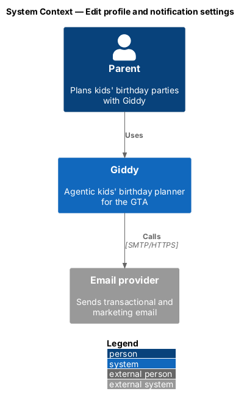
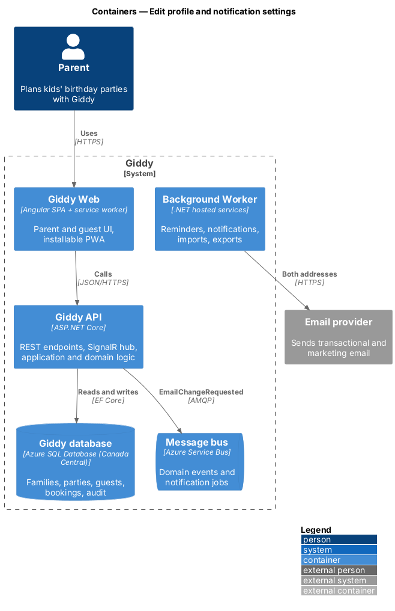
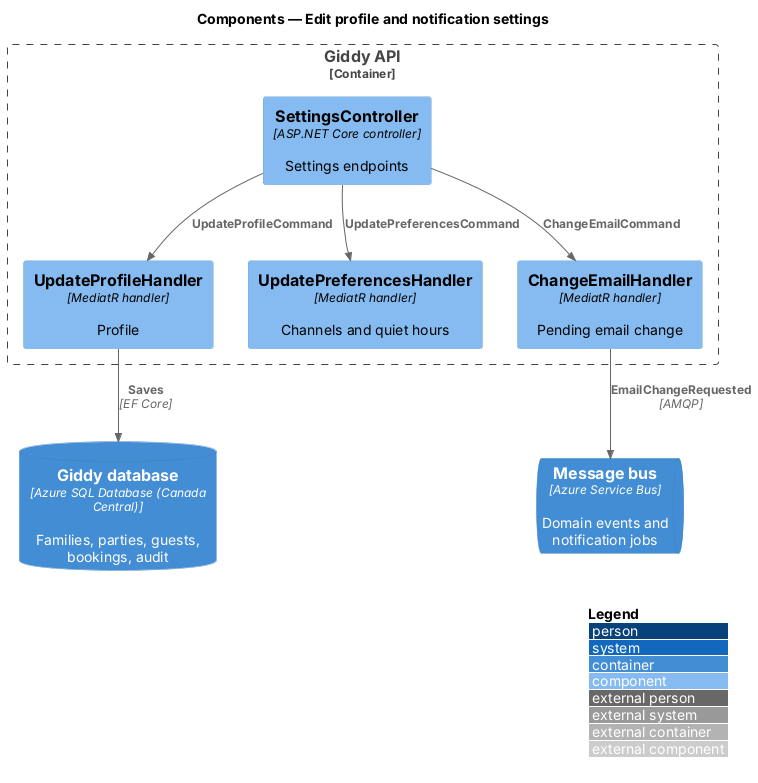
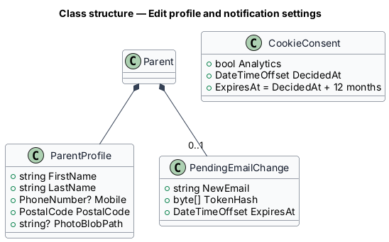
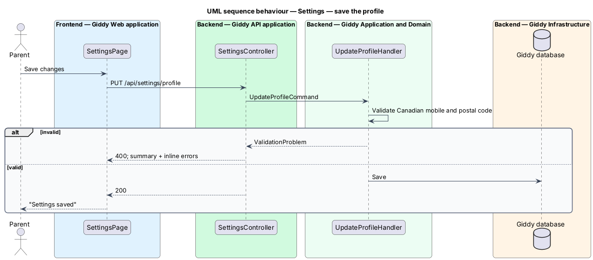

# Edit profile and notification settings

## Overview

Settings holds the parent's profile, notification channels per category, quiet hours and the cookie choice. Email changes require verification of the new address and notify the old one.

- **email change** — pending replacement address that takes effect only after its verification link is opened

This feature belongs to the **Account, settings and privacy** subsystem. It is designed from the screens in [`docs/mocks`](../../../mocks/README.md) and the L2 requirements listed below.

## Description

The feature is a vertical slice from the Angular web application through the Giddy API to storage and any external services.

**Frontend (Giddy Web)**

- **`SettingsPage`** — Route `/settings`; profile, channel matrix, quiet hours switch (immediate), memories, privacy actions.
- **`CookieConsentBanner`** — Essential only / Allow all / Choose with equal weight; loads analytics only after consent.

**Backend (Giddy API)**

- **`SettingsController`** — `GET/PUT /api/settings/profile`, `PUT .../preferences`, `PUT .../quiet-hours`, `POST .../email-change`.
- **`UpdateProfileHandler`** — Validates Canadian mobile and postal code.
- **`ChangeEmailHandler`** — Creates a pending change, emails both addresses.

## Requirements

The feature realizes the following level-2 (L2) requirements. Each L2 requirement refines the level-1 (L1) requirement cited beside it; the full acceptance criteria are in [`docs/specs/L2.md`](../../../specs/L2.md).

| L2 ID | Refines (L1) | Requirement |
|-------|--------------|-------------|
| `L2-065` | `L1-017` | **Profile and notification settings.** Given Settings, when the parent edits first name, last name, photo, mobile number or postal code and saves, then changes are saved and a success alert confirms them. |
| `L2-068` | `L1-017` | **Cookie consent.** Given a first visit, when any page loads, then a consent banner offers "Essential only", "Allow all" and "Choose" with equal visual weight, and no analytics cookies or scripts load until the visitor allows them. |

## Diagrams

### System context

Giddy emails both addresses when the email changes.

### Containers

Email change messages go through the worker.

### Components

Each settings area has its own handler.

### Class structure

A pending email change waits beside the current address.

### Behaviour — save the profile

Invalid mobile or postal code returns field errors and saves nothing (`L2-065`).

