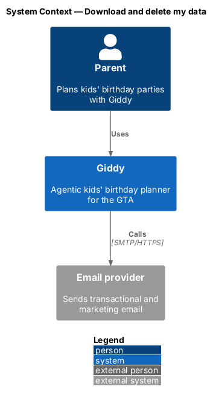
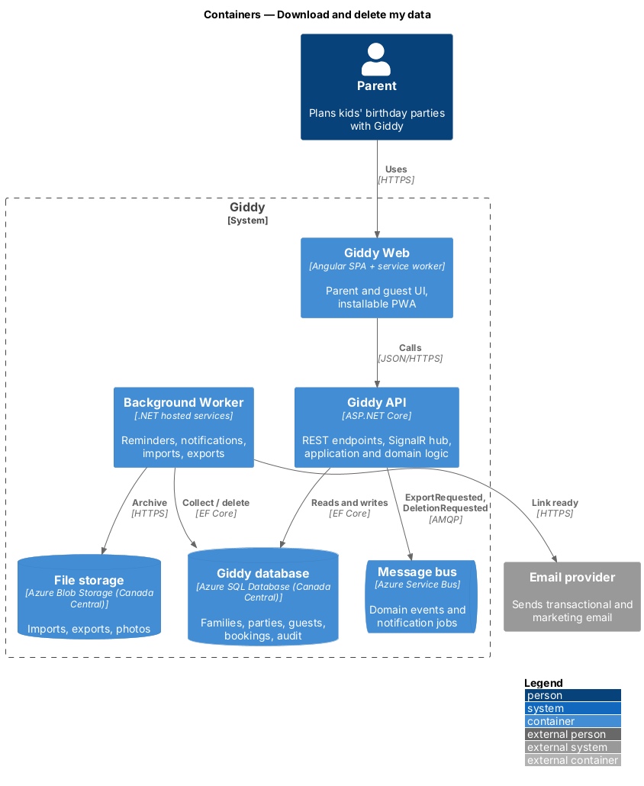
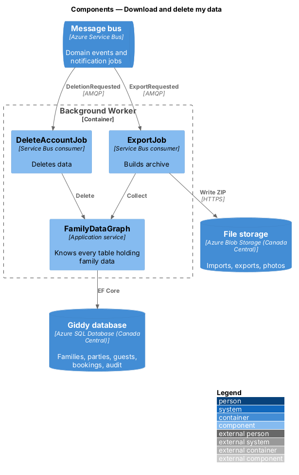
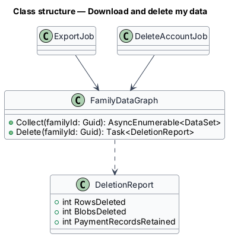
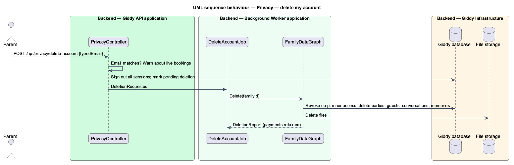

# Download and delete my data

## Overview

Parents can download everything Giddy holds about their family and delete their account. Both run as background jobs: export within 24 hours, deletion within 30 days, keeping only legally required payment records.

- **export archive** — ZIP of JSON files (profile, children, parties, guests, conversations, notifications) behind a 7-day signed-in link

This feature belongs to the **Account, settings and privacy** subsystem. It is designed from the screens in [`docs/mocks`](../../../mocks/README.md) and the L2 requirements listed below.

## Description

The feature is a vertical slice from the Angular web application through the Giddy API to storage and any external services.

**Backend (Giddy API)**

- **`PrivacyController`** — `POST /api/privacy/export`, `POST /api/privacy/delete-account` (requires typed email).
- **`ExportJob`** — Worker: collects data, writes the archive to blob storage, emails the link.
- **`DeleteAccountJob`** — Worker: deletes or anonymises data in dependency order, revokes co-planner access, purges blobs, memories and caches; keeps payment records.

**Open points**

- Legal retention period for payment records `<TO SUPPLY>`

**As built**

**Downloading data**
- "Download my data" calls `POST /api/privacy/export`. The parent is emailed "Your Giddy data is ready", linking to `/api/privacy/exports/{id}`.
- The link needs sign-in and works for 7 days, then answers 410.

**Deleting the account**
- "Delete my account" opens `DeleteAccountDialog`. It reads `GET /api/privacy/deletion-check` and warns when bookings aren't cancelled.
- The parent must type their sign-in email to confirm. Deletion removes the account, children, owned parties and what hangs off them, conversations and memories, and keeps payment bookings only as the law requires.
- The dialog then clears what this device saved and returns to sign-in.

## Requirements

The feature realizes the following level-2 (L2) requirements. Each L2 requirement refines the level-1 (L1) requirement cited beside it; the full acceptance criteria are in [`docs/specs/L2.md`](../../../specs/L2.md).

| L2 ID | Refines (L1) | Requirement |
|-------|--------------|-------------|
| `L2-067` | `L1-017` | **Download and delete data.** Given Settings, when the parent chooses "Download my data", then within 24 hours they receive a link (valid 7 days, requires sign-in) to a machine-readable archive of their profile, children, parties, guests, conversations and notifications. |

## Diagrams

### System context

Giddy emails the export link when it is ready.

### Containers

Both jobs run in the worker against the database and blob storage.

### Components

`FamilyDataGraph` is the single inventory of where family data lives.

### Class structure

Both jobs share the graph.

### Behaviour — delete my account

Deletion revokes access first, then removes data in dependency order; payment records stay as required (`L2-067`).

