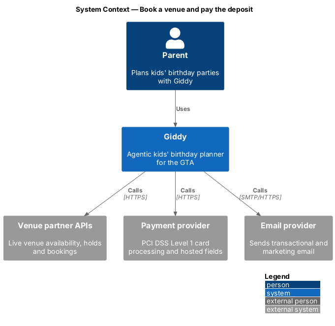
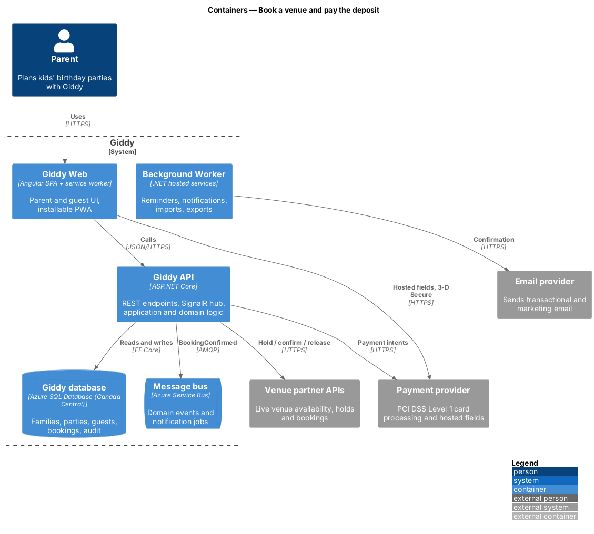
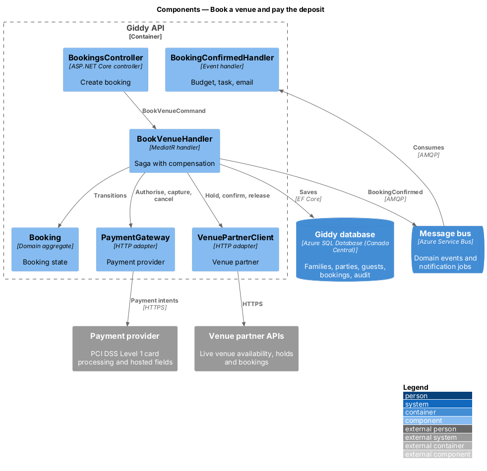
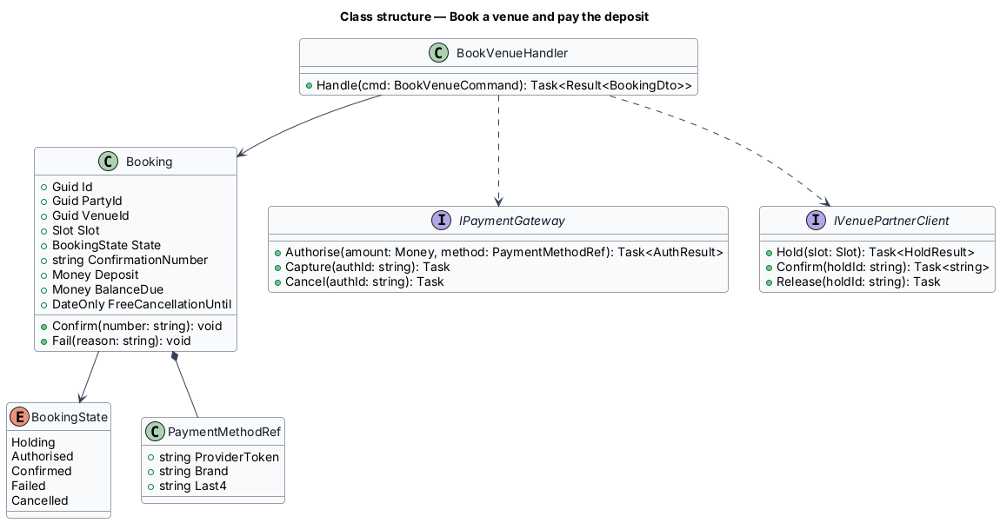
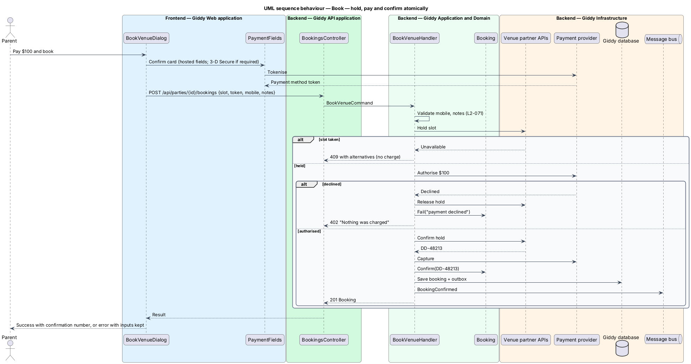

# Book a venue and pay the deposit

## Overview

Booking turns a free slot into a confirmed party venue. Giddy places a *hold* with the venue, authorises the *deposit* with the payment provider, and confirms both together: if either step fails, neither takes effect and nothing is charged.

- **hold** — temporary reservation of a slot at the venue partner, released if not confirmed
- **deposit** — part payment (default $100) that secures the booking; free cancellation until the venue's cut-off
- **hosted fields** — card inputs served by the payment provider in iframes so card data never reaches Giddy

This feature belongs to the **Bookings and payments** subsystem. It is designed from the screens in [`docs/mocks`](../../../mocks/README.md) and the L2 requirements listed below.

## Description

The feature is a vertical slice from the Angular web application through the Giddy API to storage and any external services.

**Frontend (Giddy Web)**

- **`BookVenueDialog`** — Summary, booking name, mobile, child, notes pre-filled with allergies, saved card choice, busy/failed/success states.
- **`PaymentFields`** — Provider hosted fields and 3-D Secure challenge.

**Backend (Giddy API)**

- **`BookingsController`** — `POST /api/parties/{id}/bookings`.
- **`BookVenueHandler`** — Orchestrates hold → payment authorisation → venue confirm → capture, with compensation on failure.
- **`Booking`** — Aggregate: venue, slot, state, confirmation number, deposit.
- **`PaymentGateway`** — Adapter for the provider: payment intents, 3-D Secure, capture, refund; stores only token, brand and last four.
- **`VenuePartnerClient`** — Hold, confirm and release calls to the venue partner API.
- **`BookingConfirmedHandler`** — Updates budget, adds the allergy-list task, sends the confirmation email.

**Open points**

- Payment provider selection (PCI DSS Level 1, CAD, 3-D Secure) `<TO SUPPLY>`
- Per-venue deposit amounts and cancellation cut-offs `<TO SUPPLY>`

## Requirements

The feature realizes the following level-2 (L2) requirements. Each L2 requirement refines the level-1 (L1) requirement cited beside it; the full acceptance criteria are in [`docs/specs/L2.md`](../../../specs/L2.md).

| L2 ID | Refines (L1) | Requirement |
|-------|--------------|-------------|
| `L2-028` | `L1-007` | **Book a venue slot.** Given a free slot, when the parent chooses "Book", then a dialog shows the venue, date, time, room, capacity and price, and asks for the booking name, mobile number, the birthday child and optional notes for the venue (pre-filled with the party's allergies). |
| `L2-029` | `L1-007` | **Deposit payment.** Given a booking, when the parent pays, then card details are collected by a PCI DSS Level 1 payment provider's hosted fields and never reach Giddy's servers; Giddy stores only the provider's token, card brand and last four digits. |

## Diagrams

### System context

Booking involves the venue partner (hold and confirm), the payment provider (deposit) and the email provider (confirmation).

### Containers

Card data goes from the browser straight to the payment provider; the API sees only a token.

### Components

`BookVenueHandler` is a small saga: each forward step has a compensating step.

### Class structure

`Booking` moves through `BookingState`; adapters hide the venue partner and payment provider behind interfaces.

### Behaviour — hold, pay and confirm atomically

The handler holds the slot, authorises the deposit, confirms with the venue and only then captures; any failure releases the hold and cancels the authorisation so nothing is charged (`L2-028`, `L2-029`).

