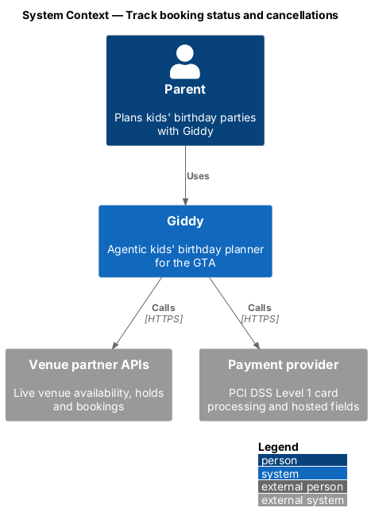
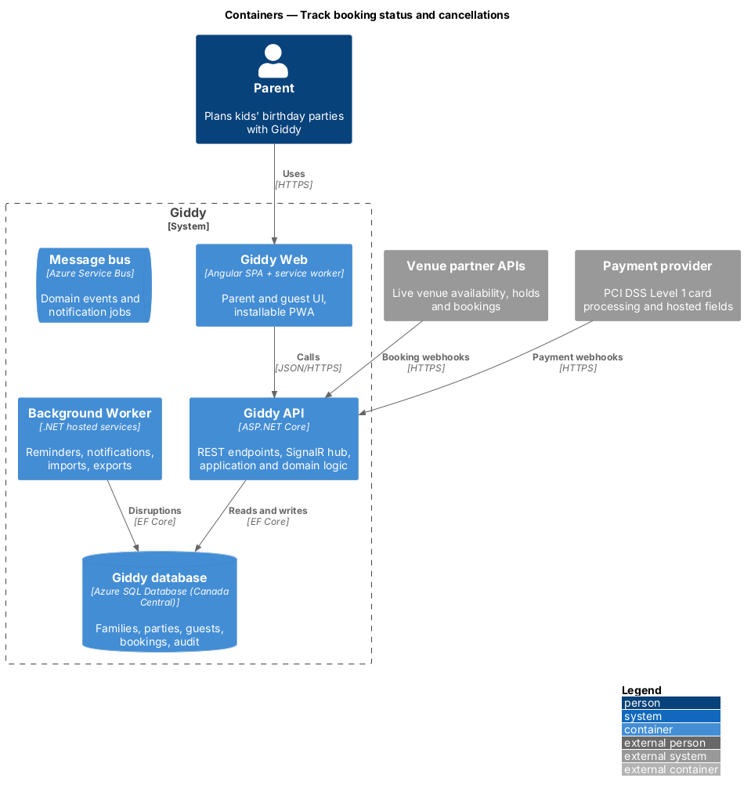
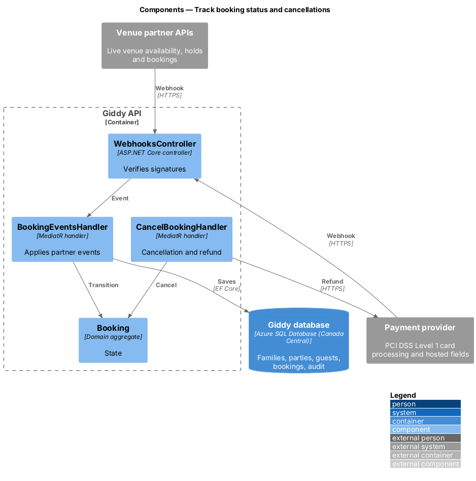
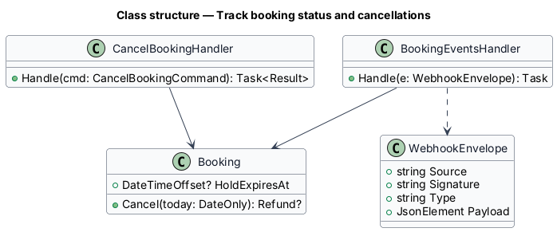
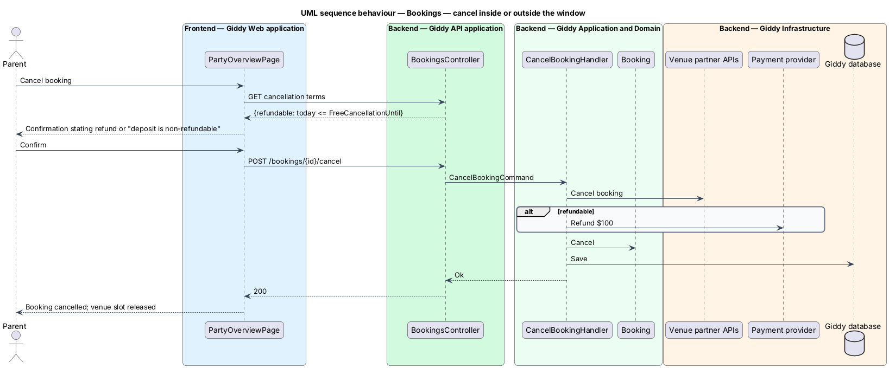

# Track booking status and cancellations

## Overview

After booking, the party overview reflects what is happening with each booking: holds that expire, confirmations, declined payments, cancellations with or without refund, and known disruptions on the day.

- **disruption** — known external event near the venue on the party date, such as a TTC closure

This feature belongs to the **Bookings and payments** subsystem. It is designed from the screens in [`docs/mocks`](../../../mocks/README.md) and the L2 requirements listed below.

## Description

The feature is a vertical slice from the Angular web application through the Giddy API to storage and any external services.

**Frontend (Giddy Web)**

- **`BookingBanner`** — Info, success, warning, danger and persistent variants on the party overview.

**Backend (Giddy API)**

- **`BookingEventsHandler`** — Consumes partner webhooks (confirmed, released, cancelled) and payment webhooks (declined, refunded).
- **`CancelBookingHandler`** — Cancels at the venue and refunds the deposit inside the window; otherwise states it is non-refundable before confirming.
- **`DisruptionFeed`** — Worker job matching transit and city notices to venue locations.

**As built**

- `GET /api/parties/{id}/booking-notices` describes the latest booking for anyone who can read the party: `hold` (info, until the hold expires), `confirmed` (success, with the confirmation number), `declined` (danger, not dismissible, offering another card) and `disruption` (warning, not dismissible, for notices within their radius of a booked venue on the party day, until the party date). Dismissing a dismissible banner is remembered in the browser.
- `POST /api/parties/{id}/bookings/{bookingId}/cancel` cancels at the venue and releases the slot. On or before the free-cancellation date it refunds the deposit; after it, the venue keeps the deposit, which stays recorded as paid. The venue page's `booking.refundable` tells the cancel dialog which message to show before the parent confirms.
- Partner and payment webhooks (`BookingEventsHandler`) and the `DisruptionFeed` worker wait for the partner, provider and notice feeds. Until then, bookings change state synchronously and disruption notices are seeded.

**Open points**

- Public transit and city notice feeds for disruptions `<TO SUPPLY>`

## Requirements

The feature realizes the following level-2 (L2) requirements. Each L2 requirement refines the level-1 (L1) requirement cited beside it; the full acceptance criteria are in [`docs/specs/L2.md`](../../../specs/L2.md).

| L2 ID | Refines (L1) | Requirement |
|-------|--------------|-------------|
| `L2-030` | `L1-007` | **Booking status, holds and cancellation.** Given a venue is holding a slot for the parent, when the party overview opens, then an info banner shows when the hold expires and offers "Book now". |

## Diagrams

### System context

Booking state changes arrive from venue partners and the payment provider as signed webhooks.

### Containers

The worker adds disruption notices from public feeds.

### Components

Webhooks are verified once, then mapped to domain transitions.

### Class structure

`Booking.Cancel` decides whether a refund applies.

### Behaviour — cancel inside or outside the window

Inside the free-cancellation window the deposit is refunded; outside it the dialog states the deposit is lost before the parent confirms (`L2-030`).

