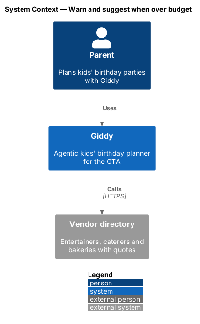
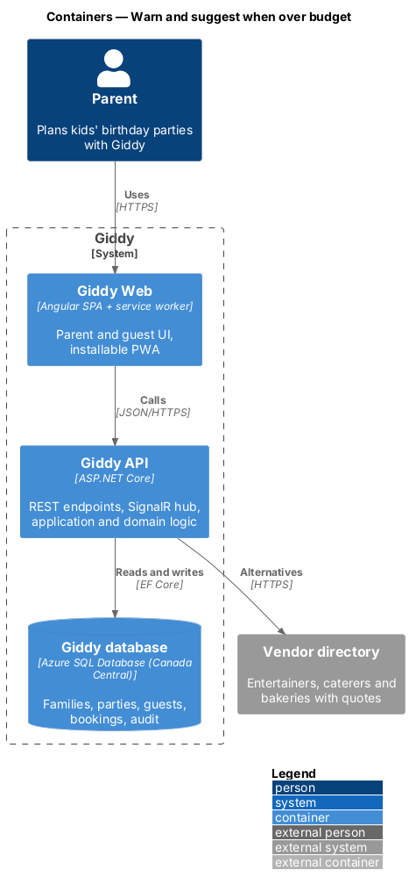
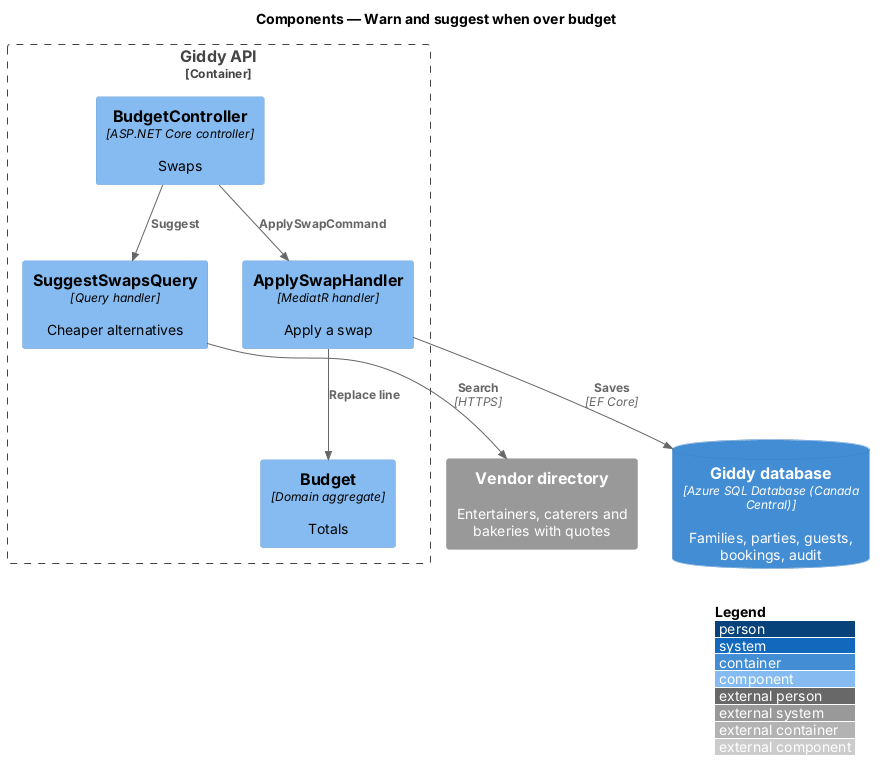
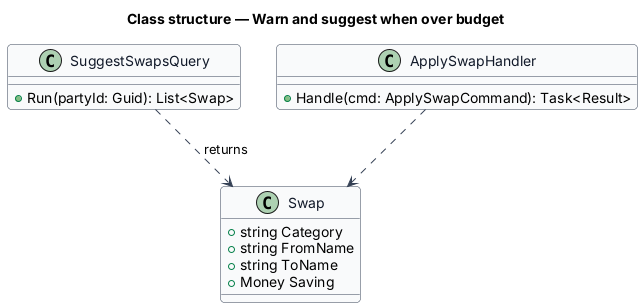
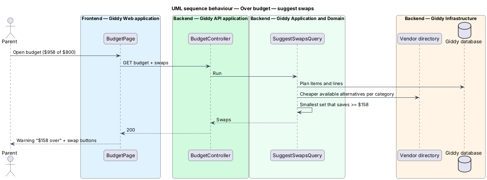

# Warn and suggest when over budget

## Overview

When planned costs exceed the budget, Giddy says by how much and proposes concrete swaps that would bring the total back within it. Applying a swap goes through the same confirmation as any agent change.

- **swap** — replacement of one plan item by a cheaper available alternative, with its saving

This feature belongs to the **Budget** subsystem. It is designed from the screens in [`docs/mocks`](../../../mocks/README.md) and the L2 requirements listed below.

## Description

The feature is a vertical slice from the Angular web application through the Giddy API to storage and any external services.

**Frontend (Giddy Web)**

- **`OverBudgetAlert`** — Warning alert with amount over, swap buttons and “Talk it through”.

**Backend (Giddy API)**

- **`SuggestSwapsQuery`** — Searches cheaper available alternatives per category and returns the smallest set that fits.
- **`ApplySwapHandler`** — Replaces the item and cost line after confirmation.

**As built**

- `BudgetProjection` asks `SwapAdvisor` for swaps whenever the plan is over budget. For each item not yet booked it takes the cheapest cheaper catalogue item in the same category that is free on the party date, within its service radius of the party, and big enough for the guests (venues need a free slot); per-kid prices are left out. It returns the smallest single swap that is enough, otherwise the biggest savings until the total fits.
- `POST /api/parties/{id}/budget/swaps` with the category and replacement id applies one swap after the parent confirms it in a dialog; the item goes back to To book and the updated budget is returned. A booked item answers 409.
- The warning lists every swap with its saving, a Swap button for each, and Talk it through, which opens Ask Giddy.

## Requirements

The feature realizes the following level-2 (L2) requirements. Each L2 requirement refines the level-1 (L1) requirement cited beside it; the full acceptance criteria are in [`docs/specs/L2.md`](../../../specs/L2.md).

| L2 ID | Refines (L1) | Requirement |
|-------|--------------|-------------|
| `L2-037` | `L1-009` | **Over-budget warning and suggestions.** Given planned costs exceed the budget, when the budget is viewed, then a warning alert states the amount over, the bar is outlined in the danger colour and the status badge reads "$<n> over". |

## Diagrams

### System context

Alternatives come from the vendor directory.

### Containers

A web → API slice with one external call.

### Components

Suggesting and applying are separate so suggestions never change data.

### Class structure

A `Swap` states its saving.

### Behaviour — suggest swaps

Swaps are only offered when they would bring the total within budget (`L2-037`).

