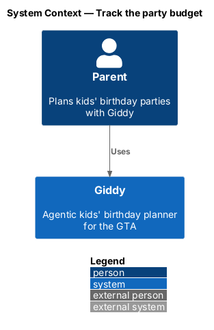
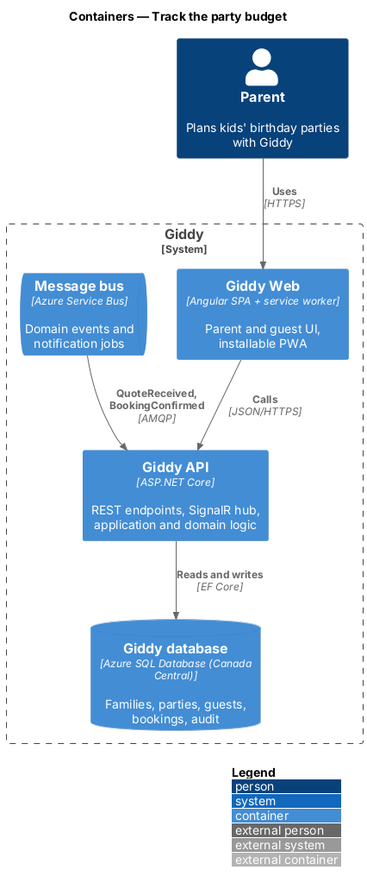
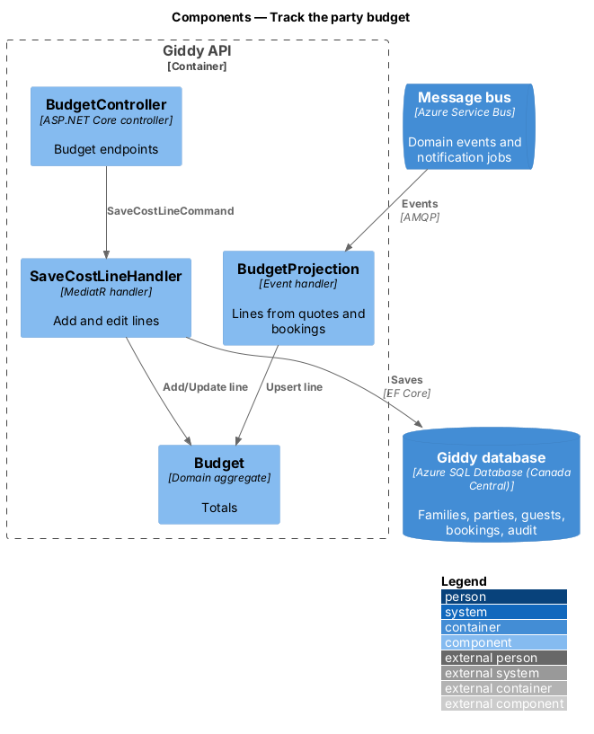
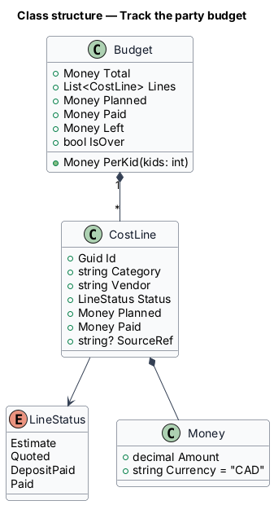
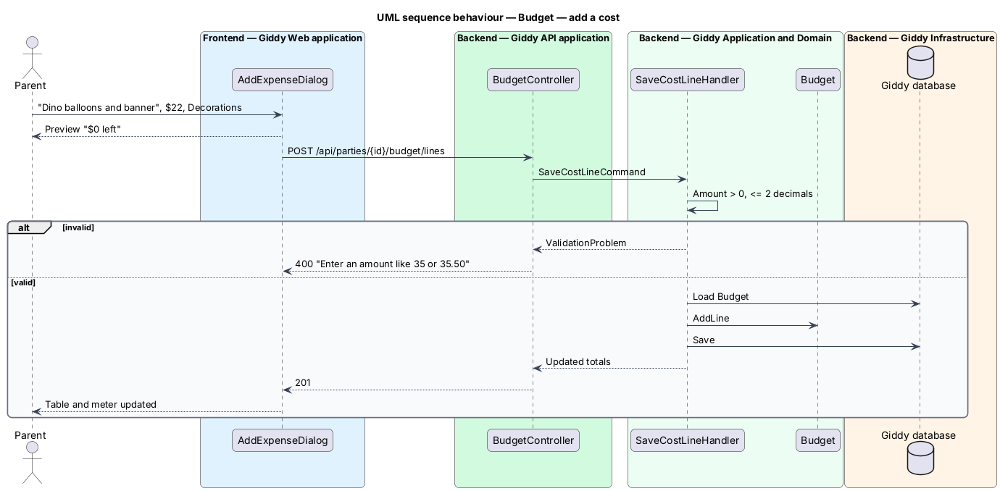

# Track the party budget

## Overview

The *budget* holds the parent's total and a list of *cost lines*. Lines come from Giddy's estimates, vendor quotes, booking deposits and manual entries. The page shows planned, paid, left and per-kid figures, a segmented bar and a table, all tax-inclusive in Canadian dollars.

- **cost line** — one budget item with category, vendor, status, planned amount and paid amount
- **line status** — Estimate, Quoted, DepositPaid or Paid

This feature belongs to the **Budget** subsystem. It is designed from the screens in [`docs/mocks`](../../../mocks/README.md) and the L2 requirements listed below.

## Description

The feature is a vertical slice from the Angular web application through the Giddy API to storage and any external services.

**Frontend (Giddy Web)**

- **`BudgetPage`** — Route `/parties/{id}/budget`.
- **`BudgetMeter`** — Segmented bar + legend.
- **`AddExpenseDialog`** — Description, category, amount, paid flag, live “left after this”.

**Backend (Giddy API)**

- **`BudgetController`** — `GET /api/parties/{id}/budget`, `POST/PUT/DELETE .../budget/lines`.
- **`Budget`** — Aggregate with `Total`, `Planned`, `Paid`, `Left`, `PerKid`.
- **`BudgetProjection`** — Event handler that upserts lines from `QuoteReceived` and `BookingConfirmed`.
- **`Money`** — Value object; CAD, two decimals, tax-inclusive.

**As built**

- The budget is a projection of the party, built when it is read: Giddy's plan items (`BookingsToDo`) take their status and amounts from quotes and bookings, so a quote shows as Quoted and a deposit as Deposit paid with no event handler and nothing for the parent to edit. The parent's own costs are `Expense` records stored with the party. The party's budget stays on the party; there is no separate `Budget` aggregate.
- `GET /api/parties/{id}/budget` returns the budget, planned, paid, left, per kid (planned ÷ guests, rounded), whether it is over and by how much, totals per category, every line (plan items in category order, then the parent's costs) and, when over, Giddy's swaps. `POST/PUT/DELETE .../budget/lines` add, change and remove the parent's own costs. Amounts are positive with at most two decimals ("Enter an amount like 35 or 35.50").
- Only the parent's own costs have Edit in the table; Giddy's items change through their vendors, quotes and bookings.
- "Fill in from the plan" is `POST .../budget/estimate`: for a party with no costs, typical GTA costs (venue $300, entertainer $200, cake $80, food $7 and loot bags $4 per child). It answers 409 once a party has costs.
- The library gained `giddy-legend`, `giddy-table-item` and a labelled variant of `giddy-stat` for the budget page.

## Requirements

The feature realizes the following level-2 (L2) requirements. Each L2 requirement refines the level-1 (L1) requirement cited beside it; the full acceptance criteria are in [`docs/specs/L2.md`](../../../specs/L2.md).

| L2 ID | Refines (L1) | Requirement |
|-------|--------------|-------------|
| `L2-035` | `L1-009` | **Budget tracking.** Given a party, when the budget opens, then it shows the budget, total planned, total paid, amount left and cost per kid, a segmented bar with one coloured segment per category and a legend with amounts, and a table of items with category, vendor, status (estimate, quoted, deposit paid, paid) and planned and paid amounts, with totals. |
| `L2-036` | `L1-009` | **Add and edit costs.** Given the budget, when the parent adds a cost with a description, category, amount and "already paid" flag, then it is added to the table and totals, and the dialog previews the amount left before saving. |

## Diagrams

### System context

Only parents and Giddy take part.

### Containers

Budget lines also arrive from quote and booking events on the bus.

### Components

Manual lines and projected lines both change the same `Budget` aggregate.

### Class structure

`Budget` derives totals from its `CostLine`s.

### Behaviour — add a cost

Amounts shall be positive with at most two decimals; totals recalculate in the aggregate (`L2-036`).

