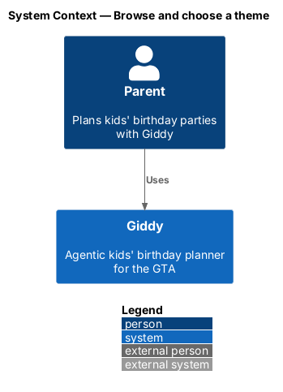
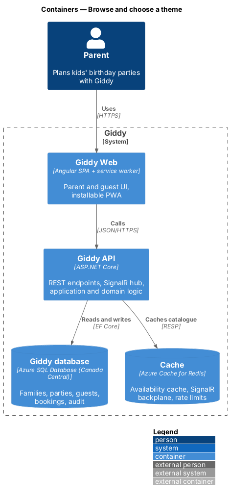
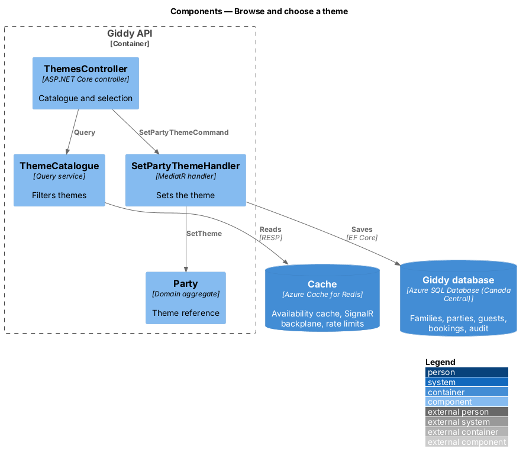
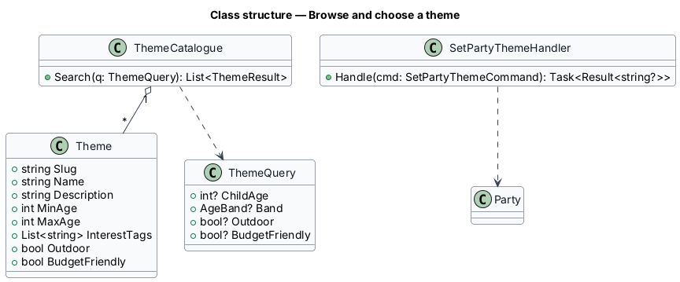
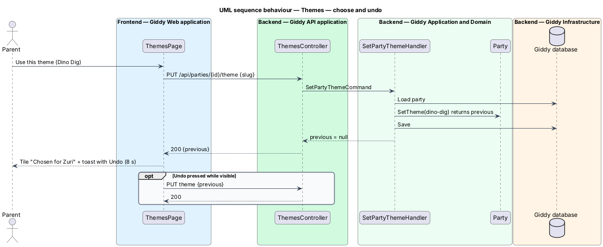

# Browse and choose a theme

## Overview

A *theme* is a ready-made party idea (Dino Dig, Outer Space…) with an age range, interest tags and ideas that Giddy reuses for invitations, cake and activities. Parents browse a filtered gallery and choose one theme per party.

- **theme match** — theme whose age range contains the child's age on the party date, tagged when its interest tags overlap the child's interests

This feature belongs to the **Themes, venues and vendors** subsystem. It is designed from the screens in [`docs/mocks`](../../../mocks/README.md) and the L2 requirements listed below.

## Description

The feature is a vertical slice from the Angular web application through the Giddy API to storage and any external services.

**Frontend (Giddy Web)**

- **`ThemesPage`** — Route `/themes`; filter chips with `aria-pressed`, tile grid, empty and error states.
- **`ThemeTile`** — Art, name, description, age range, Use this theme.
- **`UndoToast`** — 8-second toast with Undo.

**Backend (Giddy API)**

- **`ThemesController`** — `GET /api/themes?partyId&ageBand&outdoor&budget`, `PUT /api/parties/{id}/theme`.
- **`ThemeCatalogue`** — Read-only catalogue of 40 themes seeded from content.
- **`SetPartyThemeHandler`** — Sets or clears a party's theme and returns the previous one for Undo.

**Open points**

- Editorial process for adding themes to the catalogue `<TO SUPPLY>`

## Requirements

The feature realizes the following level-2 (L2) requirements. Each L2 requirement refines the level-1 (L1) requirement cited beside it; the full acceptance criteria are in [`docs/specs/L2.md`](../../../specs/L2.md).

| L2 ID | Refines (L1) | Requirement |
|-------|--------------|-------------|
| `L2-023` | `L1-005` | **Browse and filter themes.** Given a parent with a party for a child, when they open Themes, then a "For <child> (<age>)" filter is on by default and only themes whose age range includes the child's age are shown, with the number matching in the subtitle. |
| `L2-024` | `L1-005` | **Choose a theme for a party.** Given a party, when the parent chooses "Use this theme", then it becomes the party's theme, the tile shows "Chosen for <child>", and a success toast offers Undo for 8 seconds. |

## Diagrams

### System context

Only parents and Giddy take part.

### Containers

The catalogue is read-mostly and cached in Redis.

### Components

Catalogue queries and party updates are separate components.

### Class structure

`ThemeCatalogue` filters `Theme` records by a `ThemeQuery`.

### Behaviour — choose and undo

Choosing returns the previous theme so the 8-second toast can restore it (`L2-024`).

