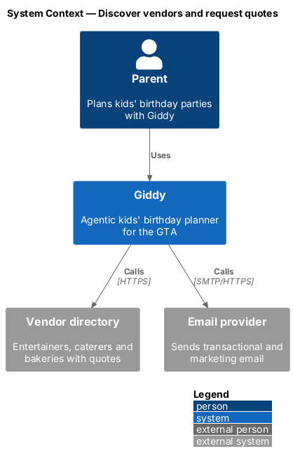
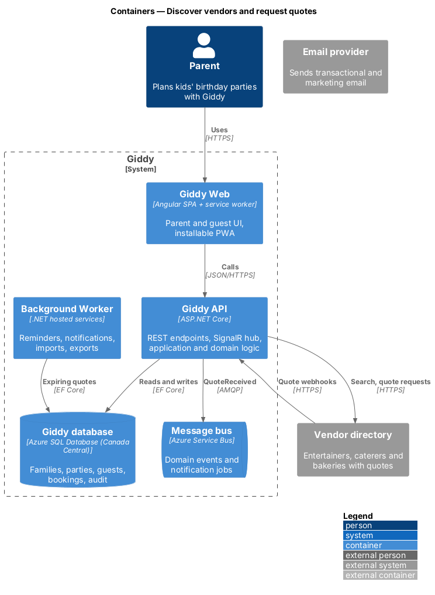
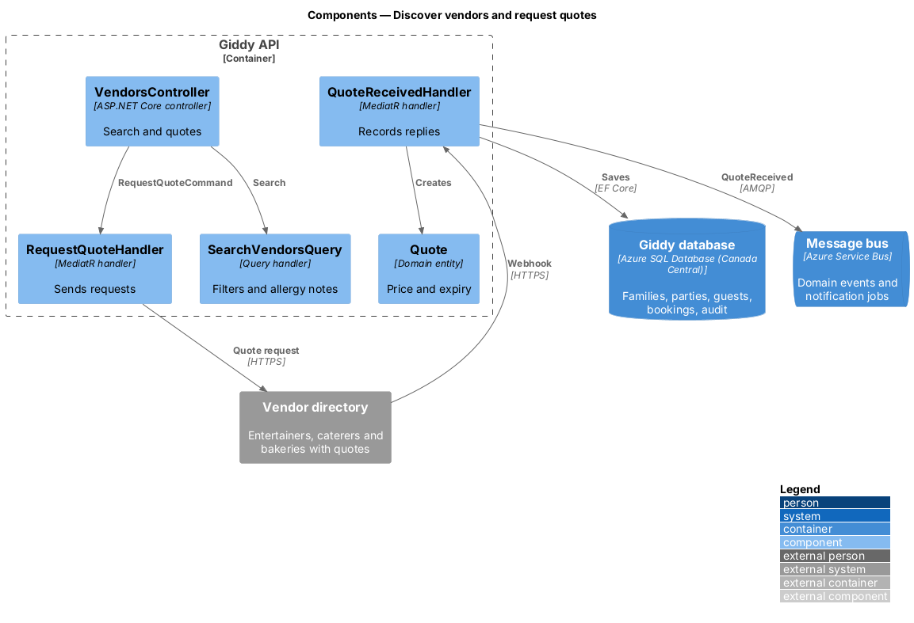
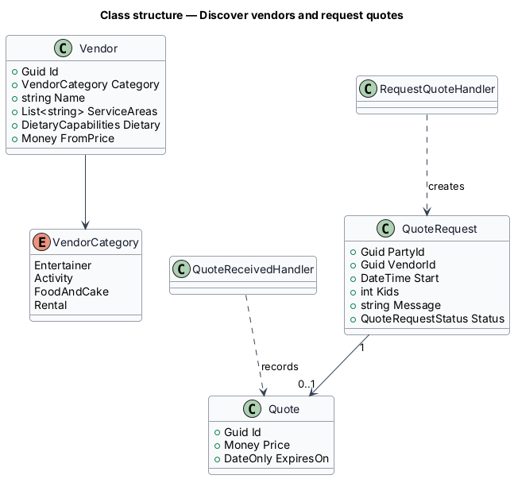
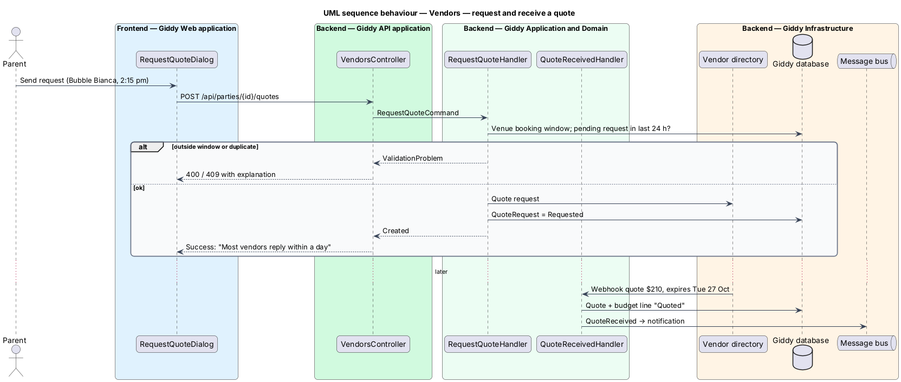

# Discover vendors and request quotes

## Overview

Fun & food lists *vendors*—entertainers, activity providers, caterers and bakeries—that are free on the party date and serve the venue's area. Food vendors show dietary options against the party's allergies. Parents request quotes; replies flow into the budget, and expiring quotes raise a warning.

- **quote** — vendor's price offer for a date, time and guest count, with an expiry date
- **dietary capability** — vendor's ability to provide nut-free, gluten-free, dairy-free or vegan options

This feature belongs to the **Themes, venues and vendors** subsystem. It is designed from the screens in [`docs/mocks`](../../../mocks/README.md) and the L2 requirements listed below.

## Description

The feature is a vertical slice from the Angular web application through the Giddy API to storage and any external services.

**Frontend (Giddy Web)**

- **`VendorsPage`** — Route `/vendors`; category chips, theme and price filters, allergy alert for food.
- **`RequestQuoteDialog`** — Pre-filled date, time, kids, location and drafted message.

**Backend (Giddy API)**

- **`VendorsController`** — `GET /api/vendors/search`, `POST /api/parties/{id}/quotes`.
- **`SearchVendorsQuery`** — Filters by category, date, travel area and theme; annotates allergy compatibility.
- **`RequestQuoteHandler`** — Validates the start time against the venue booking, enforces one pending request per vendor per 24 h, sends to the vendor.
- **`QuoteReceivedHandler`** — Consumes vendor replies, records the quote in the budget as Quoted, notifies the parent.
- **`QuoteExpiryJob`** — Worker job raising the expiring-quote banner 2 days before expiry.

**Open points**

- Vendor directory provider and webhook signing scheme `<TO SUPPLY>`

## Requirements

The feature realizes the following level-2 (L2) requirements. Each L2 requirement refines the level-1 (L1) requirement cited beside it; the full acceptance criteria are in [`docs/specs/L2.md`](../../../specs/L2.md).

| L2 ID | Refines (L1) | Requirement |
|-------|--------------|-------------|
| `L2-031` | `L1-008` | **Vendor quotes expiring.** Given a vendor quote expires within 2 days, when the party overview opens, then a warning banner names the vendor and deadline and offers "Confirm" and "Find another". |
| `L2-032` | `L1-008` | **Discover entertainers and activities.** Given a party, when the parent opens Fun & food on the Entertainers category, then only vendors free on the party date who travel to the party's venue or area are listed, with name, description, duration, age range, price, rating and review count. |
| `L2-033` | `L1-008` | **Food and cake with allergy information.** Given the Food & cake category, when it loads, then bakeries and caterers that deliver to the venue on the party date are listed with price, notice period and dietary options (nut-free, gluten-free, dairy-free, vegan). |
| `L2-034` | `L1-008` | **Request a quote.** Given a vendor, when the parent chooses "Request a quote", then a dialog pre-fills date, start time, number of kids, location and a message drafted from the party's theme. |

## Diagrams

### System context

Giddy searches the vendor directory and sends quote requests to vendors, who reply through it.

### Containers

Vendor replies arrive as webhooks; a worker job watches expiry dates.

### Components

Requesting and receiving quotes are separate handlers joined by the vendor directory.

### Class structure

A `QuoteRequest` may produce one `Quote`.

### Behaviour — request and receive a quote

The start time shall fall inside the venue booking; the reply becomes a Quoted budget line with its expiry (`L2-034`, `L2-031`).

