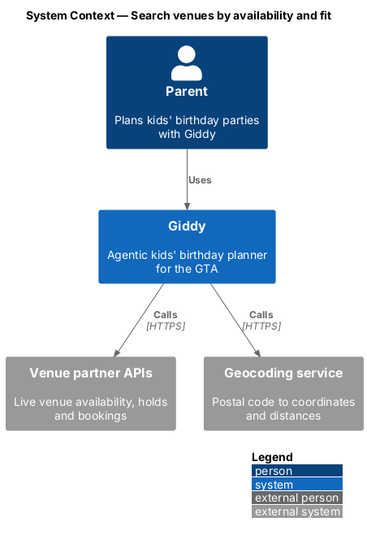
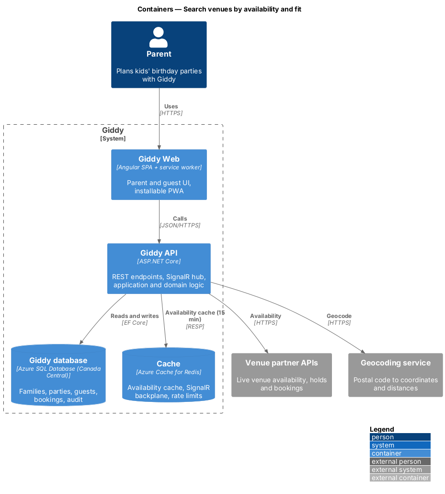
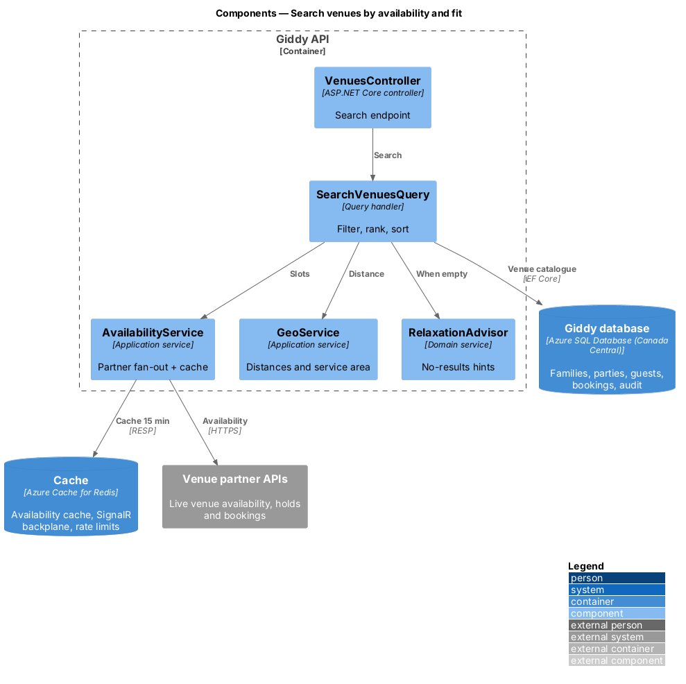
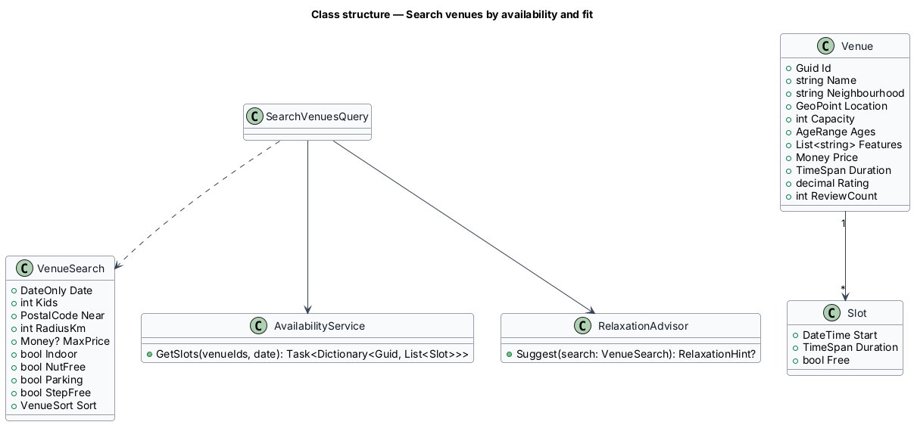
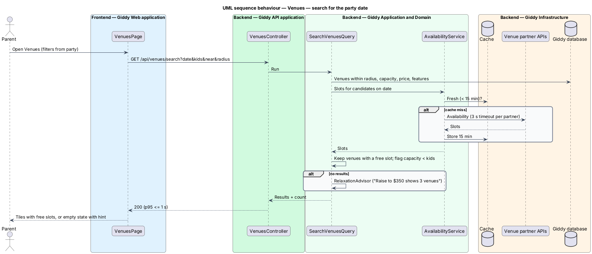

# Search venues by availability and fit

## Overview

Venue search answers one question: which GTA venues are free on the party date, fit the guest count and budget, and are close enough. Availability comes from *venue partner APIs* and is cached for at most 15 minutes.

- **venue partner API** — external booking system of a venue (or aggregator) that reports slots and accepts holds and bookings
- **slot** — bookable start time and duration at a venue on a date
- **relaxation hint** — smallest single filter change that would return results, shown when nothing matches

This feature belongs to the **Themes, venues and vendors** subsystem. It is designed from the screens in [`docs/mocks`](../../../mocks/README.md) and the L2 requirements listed below.

## Description

The feature is a vertical slice from the Angular web application through the Giddy API to storage and any external services.

**Frontend (Giddy Web)**

- **`VenuesPage`** — Route `/venues`; filters pre-filled from the party; sort; result tiles; compare checkboxes.
- **`VenuesApi`** — Typed client.

**Backend (Giddy API)**

- **`VenuesController`** — `GET /api/venues/search`.
- **`SearchVenuesQuery`** — Combines the venue catalogue, geodistance, capacity and live availability.
- **`AvailabilityService`** — Fan-out to partner APIs with 3 s per-partner timeout; caches results in Redis for 15 minutes.
- **`RelaxationAdvisor`** — Tries single-filter relaxations against cached data to build the hint.
- **`GeoService`** — Postal code to coordinates; caches lookups; enforces the GTA service area.

**Open points**

- List of launch venue partners and their API contracts `<TO SUPPLY>`
- Ranking weights for Best match `<TO SUPPLY>`

## Requirements

The feature realizes the following level-2 (L2) requirements. Each L2 requirement refines the level-1 (L1) requirement cited beside it; the full acceptance criteria are in [`docs/specs/L2.md`](../../../specs/L2.md).

| L2 ID | Refines (L1) | Requirement |
|-------|--------------|-------------|
| `L2-025` | `L1-006` | **Search venues by availability and fit.** Given a party with a date, guest count and area, when the parent opens Venues, then the filters are pre-filled with them and only venues that are free on that date for at least one slot, fit the guest count and are within the chosen distance are listed. |
| `L2-090` | `L1-023` | **Service area.** Given a postal code, when it is entered, then it must be a valid Canadian postal code; codes outside Toronto, Durham, York, Peel and Halton regions are accepted for the account but venue and vendor searches explain that Giddy currently covers the GTA only. |

## Diagrams

### System context

Giddy reads live availability from venue partner APIs and distances from a geocoding service.

### Containers

Redis absorbs repeat searches so partner APIs see at most one availability call per venue and date every 15 minutes.

### Components

The query composes distance, availability and relaxation advice.

### Class structure

`VenueSearch` is the filter set; `Venue` has many `Slot`s on a date.

### Behaviour — search for the party date

Cached availability serves most searches; stale entries trigger a partner call with a 3 s timeout, and an empty result carries a concrete relaxation hint (`L2-025`).

