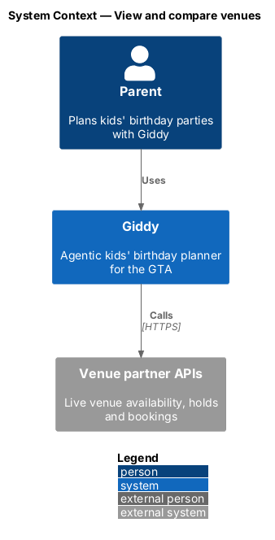
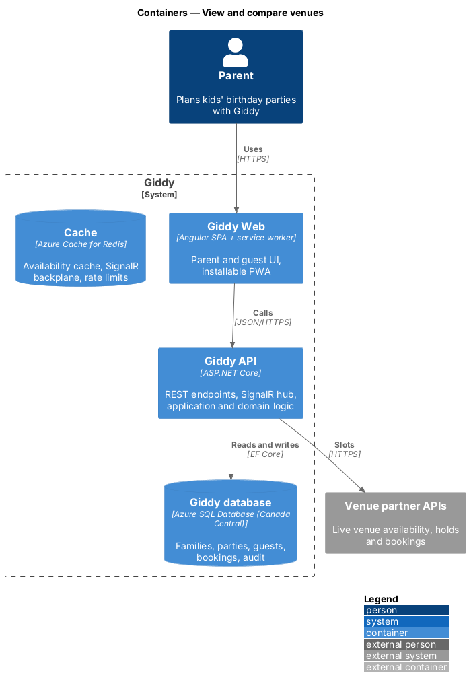
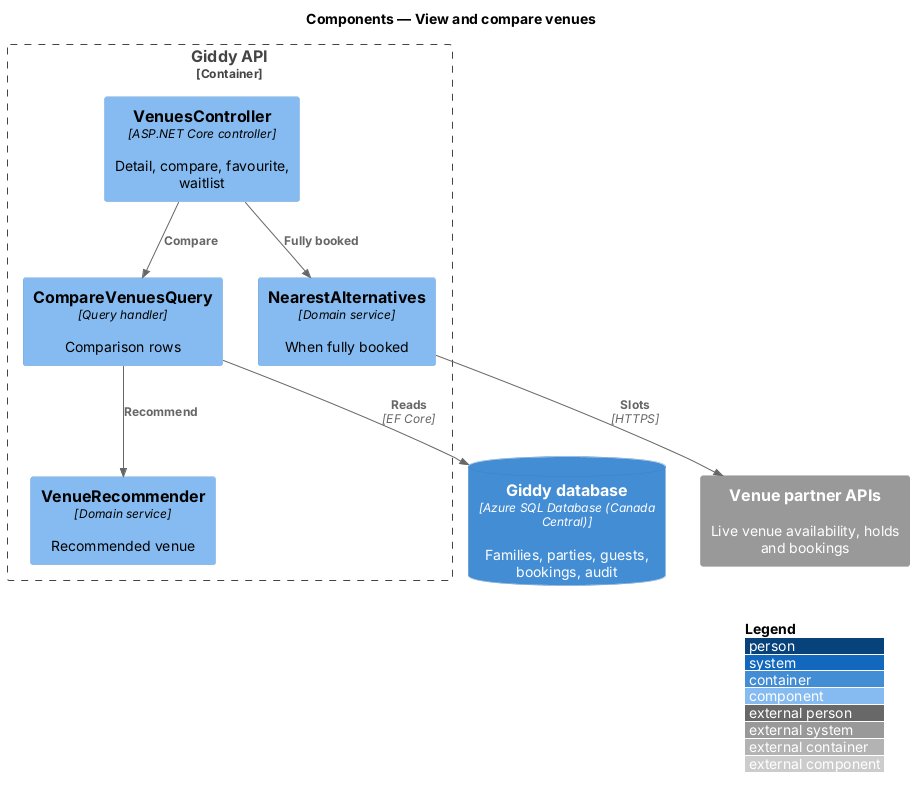
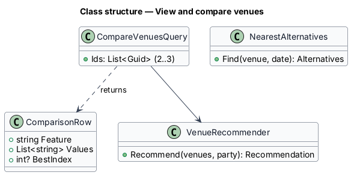
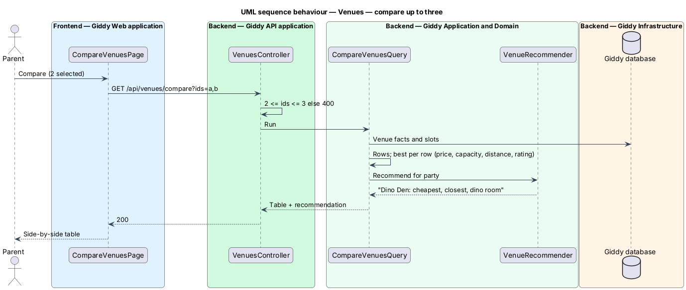

# View and compare venues

## Overview

A parent opens a venue to see photos, what is included, reviews and the slots on the party date, or ticks two or three venues to compare side by side with Giddy's recommendation.

- **waitlist** — request to be notified if a booked slot at a venue becomes free on the party date

This feature belongs to the **Themes, venues and vendors** subsystem. It is designed from the screens in [`docs/mocks`](../../../mocks/README.md) and the L2 requirements listed below.

## Description

The feature is a vertical slice from the Angular web application through the Giddy API to storage and any external services.

**Frontend (Giddy Web)**

- **`VenueDetailPage`** — Route `/venues/{id}`; gallery, booking card with slot buttons, favourite toggle.
- **`CompareBar`** — Shows selected count; refuses a 4th.
- **`CompareVenuesPage`** — Route `/venues/compare?ids=`; table with best-value highlighting and Giddy's pick.

**Backend (Giddy API)**

- **`VenuesController`** — `GET /api/venues/{id}?date`, `GET /api/venues/compare?ids`, `PUT /api/venues/{id}/favourite`, `POST /api/venues/{id}/waitlist`.
- **`CompareVenuesQuery`** — Builds rows and marks the best value per row.
- **`VenueRecommender`** — The venue best in the most rows (ties go to the cheaper one), with the rows it wins as the reason, for example "Cheapest and closest."
- **`NearestAlternatives`** — Nearest free date at the venue and a similar free venue.

## Requirements

The feature realizes the following level-2 (L2) requirements. Each L2 requirement refines the level-1 (L1) requirement cited beside it; the full acceptance criteria are in [`docs/specs/L2.md`](../../../specs/L2.md).

| L2 ID | Refines (L1) | Requirement |
|-------|--------------|-------------|
| `L2-026` | `L1-006` | **Venue details and availability.** Given a venue, when its page opens, then it shows photos, rating, address and distance, availability on the party date, a description, features, what the price includes, add-ons, and recent parent reviews. |
| `L2-027` | `L1-006` | **Compare venues.** Given the venue list, when the parent ticks Compare on 2 or 3 venues, then a bar shows the count and a Compare action; a 4th tick is refused with a message. |

## Diagrams

### System context

Slot data comes from venue partner APIs.

### Containers

Detail and comparison share the venue catalogue in the database.

### Components

Comparison and recommendation are separate so the recommender can be tuned alone.

### Class structure

`ComparisonRow` holds one feature across venues and the index of the best one.

### Behaviour — compare up to three

The API accepts two or three IDs; best values are marked in words as well as colour (`L2-027`).

