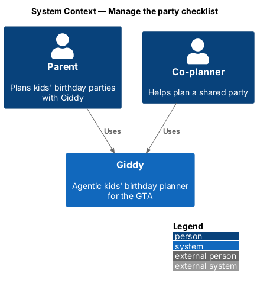
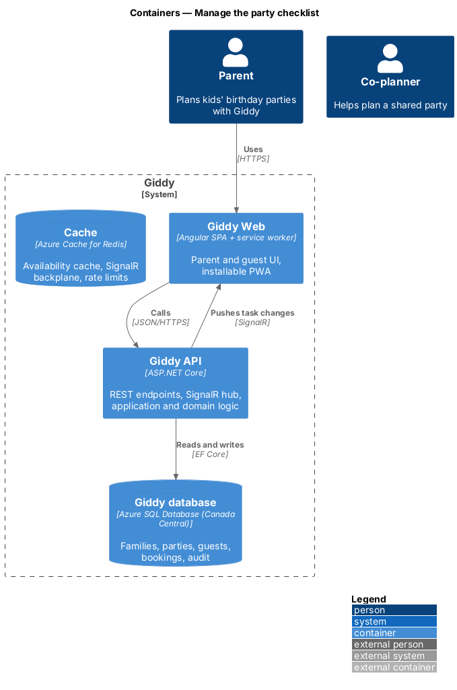
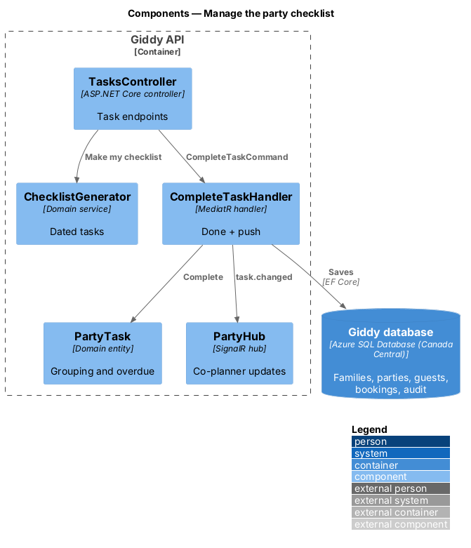
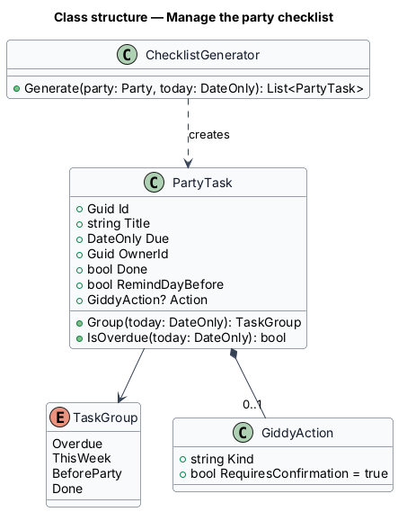
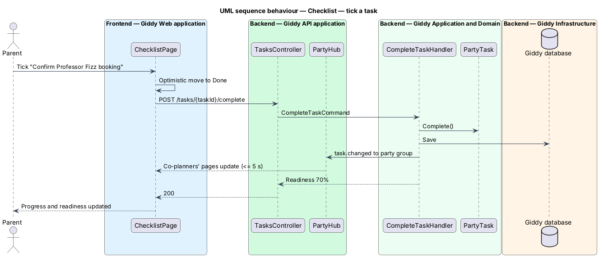

# Manage the party checklist

## Overview

Each party has a *checklist*: dated tasks generated backwards from the party date, grouped into Overdue, This week, Before the party and Done. Parents tick tasks, add their own, assign them to co-planners and let Giddy do eligible tasks after confirmation.

- **task** — dated to-do with an owner, a done flag and an optional Giddy action
- **Giddy action** — task Giddy can carry out (send the allergy list, send a reminder) after the parent confirms

This feature belongs to the **Checklist and reminders** subsystem. It is designed from the screens in [`docs/mocks`](../../../mocks/README.md) and the L2 requirements listed below.

## Description

The feature is a vertical slice from the Angular web application through the Giddy API to storage and any external services.

**Frontend (Giddy Web)**

- **`ChecklistPage`** — Route `/parties/{id}/checklist`; groups, progress bar, task menus.
- **`AddTaskDialog`** — Title, due date, owner, remind-me.

**Backend (Giddy API)**

- **`TasksController`** — `GET/POST/PUT/DELETE /api/parties/{id}/tasks`, `POST .../tasks/{taskId}/complete`.
- **`ChecklistGenerator`** — Creates tasks with offsets (cake 10 days before, food 2 days before, kit 1 day before).
- **`PartyTask`** — Entity with `Group(today)` and `IsOverdue(today)`.
- **`CompleteTaskHandler`** — Marks done, updates readiness, pushes the change to co-planners within 5 s.

**As built**

- Tasks live on the party (`ChecklistTask`, stored as JSON) with a `TaskId`, an owner (the party's owner when not set), "remind me" (on by default) and the date each was ticked. `ChecklistGenerator` dates them back from the party: the cake and loot bags 10 days before, the food 2 days before and the party-day kit the day before.
- `GET /api/parties/{id}/tasks` groups the tasks for today in Toronto: Overdue, This week (the next seven days), Before the party, and Done. It also returns progress and the planners a task can be given to. `POST`, `PUT /{taskId}` and `DELETE /{taskId}` add, change and delete tasks; a task needs a title, a date on or before the party, and an owner who is planning the party. `PUT /{taskId}/done` ticks and unticks, and `POST /generate` is "Make my checklist" (409 once there are tasks).
- Ticking writes a `task` party event that names the planner. Live updates skip events a planner caused, so the others see it within the 3-second poll and the checklist reloads.
- "Let Giddy do it" (`POST /{taskId}/giddy`) runs the existing allergy-list and RSVP-reminder commands after the parent confirms in a dialog, then ticks the task off.
- The library gained `giddy-menu-button` (CDK Menu), a checkable `giddy-task` with "Giddy can do this", and a `more` icon; `giddy-progress` now renders as a block.
- "Open the run sheet" links to `/parties/{id}/party-day`, which arrives with the party-day journey.

## Requirements

The feature realizes the following level-2 (L2) requirements. Each L2 requirement refines the level-1 (L1) requirement cited beside it; the full acceptance criteria are in [`docs/specs/L2.md`](../../../specs/L2.md).

| L2 ID | Refines (L1) | Requirement |
|-------|--------------|-------------|
| `L2-047` | `L1-012` | **Party checklist.** Given a party with a plan, when the checklist is generated, then tasks are dated working back from the party date (for example confirm entertainer, order cake 10 days before, buy loot bags, order food 2 days before, pack the party-day kit the day before) and grouped into Overdue, This week, Before the party and Done, with a progress bar. |
| `L2-048` | `L1-012` | **Add and assign tasks.** Given the checklist, when the parent adds a task with a title, due date, owner (themselves or a co-planner) and "remind me the day before", then it appears in date order. |

## Diagrams

### System context

Only parents, co-planners and Giddy take part.

### Containers

Task changes are pushed to every open page of the party.

### Components

Generation, completion and push are separate responsibilities.

### Class structure

`PartyTask.Group` derives the group from the due date and today.

### Behaviour — tick a task

Completing a task updates readiness and reaches co-planners within 5 seconds (`L2-047`).

