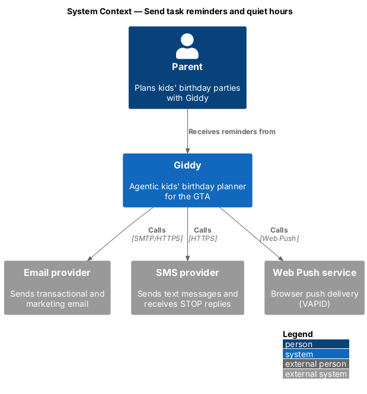
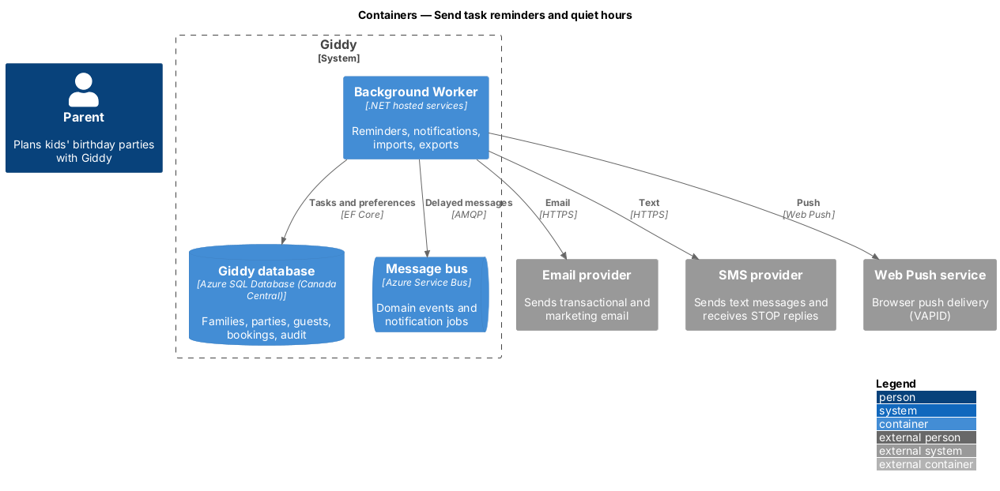
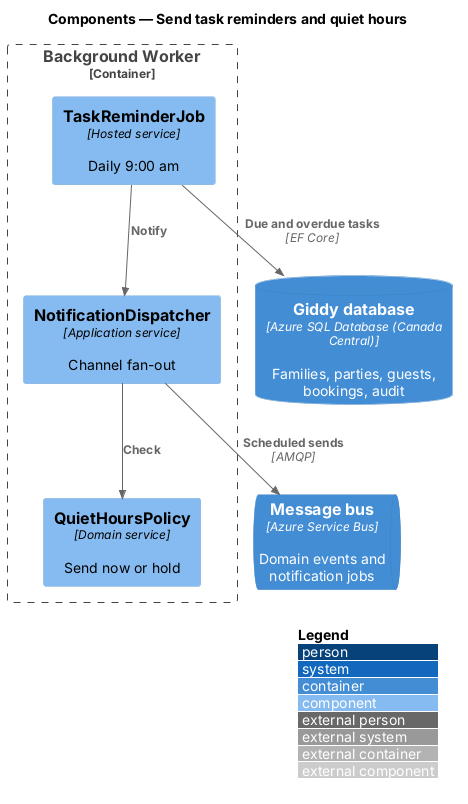
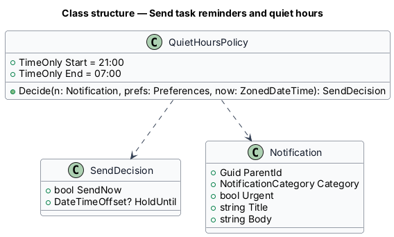
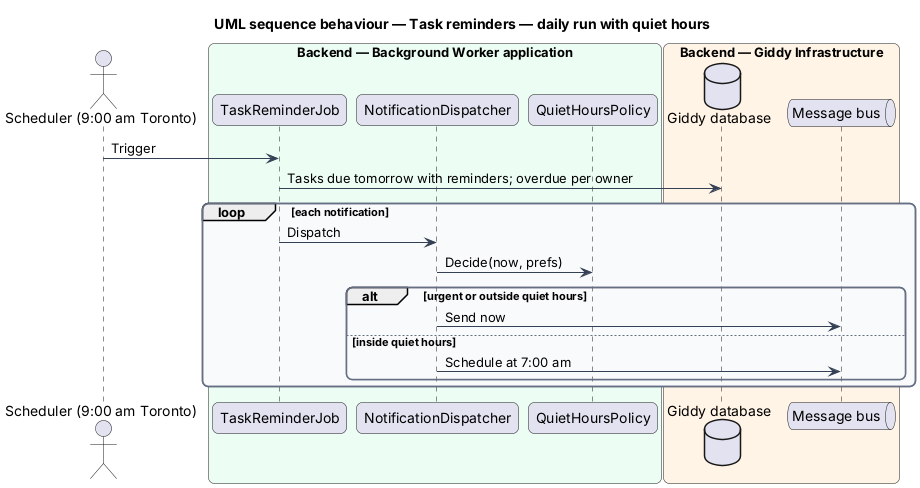

# Send task reminders and quiet hours

## Overview

Owners get a reminder the day before a task is due (9:00 am Toronto time) and one morning digest listing overdue tasks. Non-urgent push and text notifications wait until quiet hours end; urgent party-day messages do not.

- **quiet hours** — per-parent window, default 9:00 pm–7:00 am America/Toronto, in which non-urgent push and text are held
- **urgent** — notification on the party day about a cancellation or change that affects the party

This feature belongs to the **Checklist and reminders** subsystem. It is designed from the screens in [`docs/mocks`](../../../mocks/README.md) and the L2 requirements listed below.

## Description

The feature is a vertical slice from the Angular web application through the Giddy API to storage and any external services.

**Background Worker**

- **`TaskReminderJob`** — Runs at 9:00 am Toronto daily; selects tasks due tomorrow with reminders on, and overdue tasks per owner.
- **`QuietHoursPolicy`** — Decides send-now or hold-until for each notification.
- **`NotificationDispatcher`** — Shared dispatcher (see notifications subsystem).

**As built**

- `TaskReminders` runs every minute from 9:00 am Toronto time (`TaskReminderWorker`). Each run queues a reminder for each unticked task due tomorrow with "remind me" on, plus one digest per planner per party listing every overdue task.
- Messages go through `NotificationOutbox`, which keys each message so it is queued once, holds non-urgent messages through quiet hours (`QuietHours`: 9:00 pm to 7:00 am) and sends them by email when due. Messages marked urgent on the party day go straight away.
- Quiet hours apply to every non-urgent message for now. Push, text and a quiet-hours setting arrive with the notifications journey.

## Requirements

The feature realizes the following level-2 (L2) requirements. Each L2 requirement refines the level-1 (L1) requirement cited beside it; the full acceptance criteria are in [`docs/specs/L2.md`](../../../specs/L2.md).

| L2 ID | Refines (L1) | Requirement |
|-------|--------------|-------------|
| `L2-049` | `L1-012` | **Task reminders.** Given a task with "remind me" on, when it is the day before its due date at 9:00 am Toronto time, then its owner is notified by their enabled channels, subject to quiet hours (L2-061). |
| `L2-061` | `L1-015` | **Quiet hours.** Given quiet hours are on (default 9:00 pm to 7:00 am America/Toronto), when a non-urgent push or text notification is due during them, then it is held and sent at the end of quiet hours. |

## Diagrams

### System context

Reminders reach parents by email, text and push.

### Containers

Only the worker, database and bus are involved.

### Components

The quiet-hours decision is one policy shared by every notification.

### Class structure

`QuietHoursPolicy` returns a `SendDecision`.

### Behaviour — daily run with quiet hours

Reminders follow channel preferences; held messages are scheduled for the end of quiet hours unless urgent (`L2-049`, `L2-061`).

