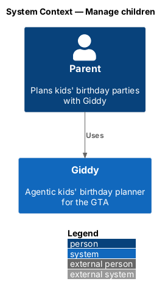
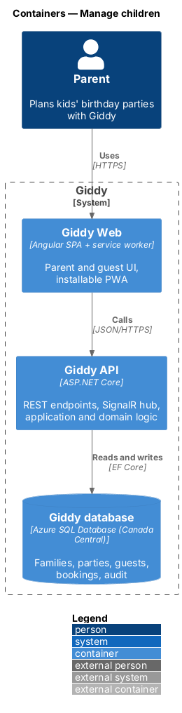
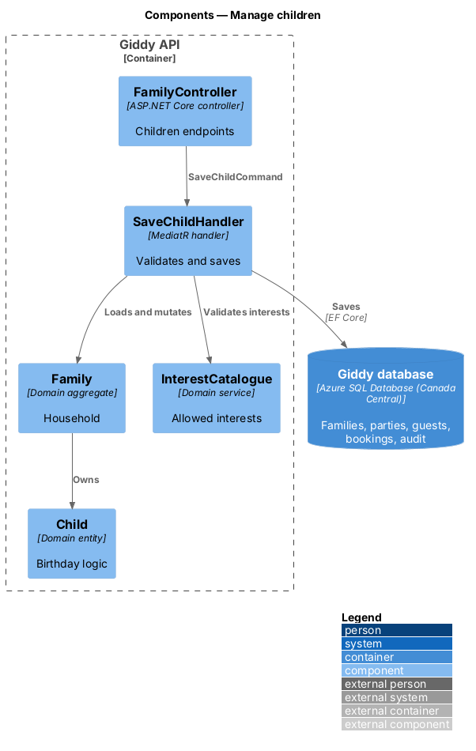
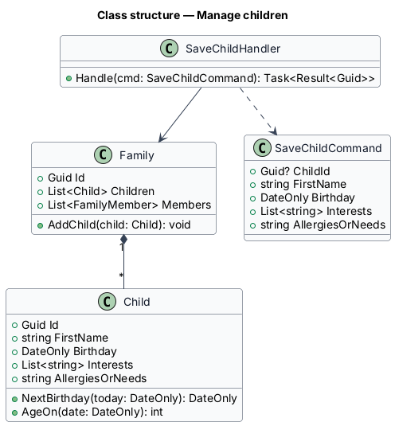
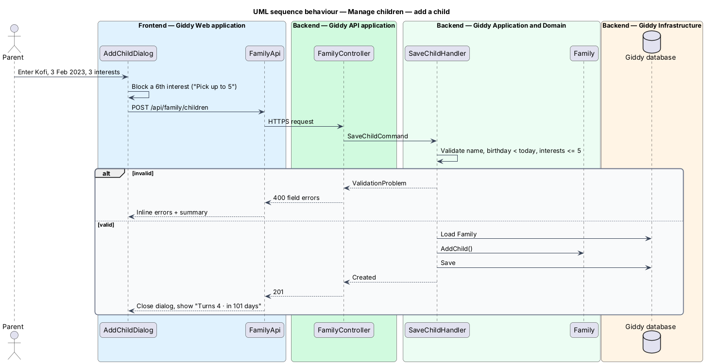

# Manage children

## Overview

A *child profile* records a child's first name, birthday, up to five interests and any allergies or needs. Giddy uses it to suggest themes, compute ages and countdowns, and filter food and venues.

Children are added during family setup after sign-up, from the Family page, or from the Add a child dialog.

- **interest** — tag from a curated list (for example Dinosaurs, Science) that drives theme matching
- **next birthday** — the child's birthday in the current or next calendar year, in America/Toronto

This feature belongs to the **Family profile** subsystem. It is designed from the screens in [`docs/mocks`](../../../mocks/README.md) and the L2 requirements listed below.

## Description

The feature is a vertical slice from the Angular web application through the Giddy API to storage and any external services.

**Frontend (Giddy Web)**

- **`OnboardingWizard`** — Route `/welcome`; step 1 adds children.
- **`FamilyPage`** — Route `/family`; child cards and grown-ups.
- **`AddChildDialog`** — Name, birthday, interest choice cards, allergies.
- **`FamilyApi`** — Typed client for `/api/family/children`.

**Backend (Giddy API)**

- **`FamilyController`** — `GET/POST/PUT/DELETE /api/family/children`.
- **`SaveChildHandler`** — Validates and saves a child.
- **`Family`** — Aggregate root: parents and children of one household.
- **`Child`** — Entity with `NextBirthday(today)` and `AgeOn(date)`.
- **`InterestCatalogue`** — Allowed interests and their theme tags.

## Requirements

The feature realizes the following level-2 (L2) requirements. Each L2 requirement refines the level-1 (L1) requirement cited beside it; the full acceptance criteria are in [`docs/specs/L2.md`](../../../specs/L2.md).

| L2 ID | Refines (L1) | Requirement |
|-------|--------------|-------------|
| `L2-007` | `L1-002` | **Add and edit children.** Given a parent in family setup or on the Family page, when they add a child with a first name, a birthday in the past, up to 5 interests and optional allergies or needs, then the child is saved and shown with their next birthday and the number of days until it. |

## Diagrams

### System context

Only the parent and Giddy take part.

### Containers

A standard web → API → database slice.

### Components

`Family` is the aggregate that owns `Child` entities.

### Class structure

`Child` computes next birthday and age from its birthday.

### Behaviour — add a child

The server re-validates the name, past birthday and five-interest limit; on failure the dialog keeps every input (`L2-007`).

