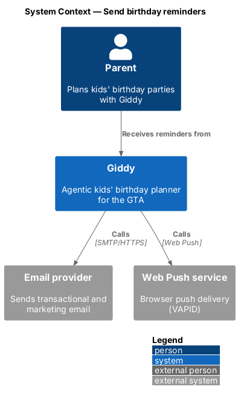
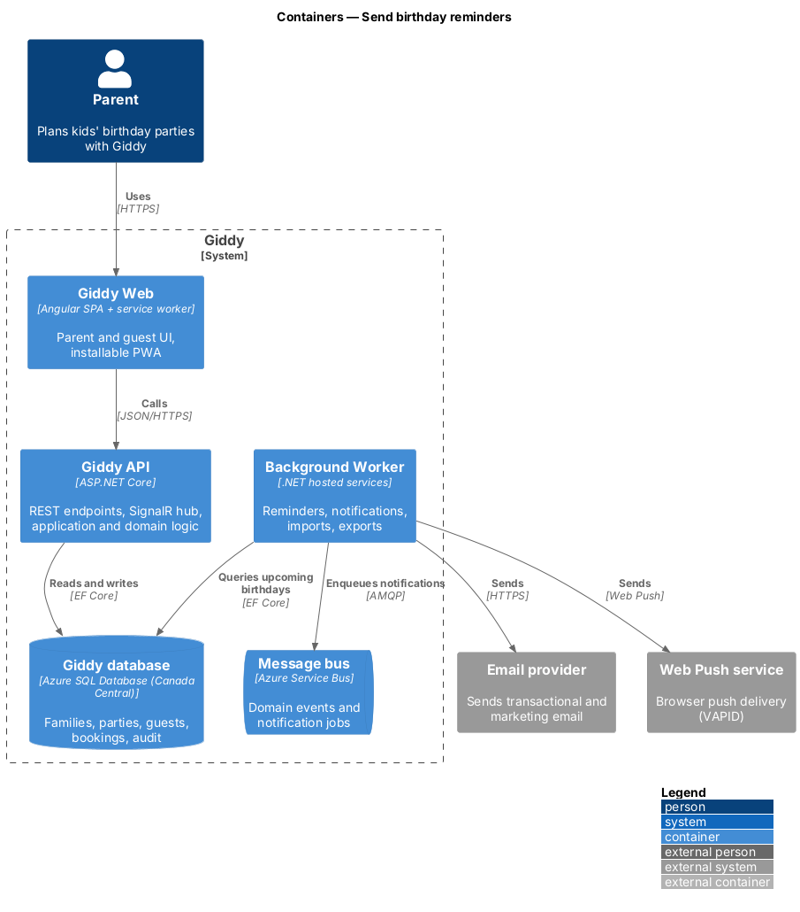
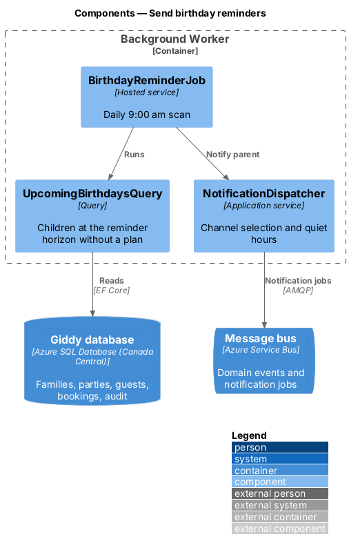
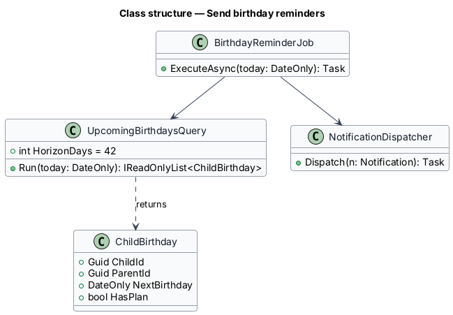
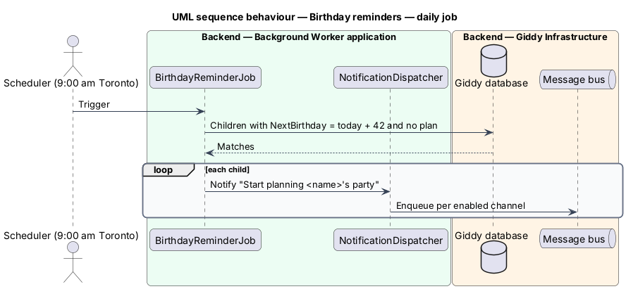

# Send birthday reminders

## Overview

Giddy reminds parents about upcoming birthdays so planning starts early. A daily job finds children whose next birthday is 42 days away and who have no party plan for it, and notifies the parent; Home shows birthdays within 120 days.

- **reminder horizon** — 42 days before a birthday, the default point at which a start-planning reminder is sent

This feature belongs to the **Family profile** subsystem. It is designed from the screens in [`docs/mocks`](../../../mocks/README.md) and the L2 requirements listed below.

## Description

The feature is a vertical slice from the Angular web application through the Giddy API to storage and any external services.

**Background Worker**

- **`BirthdayReminderJob`** — Runs daily at 9:00 am America/Toronto; queries children whose next birthday is in 42 days.
- **`NotificationDispatcher`** — Sends through the parent's enabled channels respecting quiet hours.

**Frontend (Giddy Web)**

- **`ComingUpNextCard`** — Home card for the next birthday within 120 days.

## Requirements

The feature realizes the following level-2 (L2) requirements. Each L2 requirement refines the level-1 (L1) requirement cited beside it; the full acceptance criteria are in [`docs/specs/L2.md`](../../../specs/L2.md).

| L2 ID | Refines (L1) | Requirement |
|-------|--------------|-------------|
| `L2-008` | `L1-002` | **Birthday reminders from the family profile.** Given a child whose next birthday is 42 days away and who has no party plan, when the daily reminder job runs, then the parent receives a notification suggesting they start planning, through their enabled channels. |

## Diagrams

### System context

Giddy reminds parents by email and push.

### Containers

The worker owns the schedule; the API only renders the Home card.

### Components

The job, its query and the shared dispatcher live in the Background Worker.

### Class structure

`UpcomingBirthdaysQuery` encodes the 42-day horizon.

### Behaviour — daily job

The job skips children who already have a plan for that birthday and hands each reminder to the dispatcher (`L2-008`).

