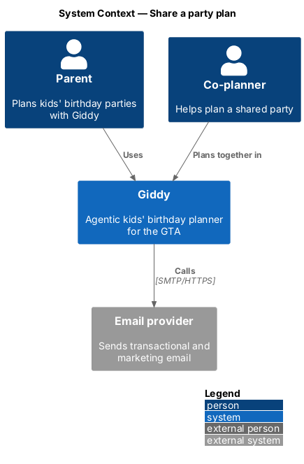
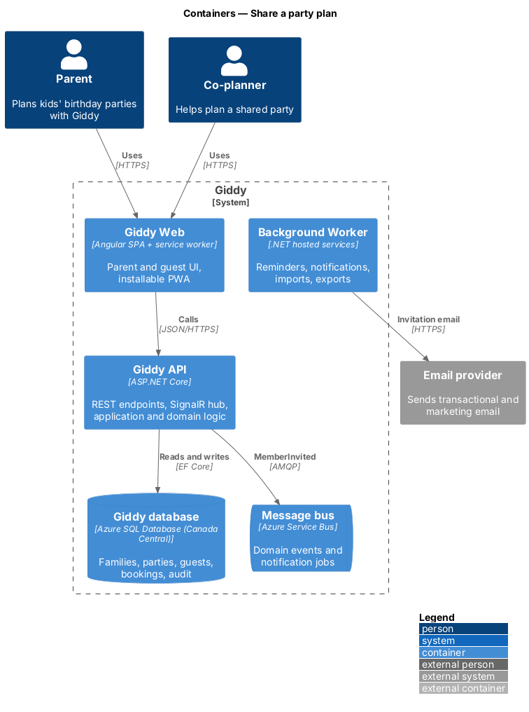
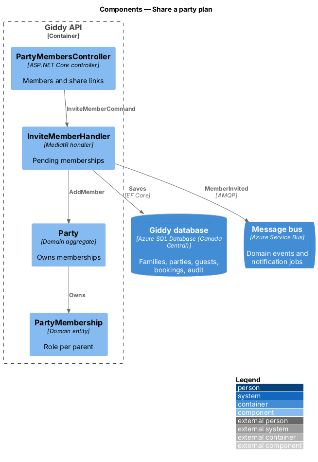
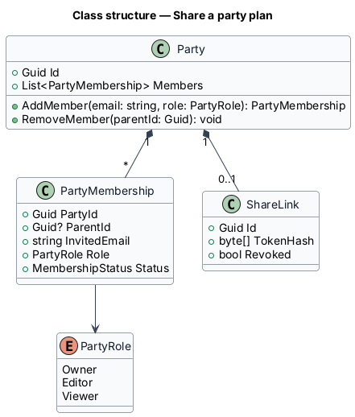
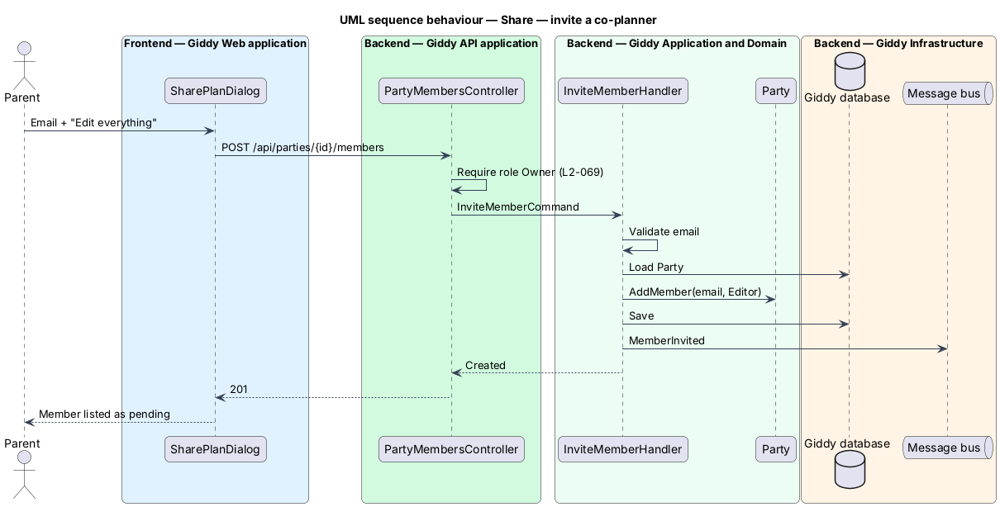

# Share a party plan

## Overview

Planning is often shared. The owner of a party invites *co-planners* (edit access) or *viewers* (read-only), or copies a view-only link. Access is enforced on every request (see the platform authorisation design).

- **membership** — link between a parent and a party with a role: Owner, Editor or Viewer
- **share link** — revocable URL granting a signed-out read-only summary without contact details or allergies

This feature belongs to the **Family profile** subsystem. It is designed from the screens in [`docs/mocks`](../../../mocks/README.md) and the L2 requirements listed below.

## Description

The feature is a vertical slice from the Angular web application through the Giddy API to storage and any external services.

**Frontend (Giddy Web)**

- **`SharePlanDialog`** — Email, role choice, current members, copy-link.
- **`PartiesApi`** — Typed client.

**Backend (Giddy API)**

- **`PartyMembersController`** — `POST/DELETE /api/parties/{id}/members`, `POST /api/parties/{id}/share-link`.
- **`InviteMemberHandler`** — Creates a pending membership and sends the invitation email.
- **`PartyMembership`** — Entity: party, parent, role, status.
- **`ShareLink`** — Token hash, created by, revoked flag.

## Requirements

The feature realizes the following level-2 (L2) requirements. Each L2 requirement refines the level-1 (L1) requirement cited beside it; the full acceptance criteria are in [`docs/specs/L2.md`](../../../specs/L2.md).

| L2 ID | Refines (L1) | Requirement |
|-------|--------------|-------------|
| `L2-009` | `L1-002` | **Co-planners and sharing.** Given a party owner, when they invite an email address as "Edit everything", then that person receives an invitation and, after signing in, can view and edit the party with the same rights as the owner except deleting the party and removing the owner. |

## Diagrams

### System context

Owners share plans with co-planners, who receive an email invitation.

### Containers

Invitation email is sent asynchronously by the worker.

### Components

`Party` owns its memberships; the controller enforces the owner role.

### Class structure

Roles are an enumeration on `PartyMembership`.

### Behaviour — invite a co-planner

Only the owner may invite; the invitee gains access after signing in with the invited email (`L2-009`, `L2-069`).

