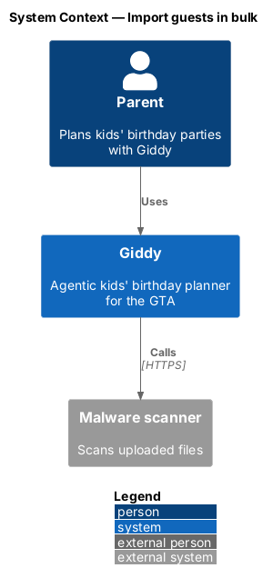
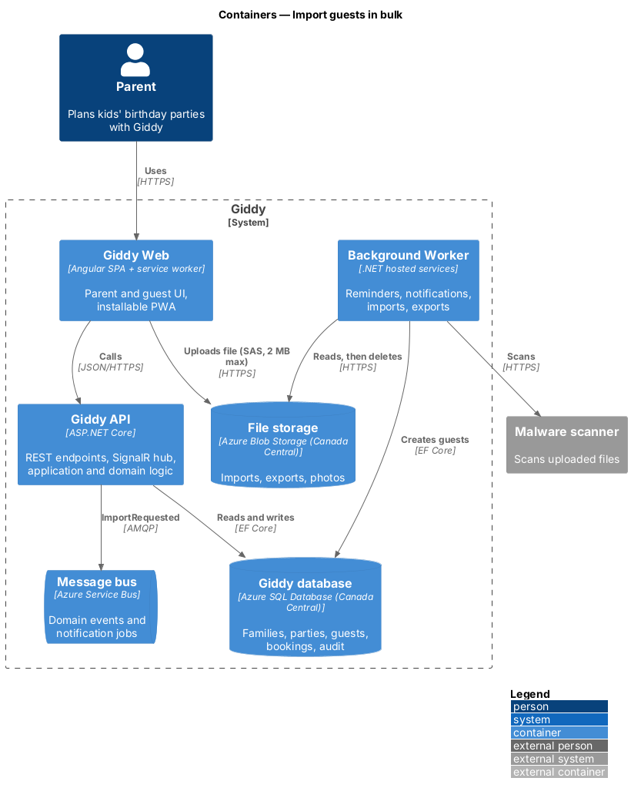
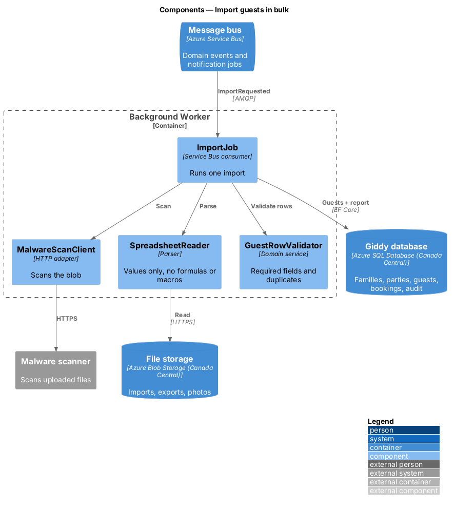
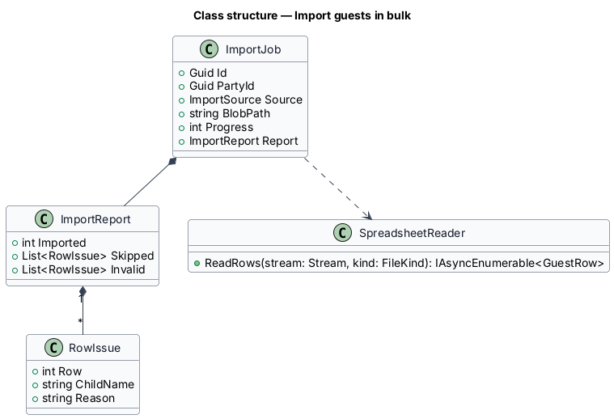
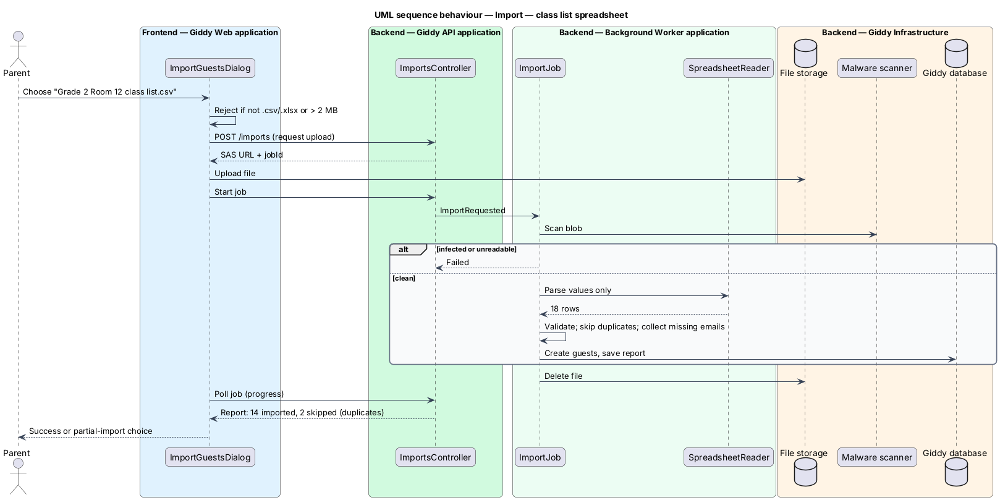

# Import guests in bulk

## Overview

Parents usually have a class list. Import reads a spreadsheet (.csv or .xlsx up to 2 MB), reuses guests from a past party, or picks phone contacts, then reports what was imported and skipped.

- **import job** — background task that scans, parses and validates an uploaded file and creates guests

This feature belongs to the **Guest list** subsystem. It is designed from the screens in [`docs/mocks`](../../../mocks/README.md) and the L2 requirements listed below.

## Description

The feature is a vertical slice from the Angular web application through the Giddy API to storage and any external services.

**Frontend (Giddy Web)**

- **`ImportGuestsDialog`** — Source choice, drop zone, progress bar, partial and success states.

**Backend (Giddy API)**

- **`ImportsController`** — `POST /api/parties/{id}/imports` (upload to blob via SAS), `GET .../imports/{jobId}`.
- **`ImportJob`** — Worker: malware scan, parse with formulas and macros disabled, validate rows, create guests, delete the file.
- **`SpreadsheetReader`** — CSV and XLSX reader that reads cell values only.
- **`ImportReport`** — Imported, skipped (duplicate), invalid (missing email) with row numbers.

**Open points**

- Phone-contacts source: platform API and permission flow `<TO SUPPLY>`

## Requirements

The feature realizes the following level-2 (L2) requirements. Each L2 requirement refines the level-1 (L1) requirement cited beside it; the full acceptance criteria are in [`docs/specs/L2.md`](../../../specs/L2.md).

| L2 ID | Refines (L1) | Requirement |
|-------|--------------|-------------|
| `L2-040` | `L1-010` | **Import guests in bulk.** Given the import dialog, when the parent chooses a spreadsheet, reuses guests from a past party, or picks from phone contacts, then the matching source is used; the Import button is disabled until a source with guests is chosen. |

## Diagrams

### System context

Uploaded files are checked by a malware scanner before anything reads them.

### Containers

The browser uploads straight to blob storage with a short-lived SAS URL; the worker processes the file.

### Components

The import job runs in the Background Worker.

### Class structure

`ImportReport` records issues by row number for the dialog.

### Behaviour — class list spreadsheet

The file is scanned before parsing and deleted afterwards; rows missing an email are reported by row and child (`L2-040`).

