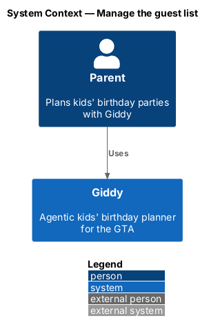
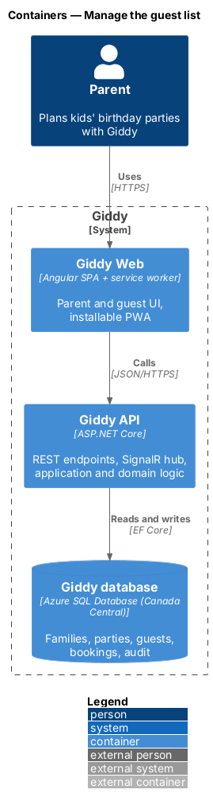
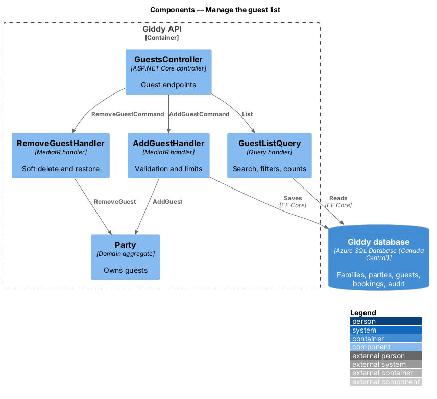
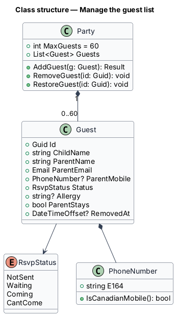
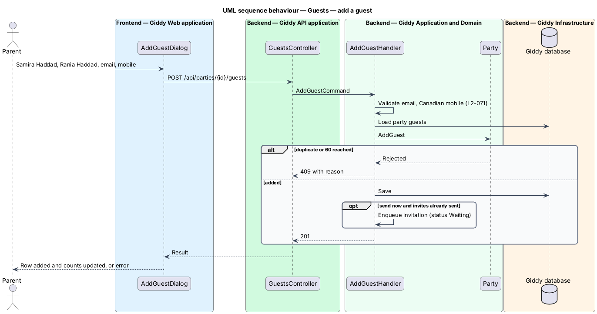
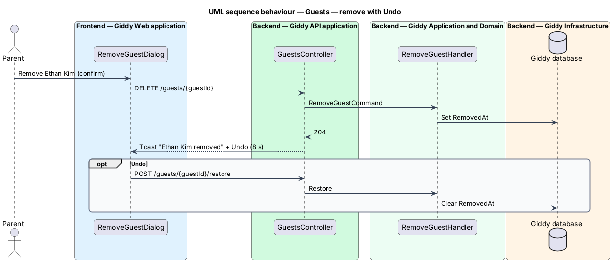

# Manage the guest list

## Overview

The *guest list* holds every invited child with a parent contact, RSVP status and allergies. Parents search and filter it, add guests one at a time and remove them with Undo.

- **guest** — invited child plus one parent contact (name, email, optional mobile)
- **RSVP status** — NotSent, Waiting, Coming or CantCome

This feature belongs to the **Guest list** subsystem. It is designed from the screens in [`docs/mocks`](../../../mocks/README.md) and the L2 requirements listed below.

## Description

The feature is a vertical slice from the Angular web application through the Giddy API to storage and any external services.

**Frontend (Giddy Web)**

- **`GuestsPage`** — Route `/parties/{id}/guests`; tally, allergy list, search, filter chips with counts, table.
- **`AddGuestDialog`** — Child, parent, email, mobile, send-now option.
- **`RemoveGuestDialog`** — Confirmation with Cancel focused; Undo toast.

**Backend (Giddy API)**

- **`GuestsController`** — `GET/POST /api/parties/{id}/guests`, `DELETE .../guests/{guestId}`, `POST .../guests/{guestId}/restore`.
- **`AddGuestHandler`** — Validates email and Canadian mobile, prevents duplicates and enforces the 60-guest limit.
- **`RemoveGuestHandler`** — Soft-deletes for 10 minutes so Undo can restore RSVP data; purges afterwards.
- **`Guest`** — Entity on the `Party` aggregate.

**As built**

- `POST /api/parties/{id}/guests` adds a family (Canadian mobile area codes checked, duplicates by child and parent email refused with `409`, at most 60 guests) and, with `sendNow` after the invitations went out, invites them straight away. `DELETE .../guests/{guestId}` soft-deletes; `POST .../guests/{guestId}/restore` undoes within ten minutes; `RemovedGuestPurgeWorker` deletes them after. A removed family's private link stops working.
- The guest list searches child and parent names as you type, filters with All, Coming, Waiting and Allergies chips with counts, and offers "Message the parent" (email) and "Remove" on each row: on hover or focus, always on touch screens. Removing asks first with Cancel focused, then offers Undo for eight seconds.

## Requirements

The feature realizes the following level-2 (L2) requirements. Each L2 requirement refines the level-1 (L1) requirement cited beside it; the full acceptance criteria are in [`docs/specs/L2.md`](../../../specs/L2.md).

| L2 ID | Refines (L1) | Requirement |
|-------|--------------|-------------|
| `L2-038` | `L1-010` | **Guest list.** Given a party, when Guests opens, then it shows counts of invited, coming, waiting and can't come; an allergy list; and a table of guests with child name, RSVP status, allergies and parent name, sorted by child name. |
| `L2-039` | `L1-010` | **Add a guest.** Given the guest list, when the parent adds a guest with the child's name, parent's name, parent's email and optional mobile number, then the guest is added with status "Not sent", or "Waiting" if "Send the invitation now" is ticked and invitations have already gone out. |
| `L2-041` | `L1-010` | **Remove a guest.** Given a guest, when the parent chooses Remove, then a confirmation names the child, says whether their parent will be messaged (they will not), and focuses Cancel. |

## Diagrams

### System context

Only parents and Giddy take part.

### Containers

A standard web → API → database slice.

### Components

`Party` owns the guest collection and its invariants.

### Class structure

`Guest` carries the parent contact and RSVP state.

### Behaviour — add a guest

The aggregate enforces the 60-guest limit and duplicate rule; invalid contacts never reach it (`L2-039`, `L2-038`).

### Behaviour — remove with Undo

Removal is soft for 10 minutes so the 8-second Undo restores the guest and RSVP exactly (`L2-041`).

