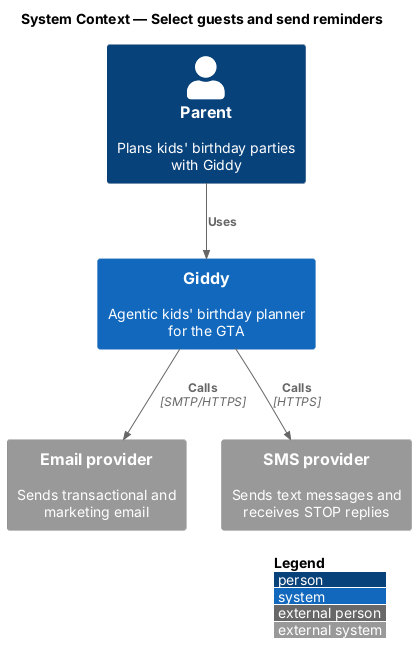
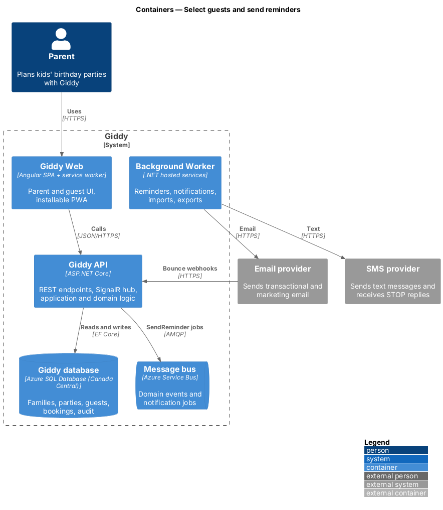
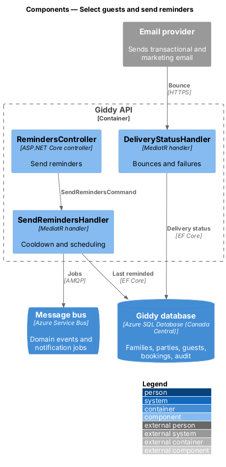
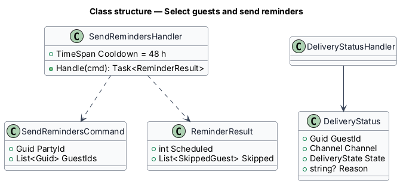
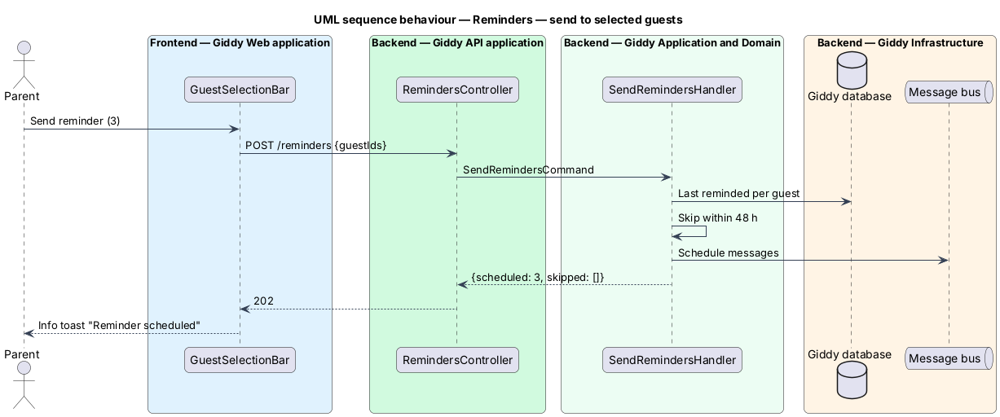

# Select guests and send reminders

## Overview

Parents select guests (usually the ones still waiting) and send a friendly reminder. Delivery failures come back as a persistent error so the parent can fix contact details.

- **reminder cooldown** — 48 hours during which a guest parent is not reminded again

This feature belongs to the **Guest list** subsystem. It is designed from the screens in [`docs/mocks`](../../../mocks/README.md) and the L2 requirements listed below.

## Description

The feature is a vertical slice from the Angular web application through the Giddy API to storage and any external services.

**Frontend (Giddy Web)**

- **`GuestSelectionBar`** — Selected count and names, Send reminder (n), Clear.
- **`ActionToasts`** — Info, success, with-action and danger toasts.

**Backend (Giddy API)**

- **`RemindersController`** — `POST /api/parties/{id}/reminders`.
- **`SendRemindersHandler`** — Applies the cooldown, schedules messages, returns skipped guests.
- **`DeliveryStatusHandler`** — Consumes provider bounces and failures; raises the danger notification.

## Requirements

The feature realizes the following level-2 (L2) requirements. Each L2 requirement refines the level-1 (L1) requirement cited beside it; the full acceptance criteria are in [`docs/specs/L2.md`](../../../specs/L2.md).

| L2 ID | Refines (L1) | Requirement |
|-------|--------------|-------------|
| `L2-042` | `L1-010` | **Select guests and send reminders.** Given the parent selects one or more guests with checkboxes, when a selection exists, then a bar shows the number and names selected and offers "Send reminder (<n>)" and clearing the selection. |

## Diagrams

### System context

Reminders go out by email and text; providers report bounces back.

### Containers

The worker sends; delivery failures return as webhooks to the API.

### Components

Sending and failure handling are separate handlers.

### Class structure

`ReminderResult` tells the UI what was skipped and why.

### Behaviour — send to selected guests

Guests reminded in the last 48 hours are skipped and named in the response (`L2-042`).

