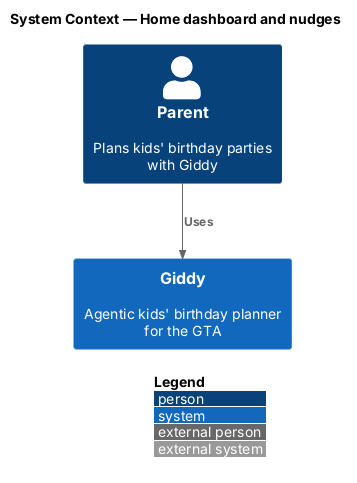
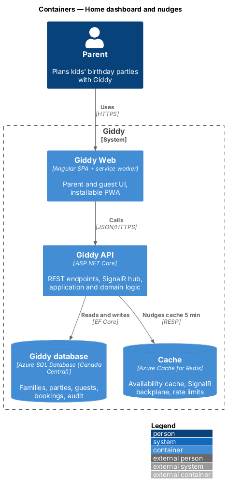
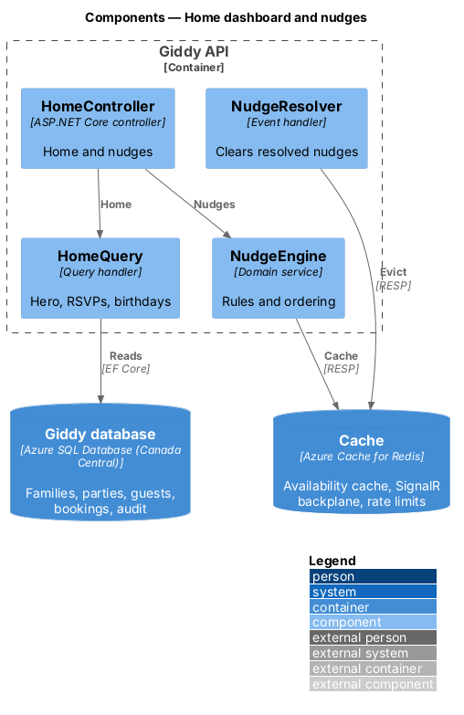
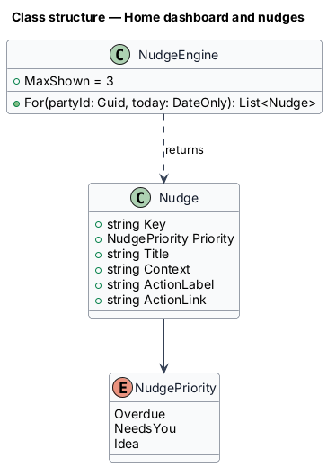
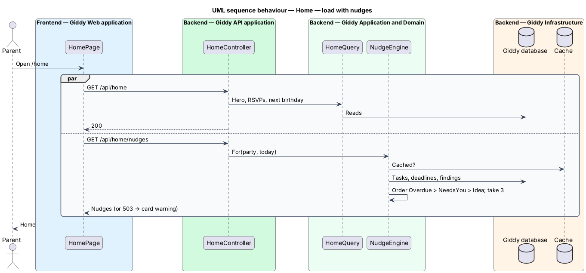

# Home dashboard and nudges

## Overview

Home is the first screen after sign-in. It shows the next party's countdown and readiness, Giddy's *nudges*, RSVP counts, quick-start links and the next birthday. With no parties, it becomes a welcome with one action: Plan a party.

- **nudge** — prioritised suggestion with one action: overdue items first, then items needing the parent this week, then ideas; at most 3 shown

This feature belongs to the **Home dashboard** subsystem. It is designed from the screens in [`docs/mocks`](../../../mocks/README.md) and the L2 requirements listed below.

## Description

The feature is a vertical slice from the Angular web application through the Giddy API to storage and any external services.

**Frontend (Giddy Web)**

- **`HomePage`** — Route `/home`; hero, nudges card, quick start, RSVP card, Coming up next; partial and offline states.

**Backend (Giddy API)**

- **`HomeController`** — `GET /api/home` and `GET /api/home/nudges` (separate so nudges fail alone).
- **`NudgeEngine`** — Rules over tasks, RSVP deadlines and Giddy findings; ordering and the limit of 3.
- **`NudgeResolver`** — Removes a nudge when its action completes.

## Requirements

The feature realizes the following level-2 (L2) requirements. Each L2 requirement refines the level-1 (L1) requirement cited beside it; the full acceptance criteria are in [`docs/specs/L2.md`](../../../specs/L2.md).

| L2 ID | Refines (L1) | Requirement |
|-------|--------------|-------------|
| `L2-062` | `L1-016` | **Home dashboard.** Given a parent with an upcoming party, when Home loads, then it shows a greeting by first name and time of day, a subtitle summarising parties in progress, items needing attention and RSVPs, and a hero card for the soonest party with countdown, date, venue, invited count, readiness and its next step, with "Open plan" and "Ask Giddy". |
| `L2-063` | `L1-016` | **Giddy's nudges.** Given a party, when nudges are computed, then they are ordered overdue first, then items needing the parent this week, then ideas; at most 3 are shown, each with a title, a status badge, one sentence of context and one action. |
| `L2-064` | `L1-016` | **First-run home.** Given a parent with no parties, when Home loads, then it welcomes them and offers one primary action, "Plan a party", with "Add my kids first" and quick links to themes, venues near them, entertainers and chatting with Giddy. |

## Diagrams

### System context

Only parents and Giddy take part.

### Containers

Nudges are cached for 5 minutes and evicted when resolved.

### Components

`NudgeEngine` owns the ordering and limit.

### Class structure

A `Nudge` has one action.

### Behaviour — load with nudges

Home and nudges load independently; a nudge failure leaves the rest working (`L2-062`, `L2-063`).

