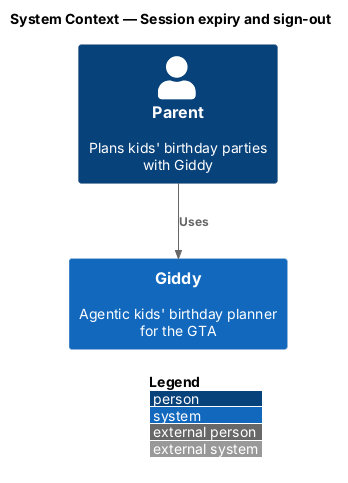
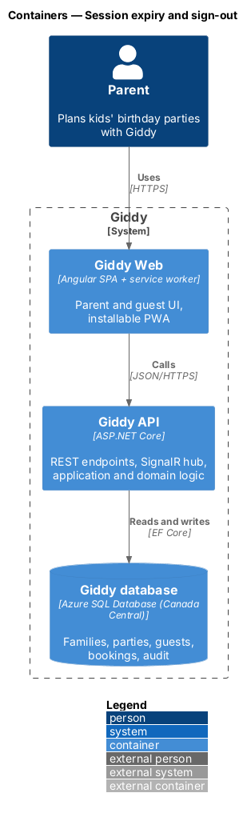
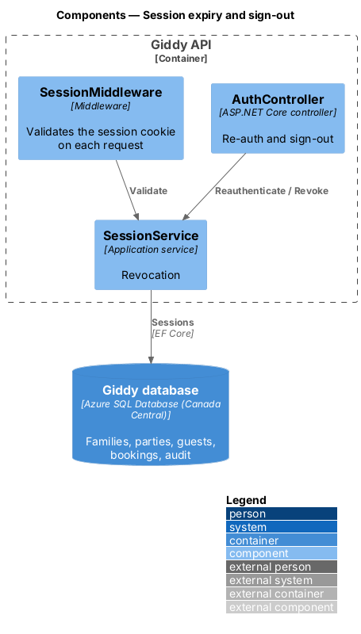
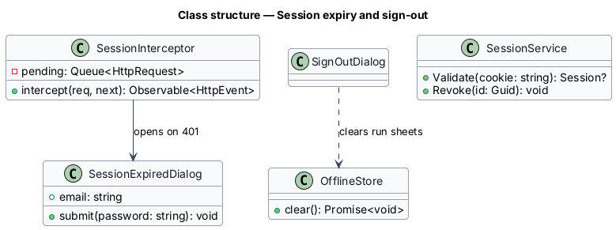
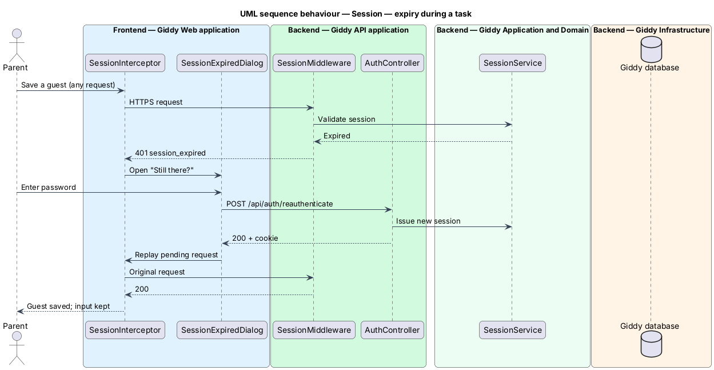

# Session expiry and sign-out

## Overview

A session expires after 30 days without activity (or at browser close when not kept). Expiry mid-task shows a re-authentication dialog so no unsaved work is lost; sign-out ends the session everywhere it matters on this device.

- **pending action** — request held in the web app while the parent re-authenticates, replayed after success

This feature belongs to the **Identity and access** subsystem. It is designed from the screens in [`docs/mocks`](../../../mocks/README.md) and the L2 requirements listed below.

## Description

The feature is a vertical slice from the Angular web application through the Giddy API to storage and any external services.

**Frontend (Giddy Web)**

- **`SessionInterceptor`** — Angular HTTP interceptor; on 401 `session_expired` it opens `SessionExpiredDialog` and queues the request.
- **`SessionExpiredDialog`** — Password-only dialog with email pre-filled.
- **`SignOutDialog`** — Confirms sign-out.
- **`OfflineStore`** — IndexedDB store cleared on sign-out.

**Backend (Giddy API)**

- **`AuthController`** — `POST /api/auth/reauthenticate`, `POST /api/auth/sign-out`.
- **`SessionService`** — Validates, extends, and revokes sessions.

## Requirements

The feature realizes the following level-2 (L2) requirements. Each L2 requirement refines the level-1 (L1) requirement cited beside it; the full acceptance criteria are in [`docs/specs/L2.md`](../../../specs/L2.md).

| L2 ID | Refines (L1) | Requirement |
|-------|--------------|-------------|
| `L2-006` | `L1-001` | **Session expiry and sign-out.** Given a session has expired, when the parent performs an action, then a "Still there?" dialog asks for their password with the email pre-filled, and after re-authenticating the pending action continues without losing unsaved input. |

## Diagrams

### System context

Only the parent and Giddy take part; no external system is involved.

### Containers

The web app and API cooperate: the API rejects the expired session, the web app recovers.

### Components

`SessionMiddleware` validates every request; `AuthController` re-authenticates and signs out.

### Class structure

`SessionInterceptor` owns the pending-request queue and opens the dialog.

### Behaviour — expiry during a task

The interceptor holds the failed request, the parent re-enters the password, and the request is replayed so nothing typed is lost (`L2-006`).

