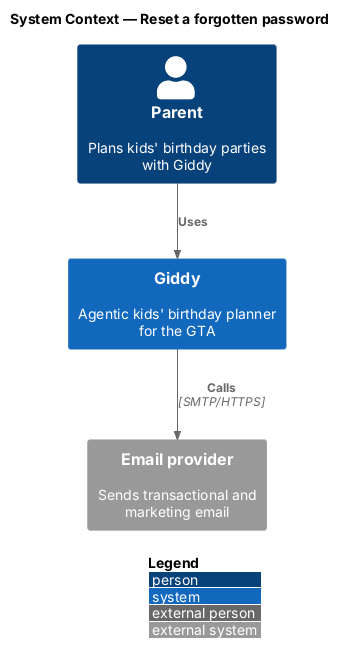
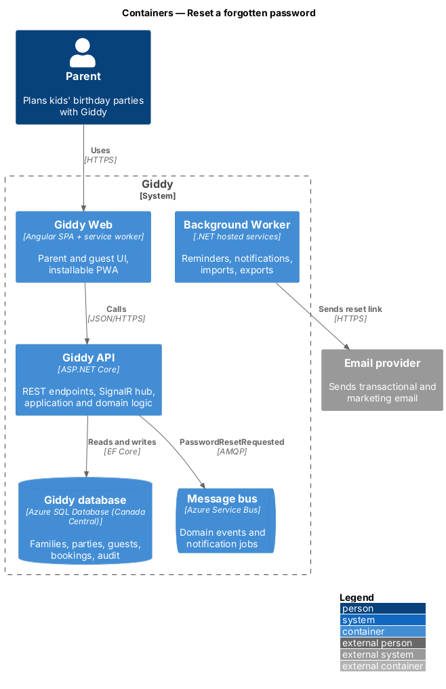
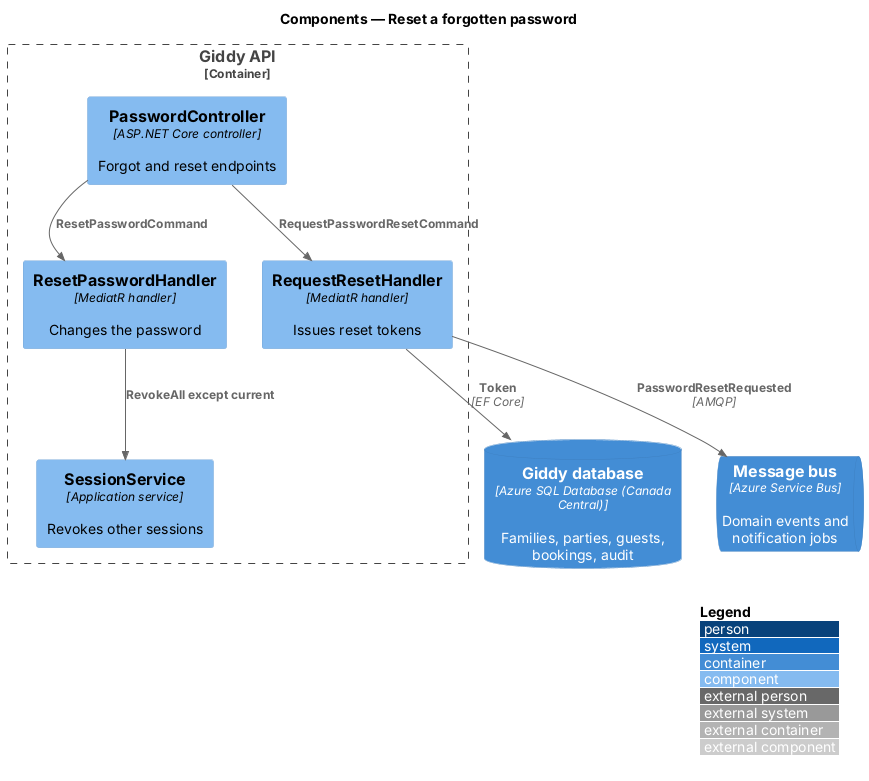
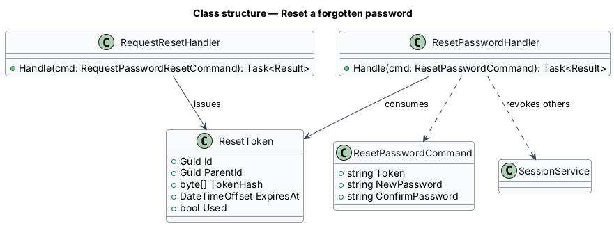
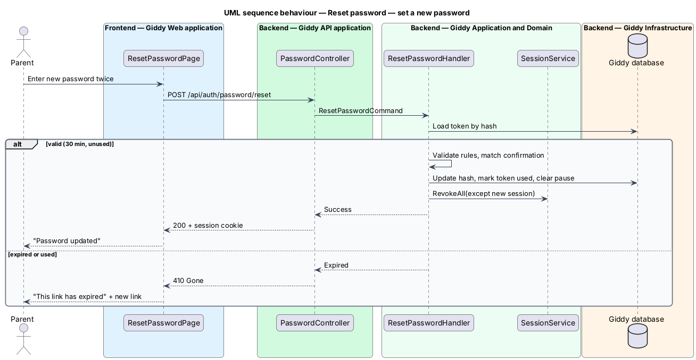

# Reset a forgotten password

## Overview

A parent who forgets a password requests a reset link by email and sets a new password from it. The flow never reveals whether an email address has an account.

- **reset token** — single-use secret, valid for 30 minutes, that authorises one password change

This feature belongs to the **Identity and access** subsystem. It is designed from the screens in [`docs/mocks`](../../../mocks/README.md) and the L2 requirements listed below.

## Description

The feature is a vertical slice from the Angular web application through the Giddy API to storage and any external services.

**Frontend (Giddy Web)**

- **`ForgotPasswordPage`** — Route `/forgot-password`.
- **`ResetPasswordPage`** — Route `/reset-password`; new and confirm fields.

**Backend (Giddy API)**

- **`PasswordController`** — `POST /api/auth/password/forgot`, `POST /api/auth/password/reset`.
- **`RequestResetHandler`** — Issues a reset token if the account exists; responds identically either way.
- **`ResetPasswordHandler`** — Validates the token and password, updates the hash, revokes other sessions, lifts any sign-in pause.
- **`ResetToken`** — Hashed token with 30-minute expiry.

## Requirements

The feature realizes the following level-2 (L2) requirements. Each L2 requirement refines the level-1 (L1) requirement cited beside it; the full acceptance criteria are in [`docs/specs/L2.md`](../../../specs/L2.md).

| L2 ID | Refines (L1) | Requirement |
|-------|--------------|-------------|
| `L2-005` | `L1-001` | **Password reset.** Given a visitor on "Forgot password", when they submit any well-formed email, then the same confirmation is shown whether or not an account exists, and if one exists a single-use reset link valid for 30 minutes is emailed. |

## Diagrams

### System context

Giddy emails reset links through the email provider.

### Containers

As with sign-up, the worker sends the email from a queued event so response time does not depend on the provider.

### Components

Two handlers split issuing from consuming tokens; `SessionService` revokes other sessions.

### Class structure

`ResetToken` is issued by one handler and consumed by the other.

### Behaviour — set a new password

A valid token changes the password, signs the parent in on this device and ends every other session (`L2-005`).

