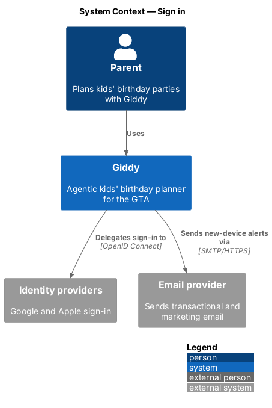
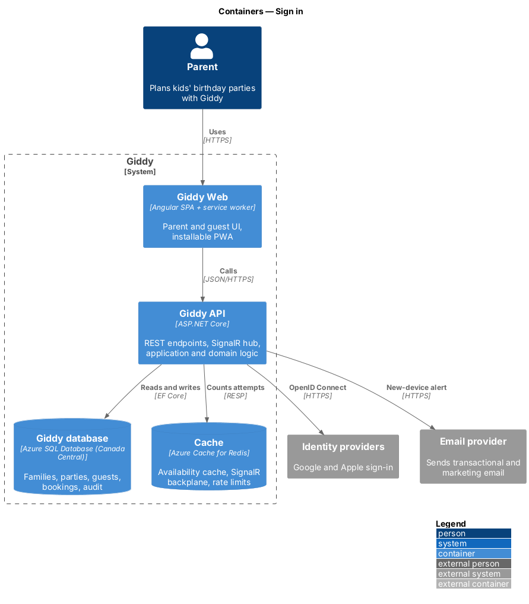
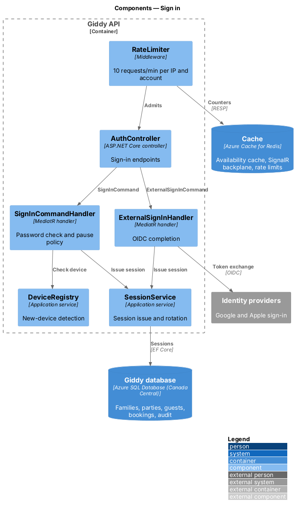
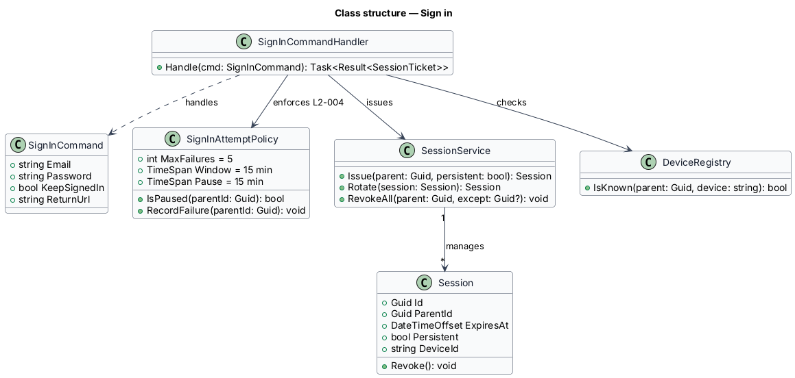
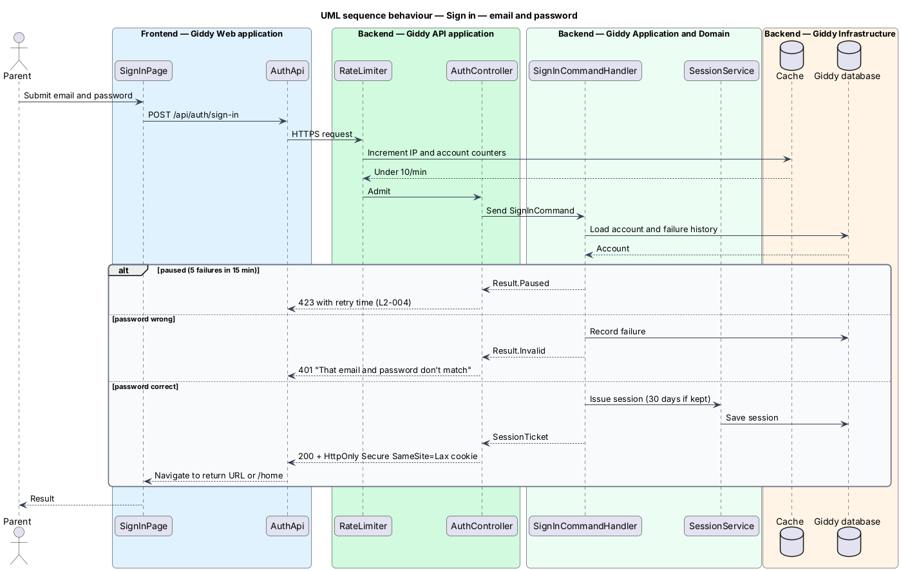
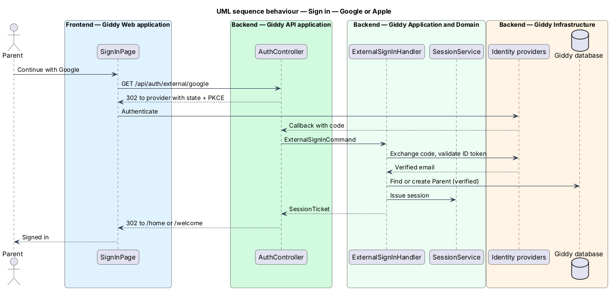

# Sign in

## Overview

Parents sign in with an email and password or with Google or Apple. Sign-in returns them to the page they asked for.

Sign-in is the main target of account takeover, so it combines generic failure messages, per-account pauses after repeated failures, rate limits and new-device alerts.

- **sign-in pause** — 15-minute block on password attempts for one account after 5 failures within 15 minutes
- **session cookie** — `HttpOnly`, `Secure`, `SameSite=Lax` cookie that identifies a server-side session

This feature belongs to the **Identity and access** subsystem. It is designed from the screens in [`docs/mocks`](../../../mocks/README.md) and the L2 requirements listed below.

## Description

The feature is a vertical slice from the Angular web application through the Giddy API to storage and any external services.

**Frontend (Giddy Web)**

- **`SignInPage`** — Route `/sign-in`; autofocused email field, password, keep-signed-in, provider buttons.
- **`AuthApi`** — Typed client.
- **`AuthGuard`** — Angular route guard that redirects to sign-in with a return URL.

**Backend (Giddy API)**

- **`AuthController`** — `POST /api/auth/sign-in`, `GET /api/auth/external/{provider}`, callback endpoint.
- **`SignInCommandHandler`** — Verifies the password with ASP.NET Core Identity (Argon2id hasher) and applies the pause policy.
- **`ExternalSignInHandler`** — Completes OpenID Connect with Google or Apple and links or creates the account.
- **`SessionService`** — Issues, rotates and revokes server-side sessions stored in the database.
- **`DeviceRegistry`** — Remembers device fingerprints and triggers new-device emails.
- **`RateLimiter`** — ASP.NET Core rate-limiting middleware backed by Redis.

**Open points**

- Apple Sign In service ID and key rotation procedure `<TO SUPPLY>`

**As built**

- `POST /api/auth/sign-in` checks the password with ASP.NET Core Identity's hasher (PBKDF2-HMAC-SHA512 at 210,000 iterations). It never says whether the email or the password was wrong.
- After five failures in 15 minutes, the next attempt pauses sign-in for 15 minutes (423). A password reset lifts the pause.
- Sessions are server-side (`ParentSession`). The `__Host-` cookie (HttpOnly, Secure, SameSite=Lax) only names the session, and it is re-issued at every sign-in.
  - Every request checks the session in `OnValidatePrincipal`.
  - "Keep me signed in" makes a persistent 30-day sliding session; otherwise the cookie lasts for the browser session, with a 12-hour idle limit on the server.
- A sign-in from a device the account hasn't used before emails the parent with the device (from the user agent) and the place the edge network reports in `X-Client-City`.
- Google and Apple are registered only when their client ids are configured (from environment variables).
  - `/api/auth/external/{provider}` round-trips through a short-lived external cookie.
  - The callback signs in the account with that verified email, or creates a verified one that goes to `/welcome`.
  - Failures go back to `/sign-in?error=provider`. Only local return paths are followed.
- Sign-in, sign-up, reset and resend are limited to 10 requests a minute per IP address, with `Retry-After`. The per-account limit is the sign-in pause.
- The web app's `signedInGuard` sends visitors to `/sign-in?returnUrl=…`.

## Requirements

The feature realizes the following level-2 (L2) requirements. Each L2 requirement refines the level-1 (L1) requirement cited beside it; the full acceptance criteria are in [`docs/specs/L2.md`](../../../specs/L2.md).

| L2 ID | Refines (L1) | Requirement |
|-------|--------------|-------------|
| `L2-002` | `L1-001` | **Sign in with third-party identity providers.** Given a visitor on the sign-in page, when they choose "Continue with Google" or "Continue with Apple" and complete the provider's flow, then they are signed in to an existing account with the same verified email or a new verified account is created. |
| `L2-004` | `L1-001` | **Sign in with email and password.** Given a registered parent, when they submit the correct email and password, then they are signed in and taken to the page they originally requested, or Home if none. |
| `L2-070` | `L1-018` | **Authentication security.** Given passwords, when they are stored, then they are hashed with Argon2id (or the ASP.NET Core Identity equivalent configured at OWASP-recommended cost). |

## Diagrams

### System context

Parents sign in to Giddy directly or through Google or Apple; Giddy emails an alert when a new device signs in.

### Containers

The API counts attempts in Redis for rate limits and keeps sessions in the database so they can be revoked server-side.

### Components

Rate limiting runs before the controller; both sign-in handlers issue sessions through `SessionService`.

### Class structure

`SignInAttemptPolicy` holds the pause rule; `SessionService` owns `Session` lifetimes.

### Behaviour — email and password

The API applies the rate limit and pause policy before checking the password, returns the same message for any mismatch, and sets a rotated session cookie (`L2-004`, `L2-070`).

### Behaviour — Google or Apple

Provider sign-in links to an existing account with the same verified email or creates a verified one (`L2-002`).

