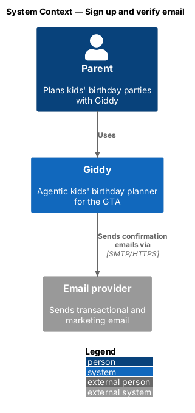
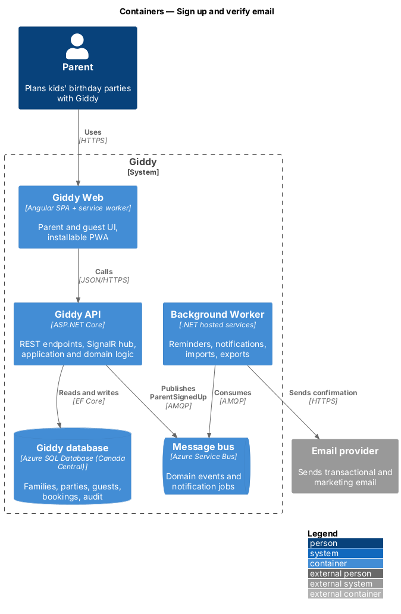
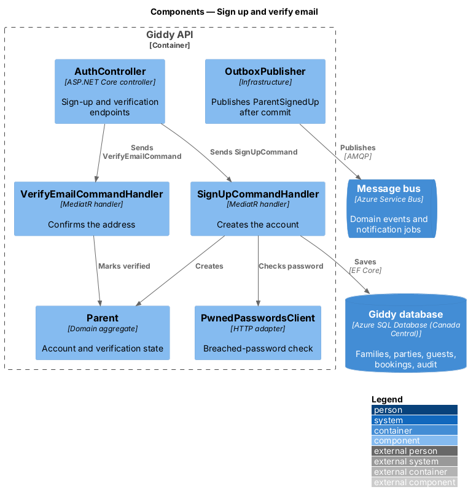
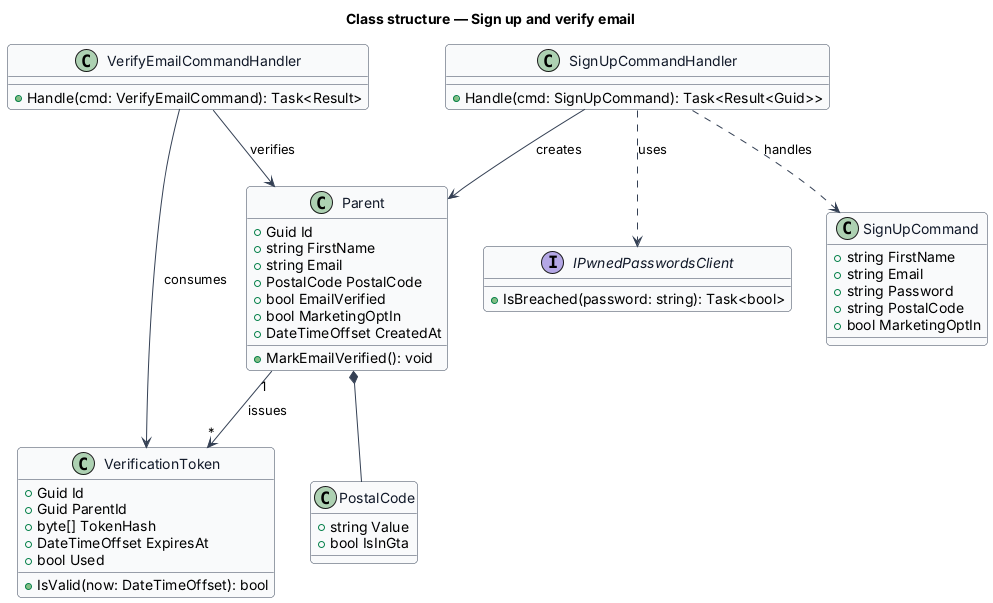
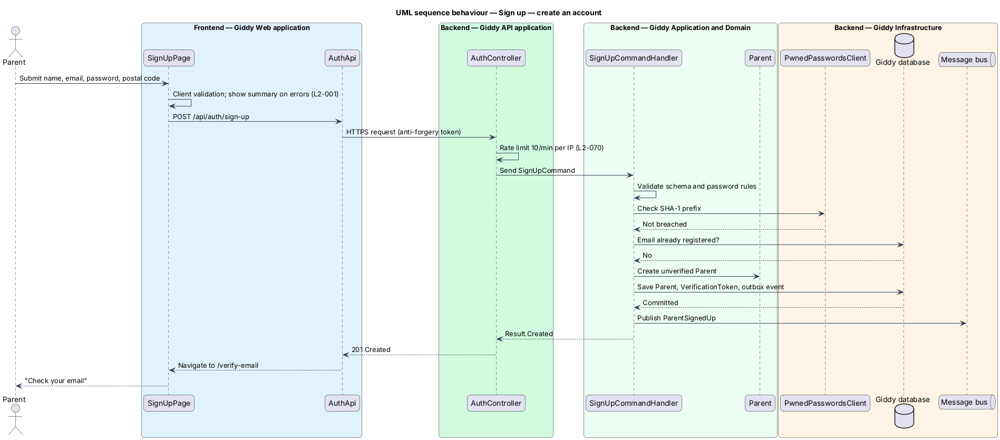
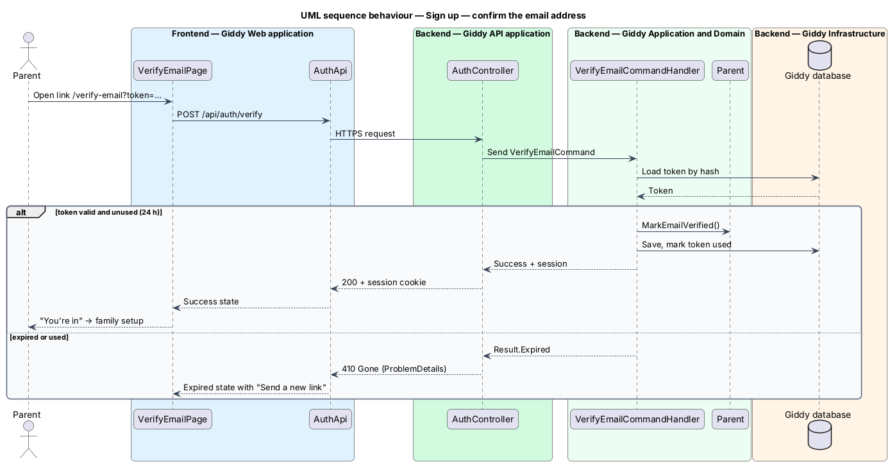

# Sign up and verify email

## Overview

A *parent* is the account holder who plans parties in Giddy. Before planning, a visitor creates an account with a first name, an email address, a password and a postal code, then confirms the email address through a link.

Email confirmation exists because invitations are sent in the parent's name: an unverified address cannot send invitations. Until the address is confirmed, the app shows a persistent banner and blocks sending.

- **verification token** — single-use secret, valid for 24 hours, that proves control of an email address
- **breached-password list** — set of passwords known from public data breaches, checked by k-anonymity hash prefix

This feature belongs to the **Identity and access** subsystem. It is designed from the screens in [`docs/mocks`](../../../mocks/README.md) and the L2 requirements listed below.

## Description

The feature is a vertical slice from the Angular web application through the Giddy API to storage and any external services.

**Frontend (Giddy Web)**

- **`SignUpPage`** — Angular route `/sign-up`; reactive form with inline errors, error summary and busy state.
- **`VerifyEmailPage`** — Route `/verify-email`; shows check-inbox, success and expired states.
- **`VerifyEmailBanner`** — Shell banner shown while the parent's email is unverified or bounced.
- **`AuthApi`** — Typed HTTP client for `/api/auth/*`.

**Backend (Giddy API)**

- **`AuthController`** — Exposes `POST /api/auth/sign-up`, `POST /api/auth/verify`, `POST /api/auth/verify/resend`.
- **`SignUpCommandHandler`** — Validates input, checks the breached-password list, creates the `Parent` with ASP.NET Core Identity and issues a `VerificationToken`.
- **`VerifyEmailCommandHandler`** — Consumes a token, marks the email verified and starts a session.
- **`Parent`** — Aggregate root for the account: name, email, postal code, verification state, marketing consent.
- **`VerificationToken`** — Hashed token with expiry and used flag.
- **`EmailSender`** — Infrastructure adapter that renders templates and calls the email provider.
- **`PwnedPasswordsClient`** — Checks a password's SHA-1 prefix against the breached-password service.

**Open points**

- Template copy for the confirmation email `<TO SUPPLY>`
- Exact breached-password service and its SLA `<TO SUPPLY>`

## Requirements

The feature realizes the following level-2 (L2) requirements. Each L2 requirement refines the level-1 (L1) requirement cited beside it; the full acceptance criteria are in [`docs/specs/L2.md`](../../../specs/L2.md).

| L2 ID | Refines (L1) | Requirement |
|-------|--------------|-------------|
| `L2-001` | `L1-001` | **Sign up with email and password.** A visitor can create an account with first name, email, password, postal code and an optional marketing opt-in. |
| `L2-003` | `L1-001` | **Email verification.** Given an unverified parent, when they open the verification link within 24 hours, then the address is marked verified and they see the success page leading to family setup. |

## Diagrams

### System context

The parent signs up through Giddy, which sends the confirmation email through the email provider.

### Containers

The web app posts the form to the API, which stores the account and publishes an event; the background worker sends the email so a slow provider never delays sign-up.

### Components

Inside the API, `AuthController` dispatches commands to two handlers; an outbox publishes `ParentSignedUp` only after the account commits.

### Class structure

`Parent` owns its `PostalCode` and issues `VerificationToken` records; the handlers create and verify it.

### Behaviour — create an account

The handler validates every field on the server, rejects breached passwords and existing emails, then creates the unverified account and queues the confirmation email (`L2-001`, `L2-003`).

### Behaviour — confirm the email address

Opening the link consumes the single-use token; expired or used tokens show the expired page with a resend action (`L2-003`).

