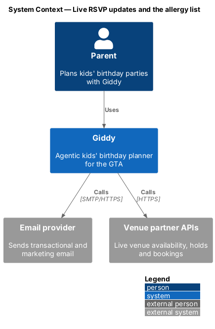
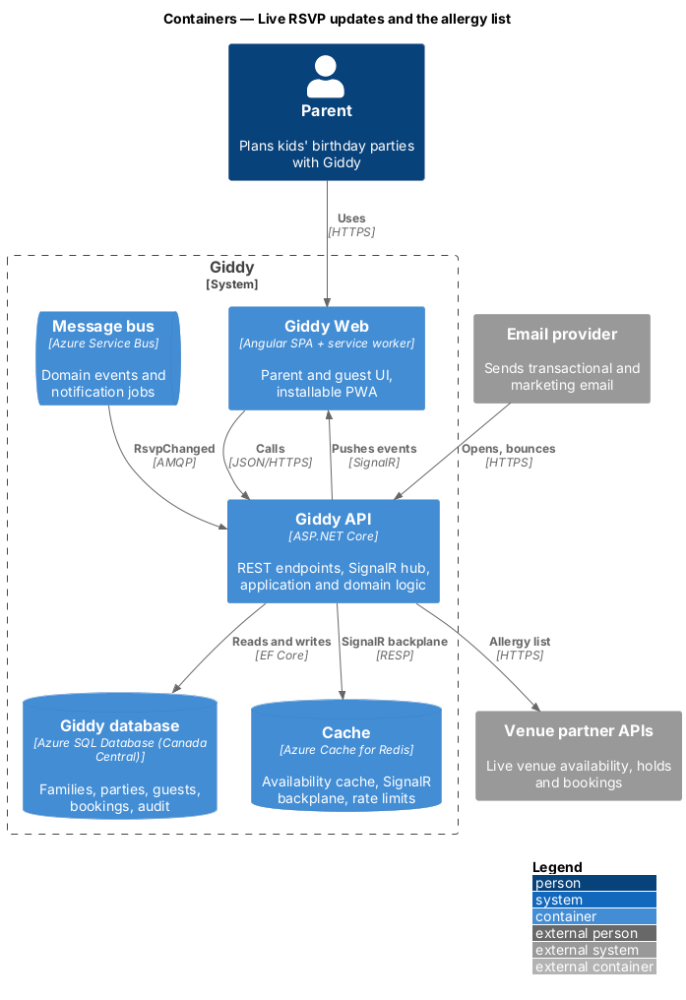
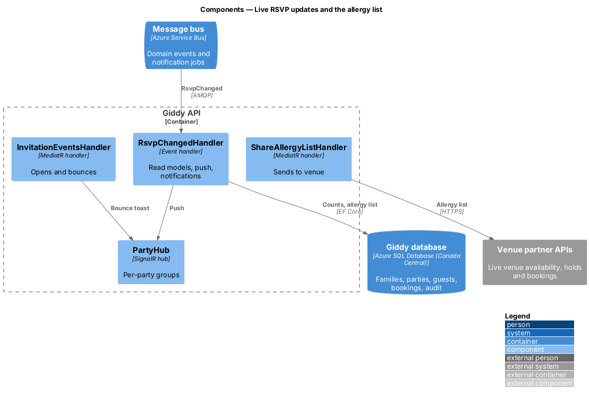
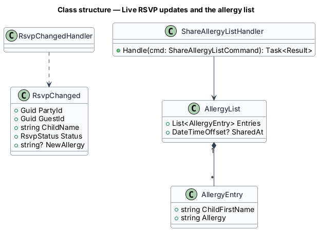
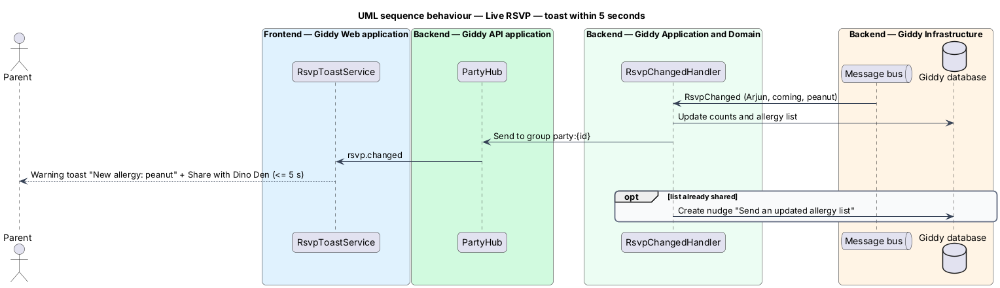

# Live RSVP updates and the allergy list

## Overview

When a guest parent replies, the host sees it within 5 seconds: a toast, updated counts and any new allergy. The host can then share the allergy list with the venue, which receives first names and allergies only.

- **allergy list** — first name and allergy of each child who is coming, without parent contact details

This feature belongs to the **Invitations and RSVPs** subsystem. It is designed from the screens in [`docs/mocks`](../../../mocks/README.md) and the L2 requirements listed below.

## Description

The feature is a vertical slice from the Angular web application through the Giddy API to storage and any external services.

**Frontend (Giddy Web)**

- **`RsvpToastService`** — SignalR listener showing info, success, warning and danger toasts and refreshing counts.

**Backend (Giddy API)**

- **`RsvpChangedHandler`** — Consumes `RsvpChanged`; updates read models; pushes to the party's SignalR group; creates notifications; nudges when an allergy arrives after the list was shared.
- **`ShareAllergyListHandler`** — Sends the list to the booked venue and ticks the checklist task.
- **`InvitationEventsHandler`** — Consumes opens and bounces from the email provider.

## Requirements

The feature realizes the following level-2 (L2) requirements. Each L2 requirement refines the level-1 (L1) requirement cited beside it; the full acceptance criteria are in [`docs/specs/L2.md`](../../../specs/L2.md).

| L2 ID | Refines (L1) | Requirement |
|-------|--------------|-------------|
| `L2-045` | `L1-011` | **Live RSVP updates for the host.** Given the host has Giddy open, when a guest parent replies, then within 5 seconds a toast names the child and reply, the counts on screen update, and any new allergy is added to the allergy list. |
| `L2-046` | `L1-011` | **Share the allergy list.** Given guests with allergies, when the parent chooses "Send to <venue>", then the venue receives each child's first name and allergy only, without parent contact details, and the checklist task "Share the allergy list" is ticked. |

## Diagrams

### System context

Allergy lists go only to the booked venue; email opens and bounces come back from the email provider.

### Containers

SignalR with a Redis backplane delivers events to every planner who has the party open.

### Components

One event handler fans out to read models, the hub and notifications.

### Class structure

`AllergyEntry` holds only a first name and the allergy (`L2-072`).

### Behaviour — toast within 5 seconds

A reply with a new allergy produces a warning toast with a share action (`L2-045`, `L2-046`).

