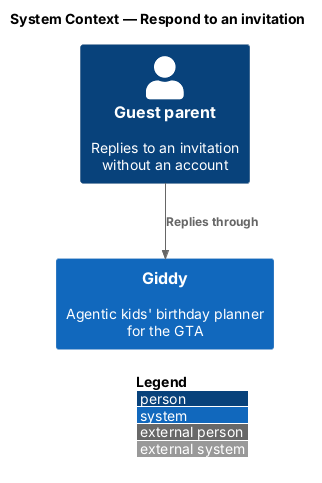
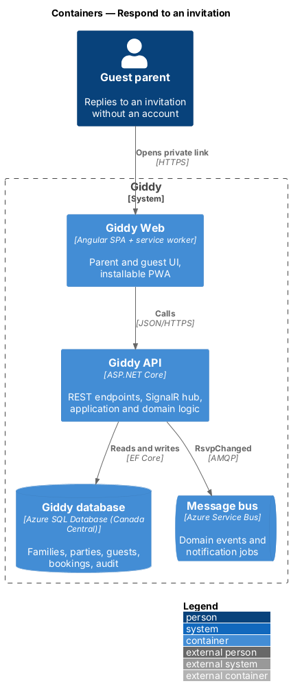
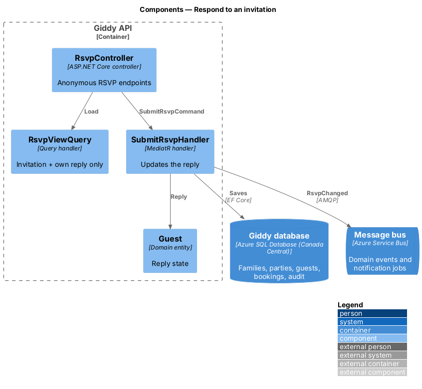
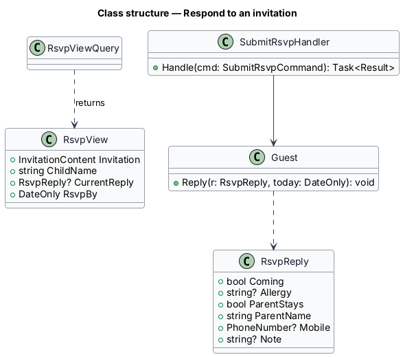
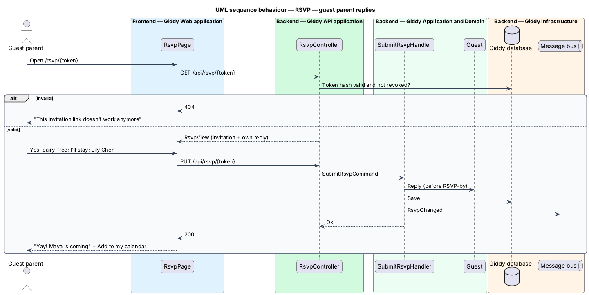

# Respond to an invitation

## Overview

A *guest parent* opens their private RSVP link, sees the invitation, and replies without an account: coming or not, allergies, whether a parent stays, name, optional mobile and a note. They can change the reply until the RSVP-by date.

- **guest parent** — recipient of an invitation who has no Giddy account and is identified only by the RSVP token

This feature belongs to the **Invitations and RSVPs** subsystem. It is designed from the screens in [`docs/mocks`](../../../mocks/README.md) and the L2 requirements listed below.

## Description

The feature is a vertical slice from the Angular web application through the Giddy API to storage and any external services.

**Frontend (Giddy Web)**

- **`RsvpPage`** — Public route `/rsvp/{token}`; invitation, reply choice cards, form, success with calendar file.
- **`RsvpApi`** — Typed client for the public RSVP endpoints.

**Backend (Giddy API)**

- **`RsvpController`** — Anonymous `GET /api/rsvp/{token}`, `PUT /api/rsvp/{token}`, `GET /api/rsvp/{token}/calendar.ics`; rate-limited per token and IP.
- **`SubmitRsvpHandler`** — Validates, updates the guest's reply and allergies, publishes `RsvpChanged`.
- **`RsvpView`** — Projection exposing only the invitation and this guest's reply.

**As built**

- `GET/PUT /api/rsvp/{token}` and `GET /api/rsvp/{token}/calendar.ics` are anonymous, rate-limited to 60 requests a minute per address, and exempt from the anti-forgery check because the token in the path is the credential.
- Unknown, replaced and deleted-party links answer `404` "This link no longer works" with no party details. Replies change until the RSVP-by date, then `409`.
- A reply that is coming with an allergy adds it to the party's allergy list.

## Requirements

The feature realizes the following level-2 (L2) requirements. Each L2 requirement refines the level-1 (L1) requirement cited beside it; the full acceptance criteria are in [`docs/specs/L2.md`](../../../specs/L2.md).

| L2 ID | Refines (L1) | Requirement |
|-------|--------------|-------------|
| `L2-044` | `L1-011` | **Guest RSVP without an account.** Given a guest parent opens their private link, when the page loads, then it shows the invitation and a form asking whether the child is coming, allergies or dietary needs, whether a parent will stay, the parent's name, an optional mobile number and an optional note, pre-filled with any details already known. |

## Diagrams

### System context

Guest parents use Giddy only through their private link.

### Containers

Anonymous endpoints sit in the same API with their own rate limits.

### Components

A dedicated projection keeps other guests' data out of the RSVP page.

### Class structure

`Guest.Reply` applies the RSVP-by rule.

### Behaviour — guest parent replies

The token is the only credential; replaced or revoked tokens show a page with no party details, and the view never includes other guests (`L2-044`).

