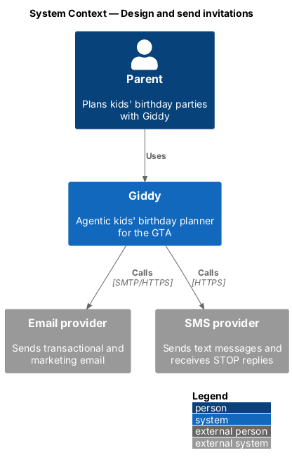
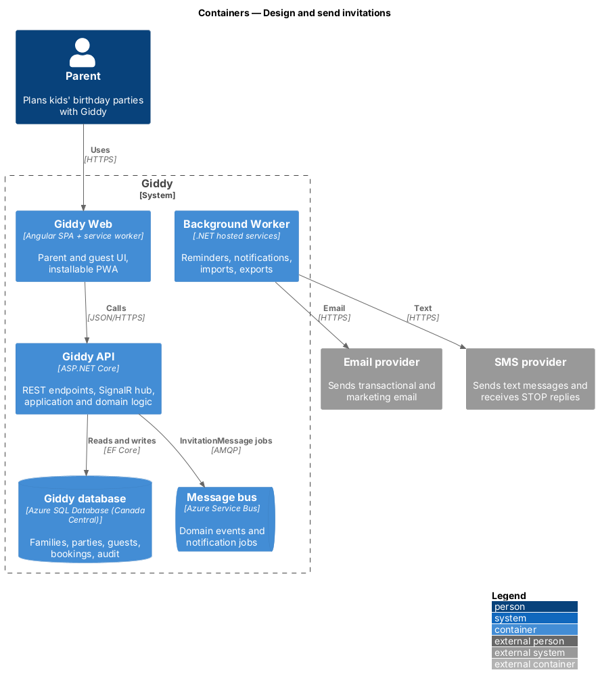
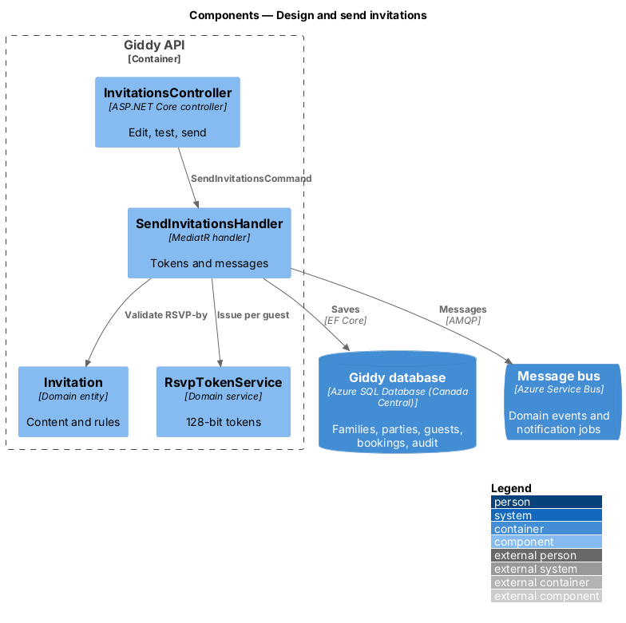
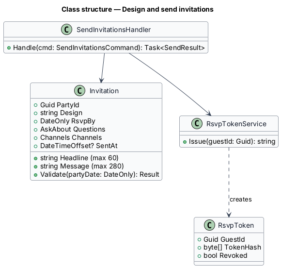
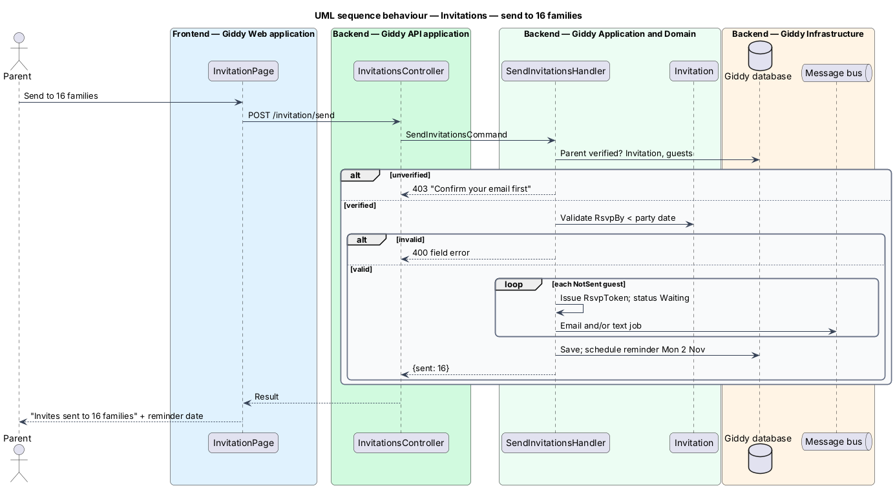

# Design and send invitations

## Overview

Giddy drafts the invitation from the party's theme, date, time and venue. The parent picks a design, edits the headline and message, sets the RSVP-by date and the questions to ask, then sends private links by email and text.

- **RSVP link** — per-guest URL containing a 128-bit random token that opens the guest's reply page
- **RSVP-by date** — last day to reply; shall be before the party date (default 8 days before)

This feature belongs to the **Invitations and RSVPs** subsystem. It is designed from the screens in [`docs/mocks`](../../../mocks/README.md) and the L2 requirements listed below.

## Description

The feature is a vertical slice from the Angular web application through the Giddy API to storage and any external services.

**Frontend (Giddy Web)**

- **`InvitationPage`** — Route `/parties/{id}/invite`; editor and live preview; counters (60 and 280).
- **`InvitePreview`** — Rendered invitation with the chosen design.

**Backend (Giddy API)**

- **`InvitationsController`** — `GET/PUT /api/parties/{id}/invitation`, `POST .../invitation/test`, `POST .../invitation/send`.
- **`Invitation`** — Entity: design, headline, message, RSVP-by, questions, channels.
- **`SendInvitationsHandler`** — Requires a verified sender email; issues tokens for NotSent guests and enqueues messages; schedules the automatic reminder.
- **`RsvpTokenService`** — Generates and hashes 128-bit tokens.

**Open points**

- Invitation designs beyond the four launch designs `<TO SUPPLY>`

## Requirements

The feature realizes the following level-2 (L2) requirements. Each L2 requirement refines the level-1 (L1) requirement cited beside it; the full acceptance criteria are in [`docs/specs/L2.md`](../../../specs/L2.md).

| L2 ID | Refines (L1) | Requirement |
|-------|--------------|-------------|
| `L2-043` | `L1-011` | **Design and send invitations.** Given a party, when the parent opens Invites, then a draft written by Giddy from the party's theme, date, time and venue is shown with a live preview, a design choice, a headline (max 60 characters), a message (max 280 characters with a counter), an RSVP-by date (default 8 days before the party), the questions to ask (allergies, parent staying, siblings), and channels (email, text). |

## Diagrams

### System context

Invitations go to guests' parents by email and text.

### Containers

Messages are queued and sent by the worker so a slow provider never blocks the page.

### Components

`SendInvitationsHandler` is the only issuer of RSVP tokens.

### Class structure

`Invitation.Validate` enforces the RSVP-by rule.

### Behaviour — send to 16 families

Sending requires a verified sender and an RSVP-by date before the party; each NotSent guest gets a token and a message per channel they can receive (`L2-043`, `L2-003`).

