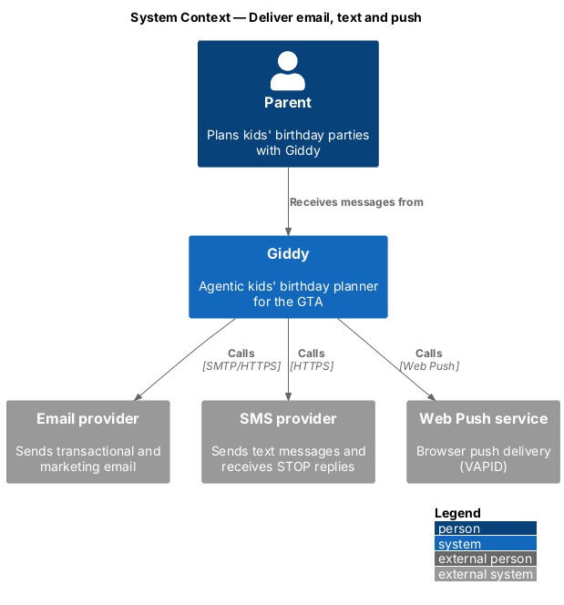
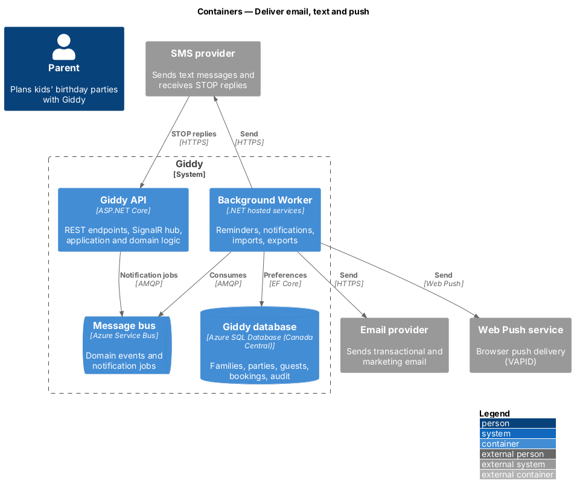
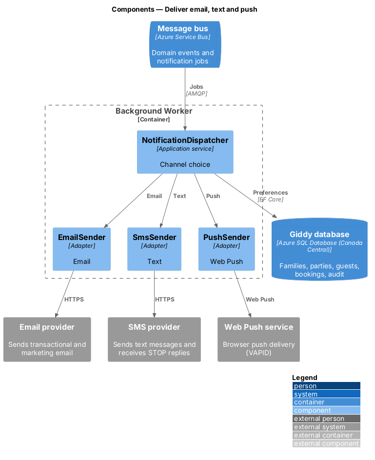
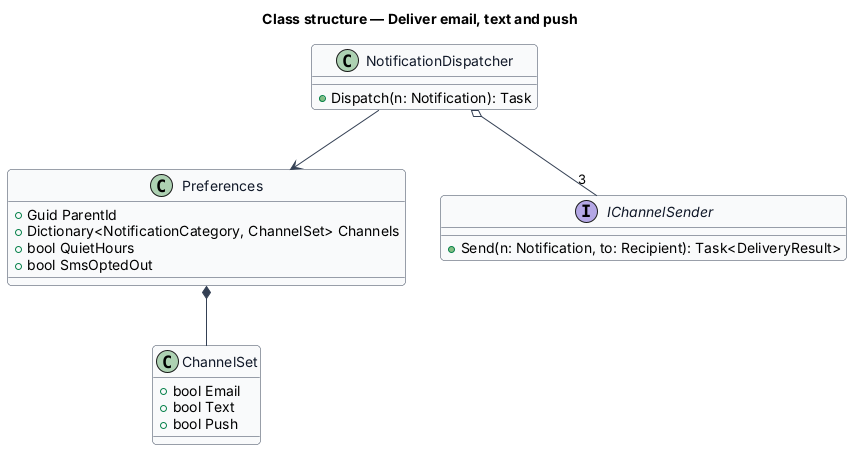
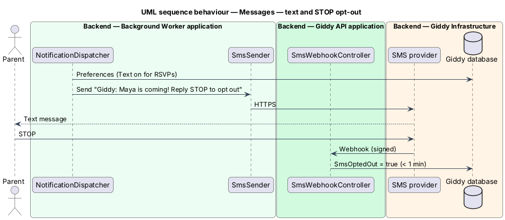

# Deliver email, text and push

## Overview

Outside the app, Giddy reaches parents by email, text message and push according to per-category preferences. Transactional emails always send; text messages comply with CASL (sender identification, STOP opt-out); marketing emails have one-click unsubscribe.

- **transactional email** — message the parent needs to use the service: verification, password reset, booking confirmation
- **CASL** — Canada's Anti-Spam Legislation

This feature belongs to the **Notifications** subsystem. It is designed from the screens in [`docs/mocks`](../../../mocks/README.md) and the L2 requirements listed below.

## Description

The feature is a vertical slice from the Angular web application through the Giddy API to storage and any external services.

**Background Worker**

- **`NotificationDispatcher`** — Chooses channels from preferences and category; applies quiet hours; enqueues sends.
- **`EmailSender`** — Renders templates and calls the email provider; adds List-Unsubscribe headers to marketing mail.
- **`SmsSender`** — Adds “Giddy:” prefix and “Reply STOP to opt out”.
- **`PushSender`** — Web Push with VAPID keys.

**Backend (Giddy API)**

- **`SmsWebhookController`** — Receives STOP replies and disables text for that number within 1 minute.
- **`UnsubscribeController`** — Signed one-click unsubscribe link without sign-in.

**Open points**

- Email and SMS provider selection and Canadian sender numbers `<TO SUPPLY>`

## Requirements

The feature realizes the following level-2 (L2) requirements. Each L2 requirement refines the level-1 (L1) requirement cited beside it; the full acceptance criteria are in [`docs/specs/L2.md`](../../../specs/L2.md).

| L2 ID | Refines (L1) | Requirement |
|-------|--------------|-------------|
| `L2-058` | `L1-015` | **Email and text message notifications.** Given the notification settings, when the parent sets email, text and push per category (RSVPs, vendor quotes and bookings, Giddy's reminders, party ideas), then only those channels are used for that category. |

## Diagrams

### System context

Giddy uses separate providers for email, text and push.

### Containers

Only the worker sends; the API receives provider callbacks.

### Components

One dispatcher fans out to three channel senders.

### Class structure

`Preferences` maps each category to a `ChannelSet`.

### Behaviour — text and STOP opt-out

Every text identifies Giddy and offers STOP; a STOP reply disables text within 1 minute (`L2-058`).

