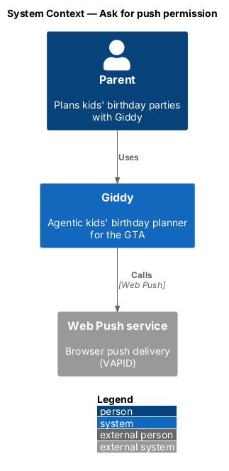
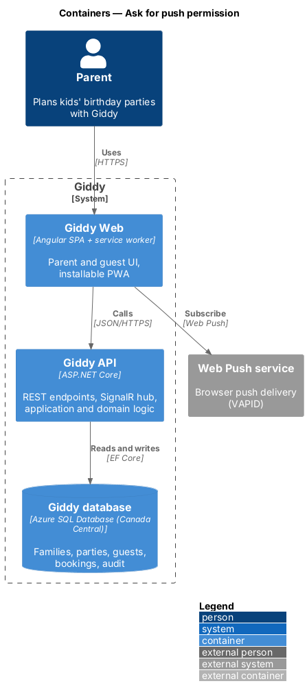
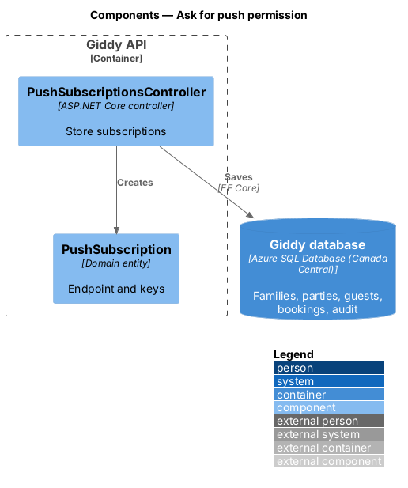
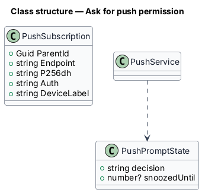
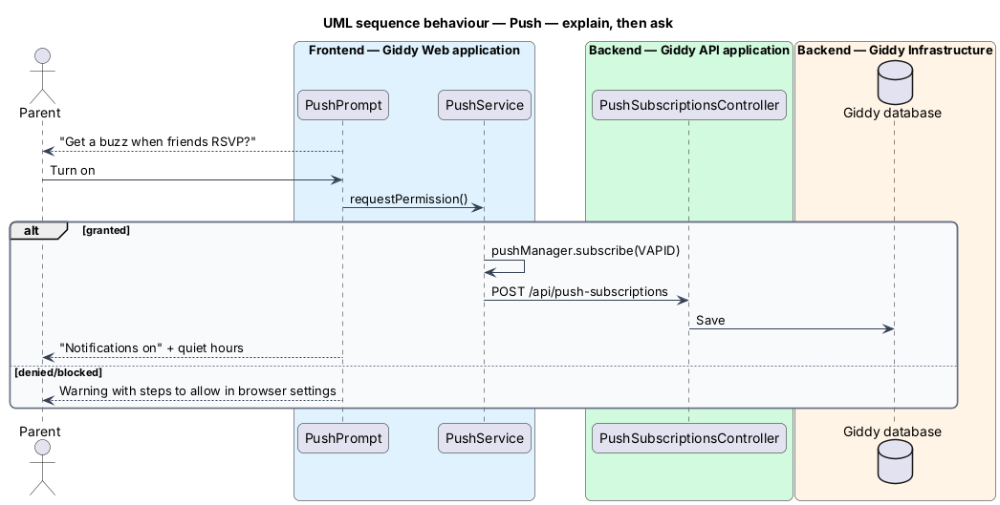

# Ask for push permission

## Overview

Push permission is requested only after the parent sends invitations, with an in-app explanation first. If the browser has blocked notifications, Giddy explains how to allow them; “Not now” suppresses the ask for 30 days.

- **push subscription** — browser endpoint and keys stored per device for Web Push

This feature belongs to the **Notifications** subsystem. It is designed from the screens in [`docs/mocks`](../../../mocks/README.md) and the L2 requirements listed below.

## Description

The feature is a vertical slice from the Angular web application through the Giddy API to storage and any external services.

**Frontend (Giddy Web)**

- **`PushPrompt`** — In-app alert with Turn on and Not now.
- **`PushService`** — Calls `Notification.requestPermission` and `pushManager.subscribe` with the VAPID key.

**Backend (Giddy API)**

- **`PushSubscriptionsController`** — `POST /api/push-subscriptions`, `DELETE ...`.

**As built**

**When Giddy asks**
- `PushPrompt` (in `@giddy/core`) starts asking once the parent has sent invitations from this device, while the browser's permission is still undecided.
- The shell shows "Get a buzz when friends RSVP?" with Turn on and Not now. The browser's own prompt appears only after Turn on.

**What happens next**
- Granted shows "Notifications on" with the quiet hours.
- Denied shows "Notifications are blocked in your browser", which links to `/help`.
- Not now, or dismissing the prompt, keeps it away from this device for 30 days (local storage).

**Not yet done**
- The help centre page is not built yet.
- `POST /api/push-subscriptions` and `DELETE /api/push-subscriptions` store and remove subscriptions. The web app does not subscribe until a VAPID public key is configured.

## Requirements

The feature realizes the following level-2 (L2) requirements. Each L2 requirement refines the level-1 (L1) requirement cited beside it; the full acceptance criteria are in [`docs/specs/L2.md`](../../../specs/L2.md).

| L2 ID | Refines (L1) | Requirement |
|-------|--------------|-------------|
| `L2-059` | `L1-015` | **Push notification permission.** Given the parent has not decided on push notifications, when they have sent their first invitations, then an in-app prompt explains what they will be notified about before the browser's permission prompt is triggered. |

## Diagrams

### System context

Browsers deliver push through their Web Push services.

### Containers

The browser subscribes directly; the API stores the subscription.

### Components

Only one API component is involved.

### Class structure

Subscriptions are per device.

### Behaviour — explain, then ask

The browser prompt appears only after the in-app explanation and the parent's Turn on (`L2-059`).

