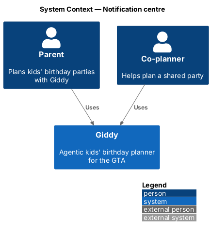
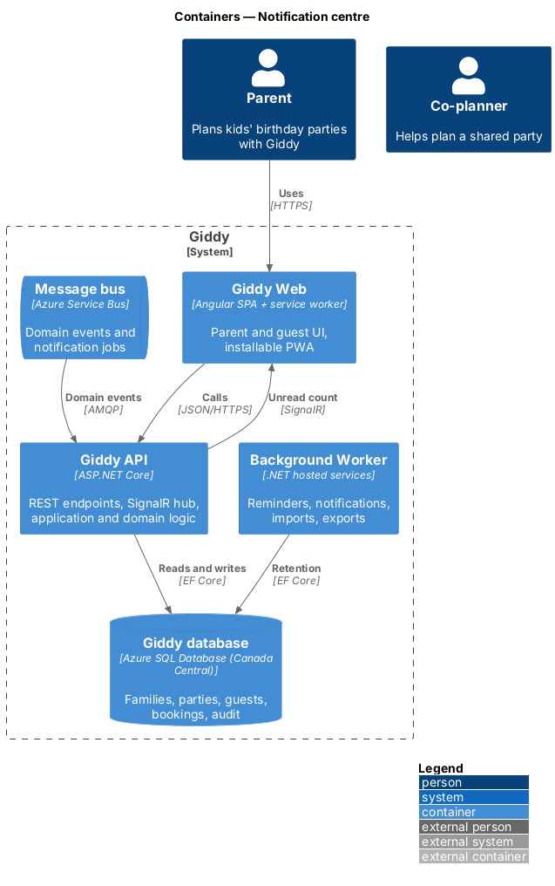
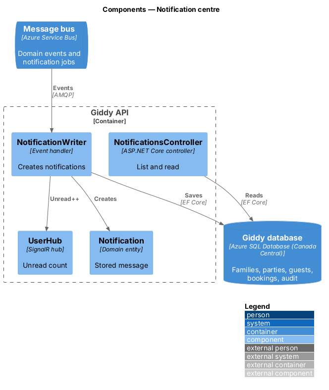
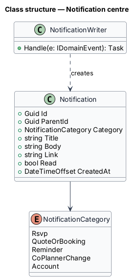
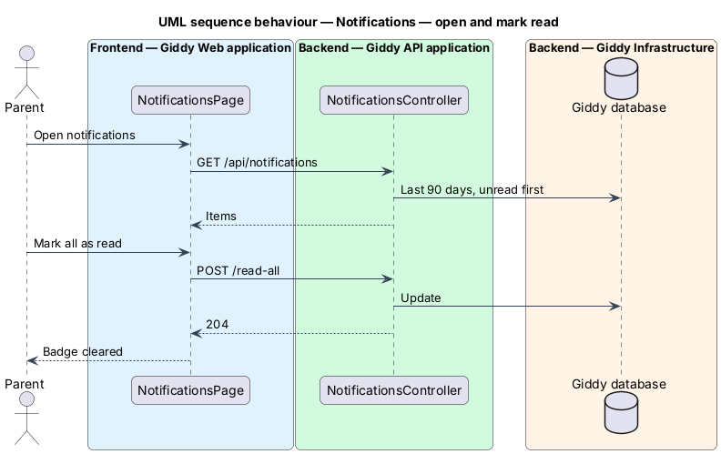

# Notification centre

## Overview

The *notification centre* is the history of what happened: RSVPs, quotes, bookings, reminders and co-planner changes. The bell in the top bar shows the unread count.

- **notification** — stored message for one parent with category, title, body, link, read flag and created time; kept 90 days

This feature belongs to the **Notifications** subsystem. It is designed from the screens in [`docs/mocks`](../../../mocks/README.md) and the L2 requirements listed below.

## Description

The feature is a vertical slice from the Angular web application through the Giddy API to storage and any external services.

**Frontend (Giddy Web)**

- **`NotificationsPage`** — Route `/notifications`; New and Earlier groups; Mark all as read.
- **`BellButton`** — Accessible name includes the unread count.

**Backend (Giddy API)**

- **`NotificationsController`** — `GET /api/notifications`, `POST .../{id}/read`, `POST .../read-all`.
- **`NotificationWriter`** — Event handler creating notifications for each affected parent (including co-planner change events).
- **`NotificationRetentionJob`** — Deletes notifications older than 90 days.

**As built**

- Every message Giddy queues through `NotificationOutbox` is also an item in the centre, under New or Earlier, with a link to what it is about.
- Opening an item marks it read. "Mark all as read" clears the count.
- The top bar's bell is labelled "Notifications, N unread", and the sidebar shows the same count. Both update live.
- Items older than 90 days are deleted by the worker.

## Requirements

The feature realizes the following level-2 (L2) requirements. Each L2 requirement refines the level-1 (L1) requirement cited beside it; the full acceptance criteria are in [`docs/specs/L2.md`](../../../specs/L2.md).

| L2 ID | Refines (L1) | Requirement |
|-------|--------------|-------------|
| `L2-055` | `L1-015` | **Notification centre.** Given notifications, when the parent opens the centre, then new (unread) items are listed first and then earlier ones, each with an icon, title, detail, relative time and a link to the related page; unread items are styled differently and say "unread" to screen readers. |
| `L2-060` | `L1-015` | **Notify co-planners of each other's changes.** Given a co-planner books, sends invites, or changes the budget, when the change is saved, then the other planners of that party receive an in-app notification naming who made the change. |

## Diagrams

### System context

Parents and co-planners receive notifications about each other's changes.

### Containers

Notifications are written from domain events and pushed as unread counts.

### Components

`NotificationWriter` is the single place notifications are created.

### Class structure

Categories match the notification settings.

### Behaviour — open and mark read

Reading updates the badge immediately in every open tab (`L2-055`).

