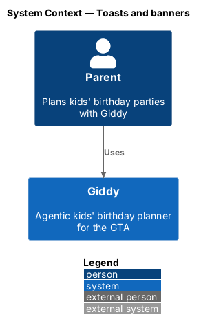
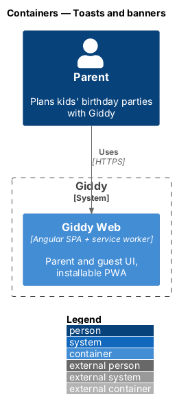
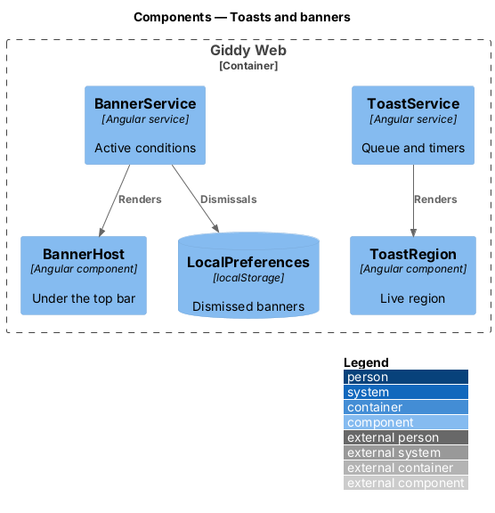
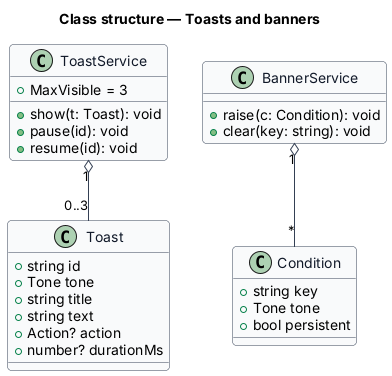
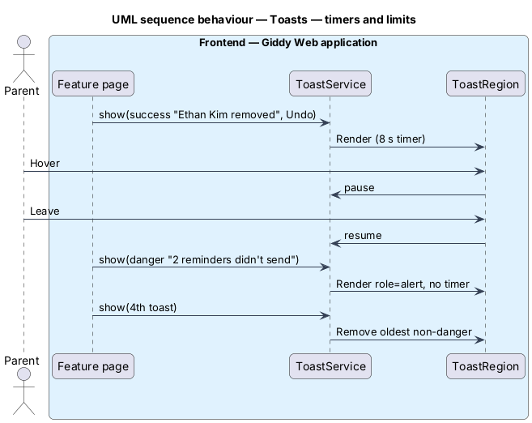

# Toasts and banners

## Overview

Two in-app surfaces carry immediate feedback. *Toasts* report the result of an action or a live event and then get out of the way. *Banners* describe lasting conditions (offline, unverified email, a booking hold) until they end.

- **toast region** — live region present in the DOM before any toast; polite for info and success, assertive for danger

This feature belongs to the **Notifications** subsystem. It is designed from the screens in [`docs/mocks`](../../../mocks/README.md) and the L2 requirements listed below.

## Description

The feature is a vertical slice from the Angular web application through the Giddy API to storage and any external services.

**Frontend (Giddy Web)**

- **`ToastService`** — Queue with max 3 visible; timers 8 s (info, success) and 12 s (warning); danger persistent; pause on hover/focus.
- **`ToastRegion`** — Live region component, positioned above the bottom navigation under 640 px.
- **`BannerService`** — Registry of active conditions; persistent banners have no dismiss; dismissals stored per device and condition.
- **`BannerHost`** — Renders banners under the top bar.

**As built**

**Toasts**
- Toasts last 8 seconds (12 for a warning) and pause while pointed at or focused.
- Danger toasts are alerts and stay until dismissed.
- The toast region shows at most three toasts.

**Banners**
- Banners sit under the top bar: offline, syncing, back online, unverified or bounced email, booking status, push and cookie consent.
- A persistent banner has no dismiss button.
- A dismissed booking banner stays dismissed for that booking on that device (`giddy.dismissed-booking-notices` in local storage).

## Requirements

The feature realizes the following level-2 (L2) requirements. Each L2 requirement refines the level-1 (L1) requirement cited beside it; the full acceptance criteria are in [`docs/specs/L2.md`](../../../specs/L2.md).

| L2 ID | Refines (L1) | Requirement |
|-------|--------------|-------------|
| `L2-056` | `L1-015` | **Toasts.** Given an action completes, when a toast is shown, then it appears in a live region that exists before the toast, bottom-right from 640px wide and full-width above the bottom navigation below that. |
| `L2-057` | `L1-015` | **Banners.** Given a lasting condition (offline, unverified email, a booking hold, a payment problem, a party-day disruption), when the relevant page is shown, then a banner under the top bar describes it and its fix. |

## Diagrams

### System context

This is a frontend-only feature; only the parent and Giddy Web take part.

### Containers

Only the Giddy Web container is involved.

### Components

Services hold state; components render it.

### Class structure

`ToastService` keeps at most three toasts.

### Behaviour — timers and limits

Danger toasts never expire; the oldest non-danger toast leaves when a fourth arrives (`L2-056`).

