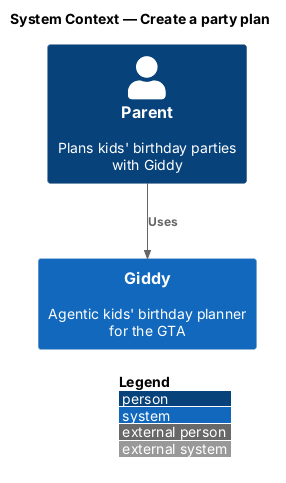
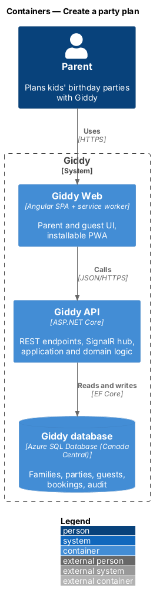
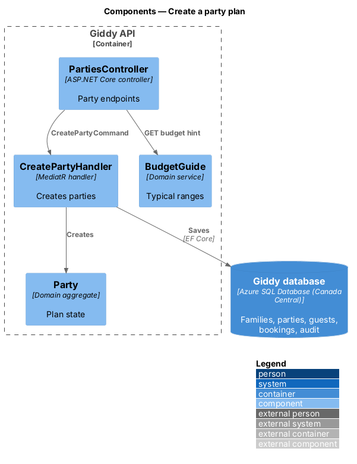
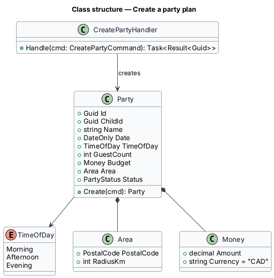
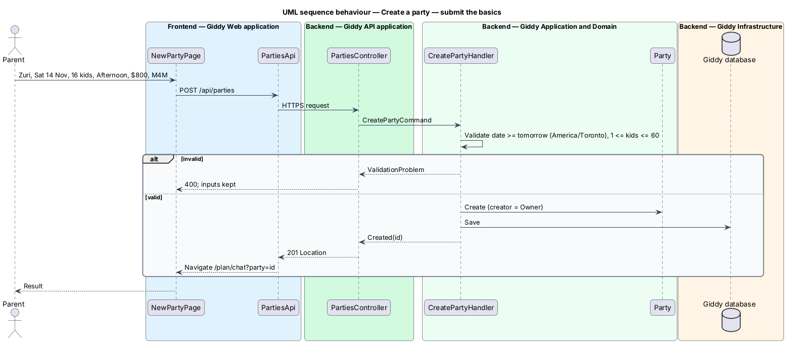

# Create a party plan

## Overview

A *party plan* is the record for one birthday party: the child, date, time of day, number of kids, budget, area and everything planned for it. A parent creates one from Plan a party, then continues in the chat with Giddy.

- **time of day** — Morning (9 am–12 pm), Afternoon (12–4 pm) or Evening (4–7 pm)
- **area** — postal code and search radius, default 10 km

This feature belongs to the **Party plans** subsystem. It is designed from the screens in [`docs/mocks`](../../../mocks/README.md) and the L2 requirements listed below.

## Description

The feature is a vertical slice from the Angular web application through the Giddy API to storage and any external services.

**Frontend (Giddy Web)**

- **`NewPartyPage`** — Route `/parties/new`; child choice cards, date, kids, time of day, budget with typical-range hint, area.
- **`PartiesApi`** — Typed client.

**Backend (Giddy API)**

- **`PartiesController`** — `POST /api/parties`.
- **`CreatePartyHandler`** — Validates and creates the party with the creator as Owner.
- **`Party`** — Aggregate root.
- **`BudgetGuide`** — Returns the typical spend range for a guest count from historical bookings.

**Open points**

- `BudgetGuide` uses Giddy's GTA price guide (a base plus a per-child cost, HST included) until there is enough booking history to replace it.
- Children come from the family (`GET /api/family`); journey 13 adds managing them. The area is resolved from the postal code by `GtaAreas`.

## Requirements

The feature realizes the following level-2 (L2) requirements. Each L2 requirement refines the level-1 (L1) requirement cited beside it; the full acceptance criteria are in [`docs/specs/L2.md`](../../../specs/L2.md).

| L2 ID | Refines (L1) | Requirement |
|-------|--------------|-------------|
| `L2-010` | `L1-003` | **Create a party plan.** Given a parent on "Plan a new party", when they choose a child (or "Someone else"), a date from tomorrow onwards, a number of kids from 1 to 60, a time of day (morning, afternoon or evening), a budget in dollars and an area, then a party plan is created and the parent is taken to Ask Giddy with these details as context. |

## Diagrams

### System context

Only the parent and Giddy take part.

### Containers

A standard web → API → database slice.

### Components

`BudgetGuide` supplies the hint; `CreatePartyHandler` creates the aggregate.

### Class structure

`Party` composes `Area` and `Money` value objects.

### Behaviour — submit the basics

Dates shall be from tomorrow in Toronto time and the guest count 1–60; success opens Ask Giddy with the party as context (`L2-010`).

