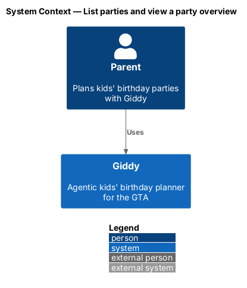
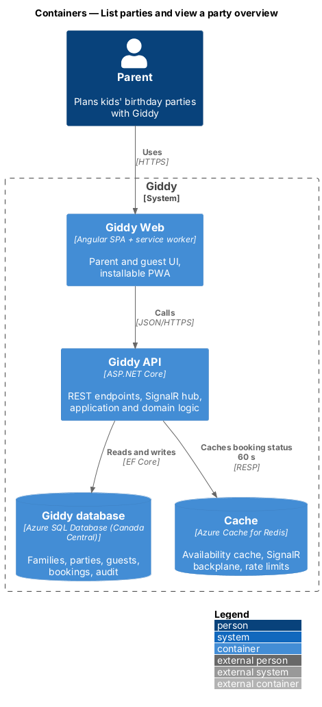
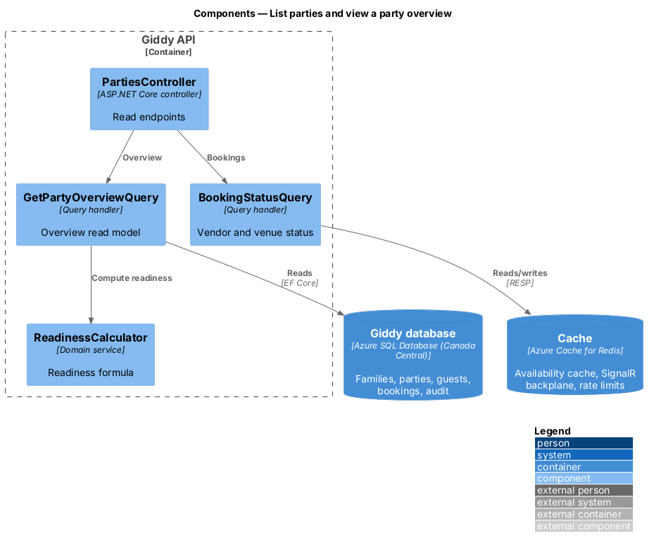
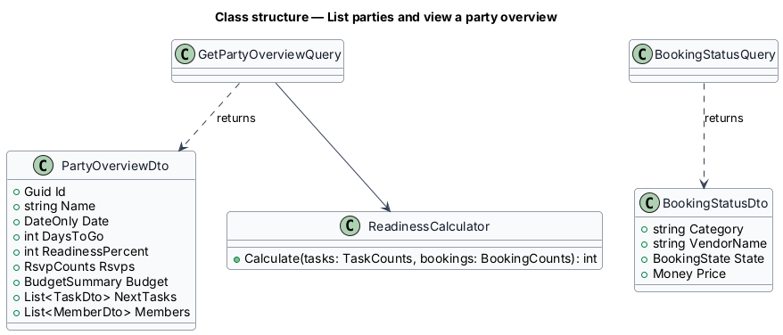
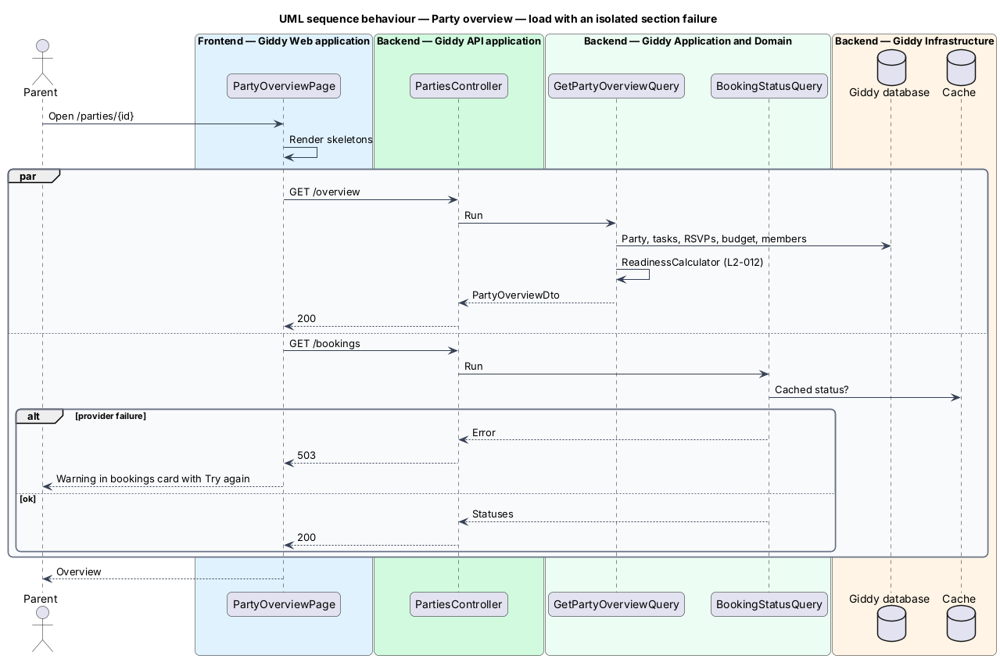

# List parties and view a party overview

## Overview

*My parties* groups a parent's parties into Upcoming, Drafts and Past. The *party overview* is the hub for one party: countdown, readiness, bookings, next tasks, guests, budget and co-planners.

*Readiness* is a single percentage shown on Home, My parties and the overview so the parent sees one consistent number.

- **readiness** — (completed tasks + confirmed bookings) ÷ (total tasks + planned bookings), rounded to the nearest whole percent
- **partial failure** — one section's data source fails while the rest of the page renders

This feature belongs to the **Party plans** subsystem. It is designed from the screens in [`docs/mocks`](../../../mocks/README.md) and the L2 requirements listed below.

## Description

The feature is a vertical slice from the Angular web application through the Giddy API to storage and any external services.

**Frontend (Giddy Web)**

- **`PartiesPage`** — Route `/parties`.
- **`PartyOverviewPage`** — Route `/parties/{id}`; loads sections independently so one failure stays local.
- **`PartyHero`** — Countdown, readiness ring, facts.

**Backend (Giddy API)**

- **`PartiesController`** — `GET /api/parties`, `GET /api/parties/{id}/overview`, `GET /api/parties/{id}/bookings`.
- **`GetPartyOverviewQuery`** — Read model joining party, tasks, RSVPs, budget and members.
- **`ReadinessCalculator`** — Domain service implementing the readiness formula.
- **`BookingStatusQuery`** — Separate query for vendor and venue status so it can fail independently.

## Requirements

The feature realizes the following level-2 (L2) requirements. Each L2 requirement refines the level-1 (L1) requirement cited beside it; the full acceptance criteria are in [`docs/specs/L2.md`](../../../specs/L2.md).

| L2 ID | Refines (L1) | Requirement |
|-------|--------------|-------------|
| `L2-011` | `L1-003` | **Party list.** Given a parent with parties, when they open My parties, then parties are grouped into Upcoming (with countdown and readiness), Drafts and Past, each sorted by date, and the subtitle shows the count in each group. |
| `L2-012` | `L1-003` | **Party overview and readiness.** Given a party, when the overview loads, then it shows the countdown in days, date, time, venue, invited count, a readiness percentage, the booking status of each planned item (venue, entertainer, cake, food, loot bags) with price, the next three checklist tasks, RSVP counts, the allergy list, the budget summary and the co-planners. |

## Diagrams

### System context

Only the parent and Giddy take part; vendor status comes from Giddy's own cache of partner data.

### Containers

Booking status is cached in Redis for 60 seconds.

### Components

Two independent query handlers back the page so each can fail alone.

### Class structure

DTOs are read models; `ReadinessCalculator` holds the only copy of the formula.

### Behaviour — load with an isolated section failure

The page requests the overview and the booking status separately; when booking status fails, only that card shows a warning (`L2-012`, `L2-087`).

