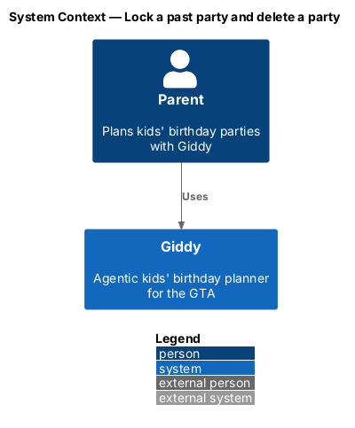
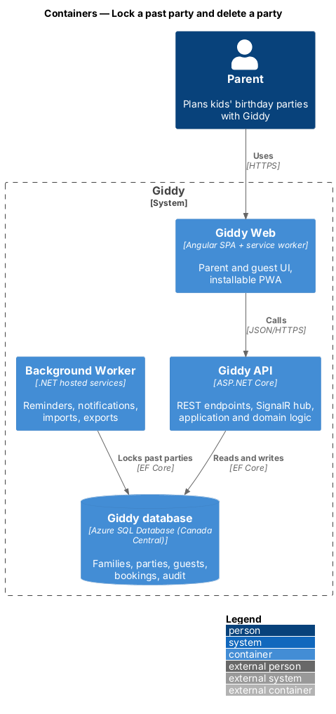
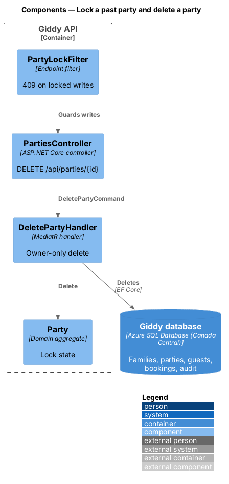
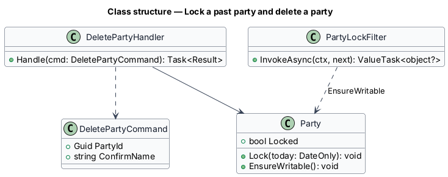
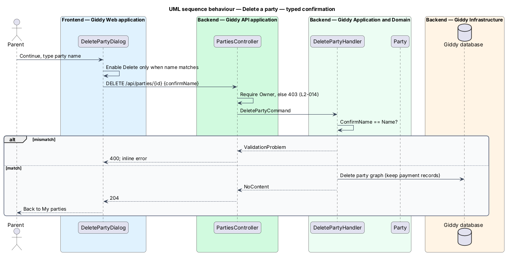
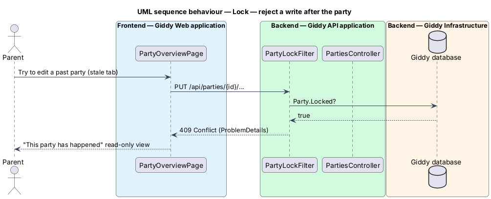

# Lock a past party and delete a party

## Overview

After a party's date passes, its plan becomes a *locked* read-only record, open only to wrap-up. Separately, an owner may delete a party after a two-step confirmation that states what is lost.

- **locked** — state of a party whose date is before today in America/Toronto; writes other than wrap-up return HTTP 409

This feature belongs to the **Party plans** subsystem. It is designed from the screens in [`docs/mocks`](../../../mocks/README.md) and the L2 requirements listed below.

## Description

The feature is a vertical slice from the Angular web application through the Giddy API to storage and any external services.

**Frontend (Giddy Web)**

- **`DeletePartyDialog`** — Two steps: consequences with Cancel focused, then typed party name.
- **`PartyOverviewPage`** — Shows the locked alert and hides edit controls.

**Backend (Giddy API)**

- **`PartyLockFilter`** — Endpoint filter returning 409 for writes to locked parties.
- **`DeletePartyHandler`** — Owner-only; deletes the party and dependent data, keeps payment records.
- **`PartyLockJob`** — Worker job at 00:05 Toronto time that sets `Locked` on yesterday's parties.

## Requirements

The feature realizes the following level-2 (L2) requirements. Each L2 requirement refines the level-1 (L1) requirement cited beside it; the full acceptance criteria are in [`docs/specs/L2.md`](../../../specs/L2.md).

| L2 ID | Refines (L1) | Requirement |
|-------|--------------|-------------|
| `L2-013` | `L1-003` | **Lock a plan after the party.** Given a party whose date has passed in America/Toronto time, when anyone opens it, then all editing, booking and sending controls are removed, an info alert says the plan is read-only, and links to Wrap-up and "Reuse this plan" are shown. |
| `L2-014` | `L1-003` | **Delete a party.** Given a party owner chooses "Delete this party", when the first dialog opens, then it states exactly what will be lost (guest list, RSVPs, budget, checklist, chat), says guests will not be notified, warns about any live bookings and deposits, and focuses Cancel. |

## Diagrams

### System context

Only parents and Giddy take part.

### Containers

The worker locks parties nightly; the API enforces the lock.

### Components

An endpoint filter enforces the lock for every write endpoint on a party.

### Class structure

`Party.EnsureWritable` is the single lock check.

### Behaviour — typed confirmation

The server re-checks the owner role and the exact name; bookings are not cancelled (`L2-014`).

### Behaviour — reject a write after the party

Once the nightly job has locked a party, the filter rejects writes before any handler runs (`L2-013`).

