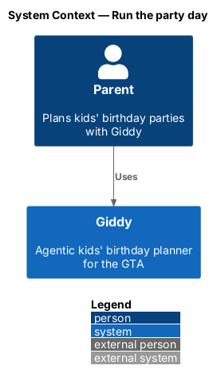
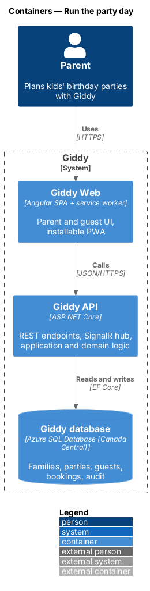
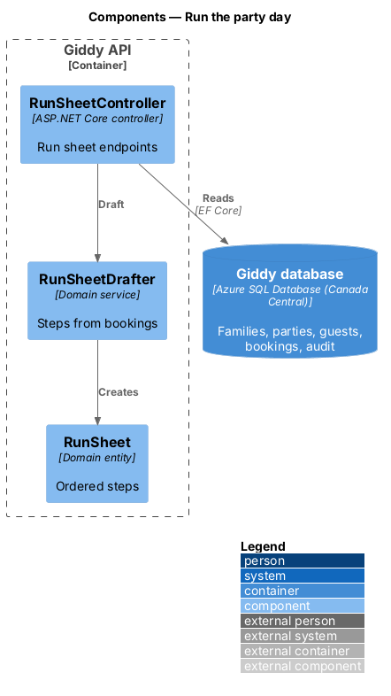
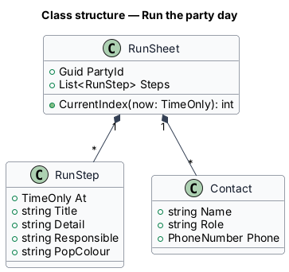
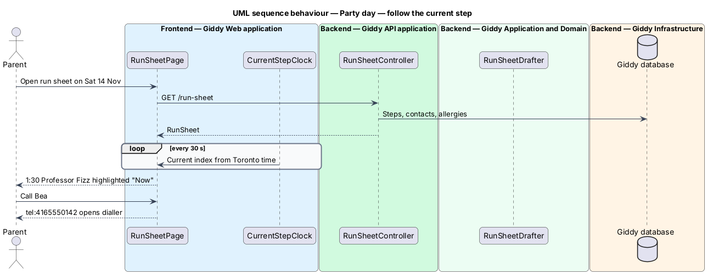

# Run the party day

## Overview

The *run sheet* is the minute-by-minute plan for the party: set-up, arrivals, the show, food, cake, loot bags and pick-up, with quick-call buttons and the allergy list. On the day, the current step is highlighted and advances on its own.

- **run step** — timed entry with what happens, who is responsible and one key reminder

This feature belongs to the **Party day** subsystem. It is designed from the screens in [`docs/mocks`](../../../mocks/README.md) and the L2 requirements listed below.

## Description

The feature is a vertical slice from the Angular web application through the Giddy API to storage and any external services.

**Frontend (Giddy Web)**

- **`RunSheetPage`** — Route `/parties/{id}/day`; timeline with Now/Done, quick calls as `tel:` links, allergy check.
- **`CurrentStepClock`** — Signal that recomputes the current step every 30 s from local Toronto time.

**Backend (Giddy API)**

- **`RunSheetController`** — `GET /api/parties/{id}/run-sheet`, `POST .../run-sheet/draft`.
- **`RunSheetDrafter`** — Builds steps from bookings, vendor times and allergies.
- **`RunSheet`** — Entity holding ordered `RunStep`s.

## Requirements

The feature realizes the following level-2 (L2) requirements. Each L2 requirement refines the level-1 (L1) requirement cited beside it; the full acceptance criteria are in [`docs/specs/L2.md`](../../../specs/L2.md).

| L2 ID | Refines (L1) | Requirement |
|-------|--------------|-------------|
| `L2-050` | `L1-013` | **Party-day run sheet.** Given a party with bookings, when Giddy drafts the run sheet, then it lists timed steps from set-up to pick-up, each with what happens, who is responsible and the key reminder (for example gluten-free slice for Hana), plus quick-call buttons for the venue host and each vendor and the allergy list. |

## Diagrams

### System context

Only the parent and Giddy take part.

### Containers

A standard read slice; offline behaviour is covered by Work offline.

### Components

`RunSheetDrafter` turns bookings into steps.

### Class structure

`RunSheet.CurrentIndex` is the single current-step rule.

### Behaviour — follow the current step

The page computes the current step locally, so it advances even without a connection (`L2-050`).

