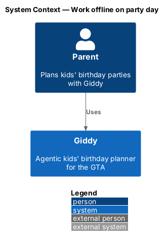
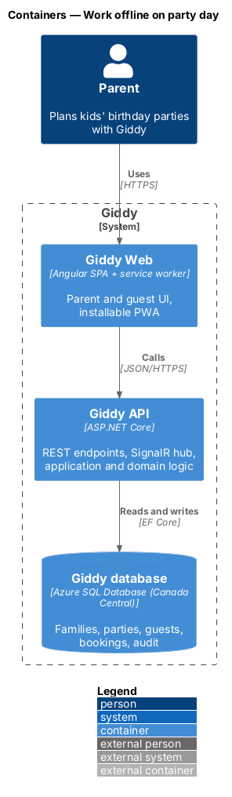
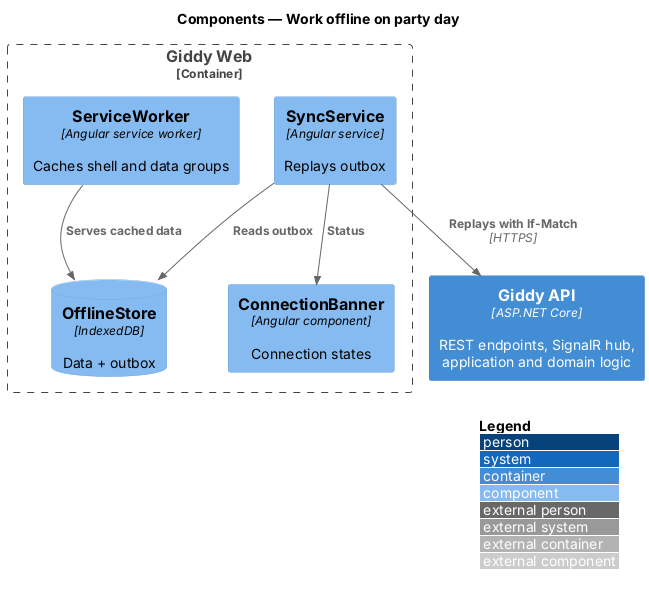
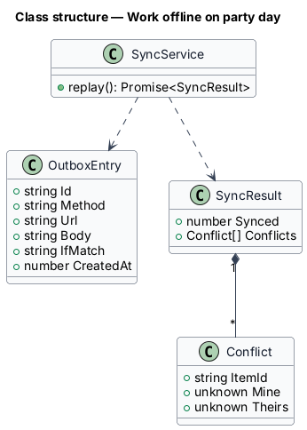
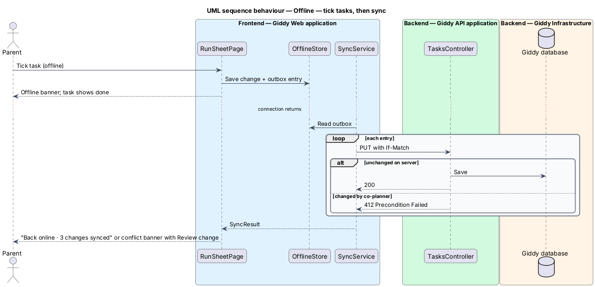

# Work offline on party day

## Overview

Venues often have poor signal. The web app is a *progressive web app* whose service worker caches the run sheet, contacts, allergy list and checklist on the device; ticks made offline sync later and conflicts are shown for the parent to resolve.

- **outbox** — IndexedDB queue of changes made offline, replayed in order when online
- **conflict** — change made offline to an item that a co-planner changed in the meantime

This feature belongs to the **Party day** subsystem. It is designed from the screens in [`docs/mocks`](../../../mocks/README.md) and the L2 requirements listed below.

## Description

The feature is a vertical slice from the Angular web application through the Giddy API to storage and any external services.

**Frontend (Giddy Web)**

- **`ServiceWorker`** — Angular service worker; caches the app shell and data groups for run sheet, contacts and checklist for 7 days.
- **`OfflineStore`** — IndexedDB store of party-day data and the outbox.
- **`SyncService`** — Replays the outbox with `If-Match` ETags; collects 412 conflicts.
- **`ConnectionBanner`** — Offline, syncing, back-online and conflict banners.

**Backend (Giddy API)**

- **`TasksController`** — Returns ETags and honours `If-Match` (412 on conflict).

## Requirements

The feature realizes the following level-2 (L2) requirements. Each L2 requirement refines the level-1 (L1) requirement cited beside it; the full acceptance criteria are in [`docs/specs/L2.md`](../../../specs/L2.md).

| L2 ID | Refines (L1) | Requirement |
|-------|--------------|-------------|
| `L2-051` | `L1-013` | **Run sheet works offline.** Given the parent has opened the run sheet on a device at least once in the 7 days before the party, when the device is offline, then the run sheet, contacts, allergy list and checklist load from the device with an offline banner. |

## Diagrams

### System context

Only the parent and Giddy take part.

### Containers

The work happens in the browser; the API only enforces optimistic concurrency.

### Components

Inside Giddy Web, the service worker and IndexedDB store keep party-day data usable offline.

### Class structure

Each `OutboxEntry` carries the ETag it was based on.

### Behaviour — tick tasks, then sync

Offline changes queue locally and replay with ETags; a 412 becomes a conflict the parent resolves (`L2-051`, `L2-076`).

