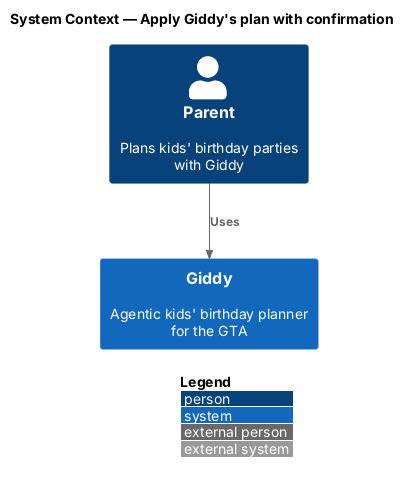
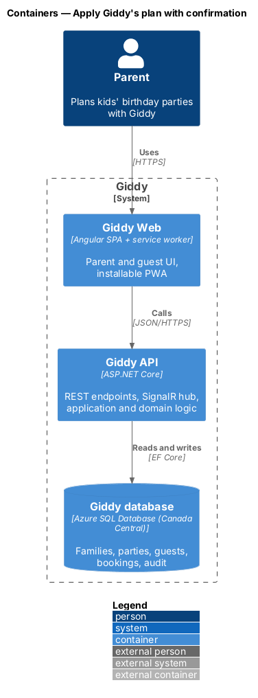
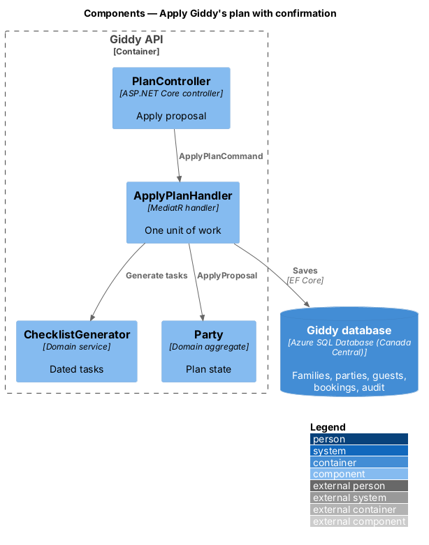
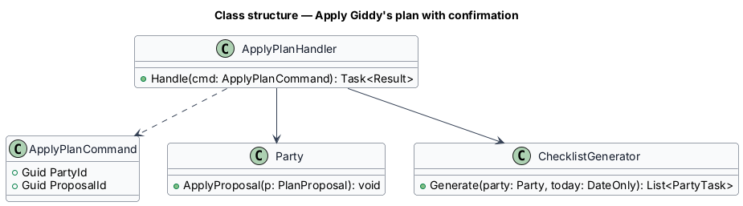
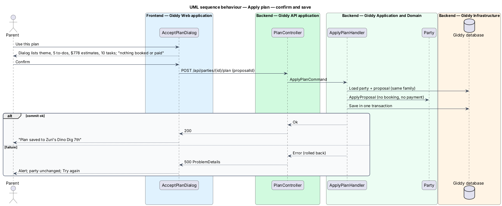

# Apply Giddy's plan with confirmation

## Overview

A proposal changes nothing until the parent applies it. *Use this plan* opens a confirmation dialog listing every change; only after confirmation does the API update the party. Giddy never books, pays, sends invitations or contacts vendors itself.

- **plan application** — single transaction that sets the theme, creates booking to-dos, budget estimates and the dated checklist from a proposal

This feature belongs to the **Planning agent** subsystem. It is designed from the screens in [`docs/mocks`](../../../mocks/README.md) and the L2 requirements listed below.

## Description

The feature is a vertical slice from the Angular web application through the Giddy API to storage and any external services.

**Frontend (Giddy Web)**

- **`AcceptPlanDialog`** — Lists changes; states nothing is booked or paid; busy and failed states.
- **`PartiesApi`** — `POST /api/parties/{id}/plan`.

**Backend (Giddy API)**

- **`PlanController`** — Applies a stored proposal by ID.
- **`ApplyPlanHandler`** — Loads the proposal, checks it belongs to the party, applies it in one unit of work.
- **`ChecklistGenerator`** — Creates dated tasks working back from the party date.
- **`Party`** — Aggregate receiving the theme, items and budget estimates.

## Requirements

The feature realizes the following level-2 (L2) requirements. Each L2 requirement refines the level-1 (L1) requirement cited beside it; the full acceptance criteria are in [`docs/specs/L2.md`](../../../specs/L2.md).

| L2 ID | Refines (L1) | Requirement |
|-------|--------------|-------------|
| `L2-018` | `L1-004` | **Apply agent changes only with confirmation.** Given a proposal, when the parent chooses "Use this plan", then a confirmation dialog lists every change that will be made (theme, bookings to do, budget estimates, checklist) and states that nothing is booked or paid yet. |

## Diagrams

### System context

Only the parent and Giddy take part; no external booking happens here.

### Containers

A standard web → API → database slice; the agent is not involved in applying.

### Components

`ApplyPlanHandler` is the only path from a proposal to party data.

### Class structure

`Party.ApplyProposal` performs the change; the generator adds tasks.

### Behaviour — confirm and save

All changes commit together or not at all; a failure leaves the party exactly as it was (`L2-018`).

