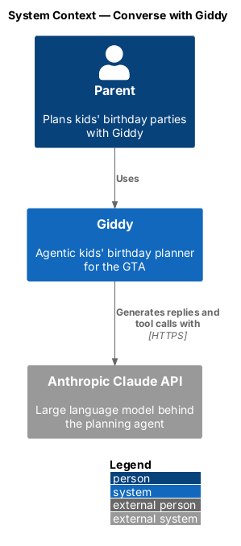
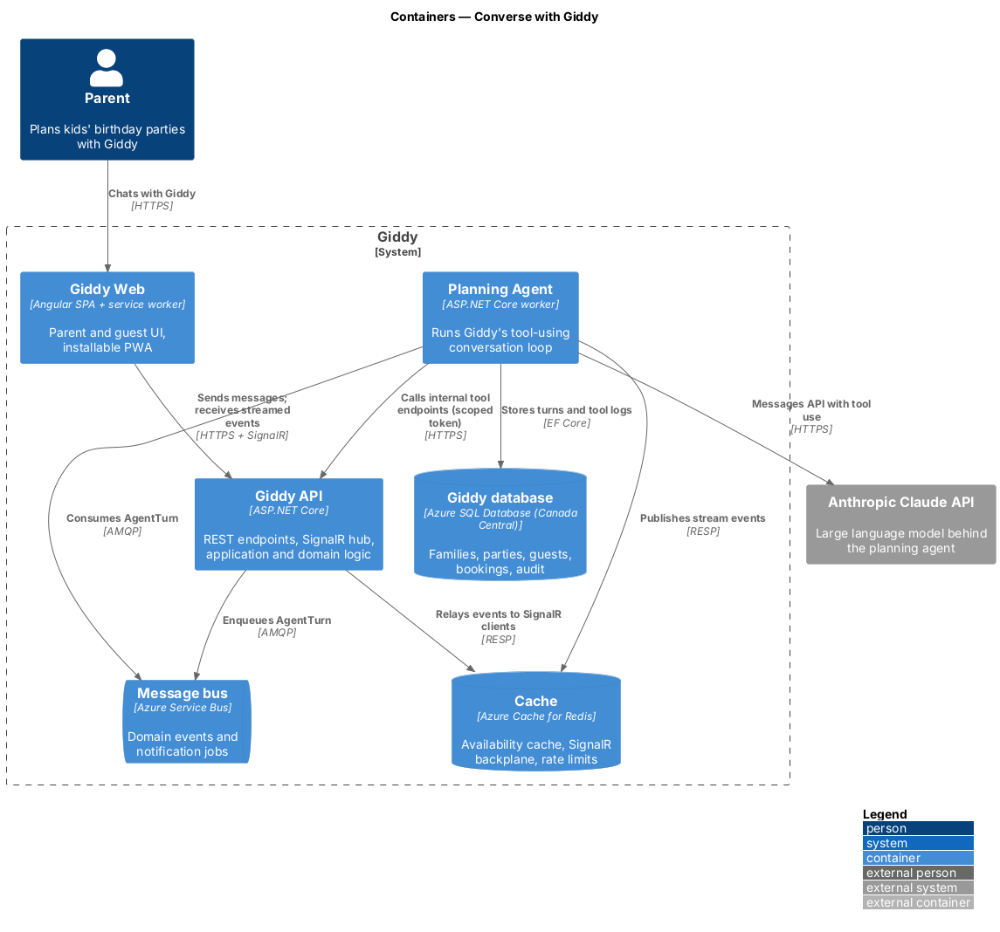
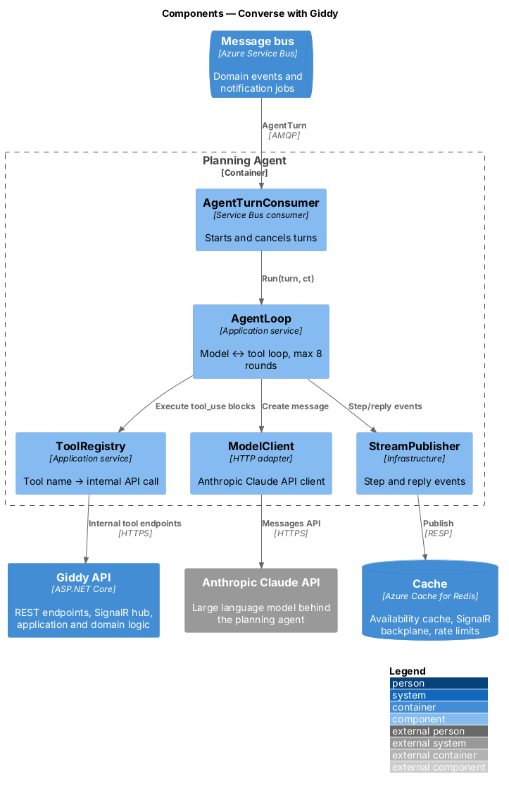
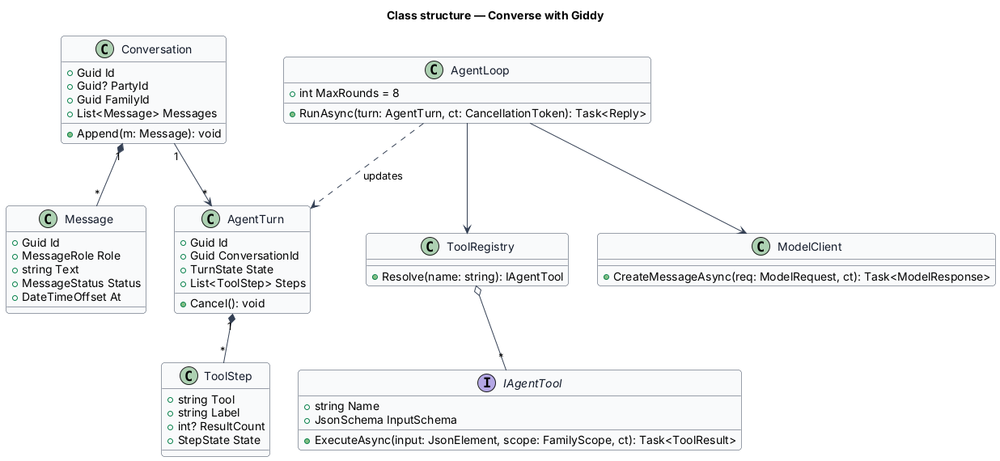
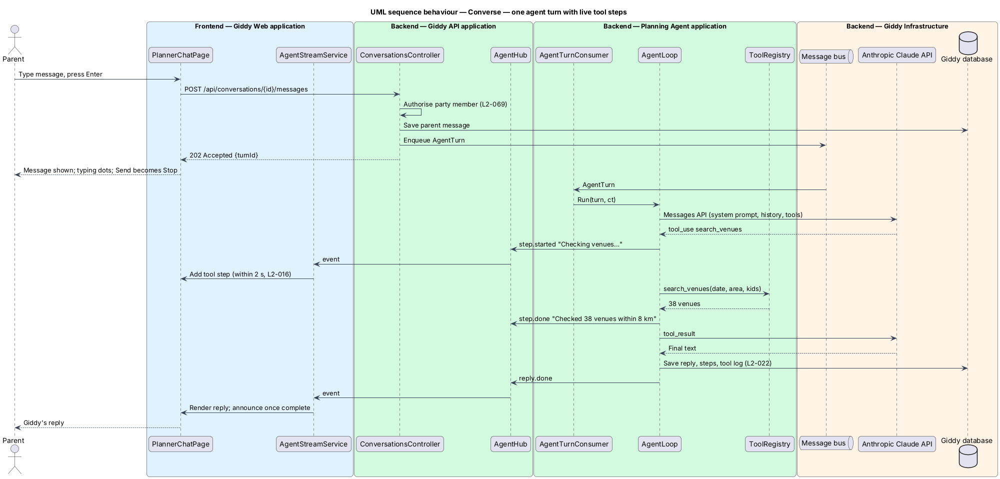
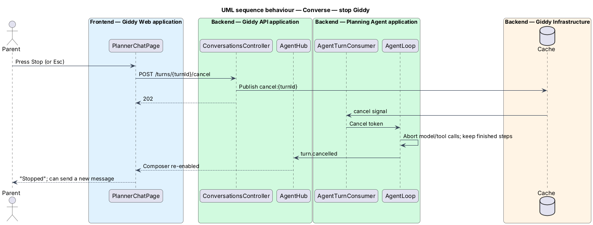
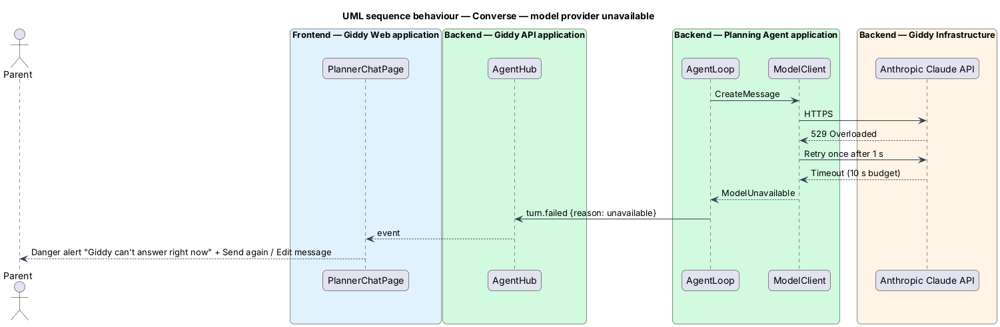

# Converse with Giddy

## Overview

*Giddy* is the planning agent: a conversational assistant that plans a party by calling tools (venue search, vendor comparison, bakery search) and proposing a priced plan. This feature covers the conversation itself: sending messages, streaming Giddy's work as it happens, stopping it, and recovering from failures.

Each parent message starts an *agent turn*. A turn runs in the Planning Agent container, not in the API request, so long-running tool use never blocks a web request. Progress reaches the browser as a stream of events over SignalR.

- **agent turn** — one cycle in which Giddy reads the conversation, calls zero or more tools and writes one reply
- **tool step** — visible line in Giddy's reply describing one tool call and, when finished, its result count
- **conversation** — ordered log of parent messages and Giddy replies for one party or a new chat

This feature belongs to the **Planning agent** subsystem. It is designed from the screens in [`docs/mocks`](../../../mocks/README.md) and the L2 requirements listed below.

## Description

The feature is a vertical slice from the Angular web application through the Giddy API to storage and any external services.

**Frontend (Giddy Web)**

- **`PlannerChatPage`** — Route `/plan/chat`; chat log (`ol` with `aria-live="polite"`), composer, Party-at-a-glance aside from 1024 px.
- **`ChatComposer`** — Textarea; Enter sends, Shift+Enter adds a line; Send becomes Stop while a turn runs; Esc stops.
- **`AgentStreamService`** — SignalR client subscribing to `conversation:{id}` events: `step.started`, `step.done`, `reply.delta`, `reply.done`, `turn.failed`.
- **`ConversationApi`** — Typed client for `/api/conversations`.

**Backend (Giddy API)**

- **`ConversationsController`** — `POST /api/conversations/{id}/messages` (returns 202 with turn id), `POST /api/conversations/{id}/turns/{turnId}/cancel`, `GET /api/conversations/{id}`.
- **`AgentHub`** — SignalR hub; authorises the caller for the conversation's party before joining its group.
- **`StartTurnHandler`** — Saves the parent message, enqueues `AgentTurn` on the bus.

**Backend (Planning Agent)**

- **`AgentTurnConsumer`** — Consumes `AgentTurn`; runs the loop with a cancellation token tied to the cancel endpoint.
- **`AgentLoop`** — Calls the Claude Messages API with the system prompt, conversation and tool definitions; executes requested tools; repeats until a final reply or 8 tool rounds.
- **`ToolRegistry`** — Maps tool names (`search_venues`, `compare_entertainers`, `find_bakeries`, `get_party`, `estimate_budget`) to internal API calls.
- **`StreamPublisher`** — Publishes step and reply events to Redis for the hub to relay.
- **`ModelClient`** — HTTP client for the Anthropic Claude API with 10 s connect and 60 s overall timeouts and one retry on 529/overloaded.

**Open points**

- Model ID and version pinning policy for the Claude API `<TO SUPPLY>`
- System prompt text and its review process `<TO SUPPLY>`

## Requirements

The feature realizes the following level-2 (L2) requirements. Each L2 requirement refines the level-1 (L1) requirement cited beside it; the full acceptance criteria are in [`docs/specs/L2.md`](../../../specs/L2.md).

| L2 ID | Refines (L1) | Requirement |
|-------|--------------|-------------|
| `L2-015` | `L1-004` | **Converse with the planning agent.** Given a parent opens a new conversation, when it loads, then Giddy greets them by name, explains what it can plan, and offers at least four starter prompts as chips; choosing a chip sends it as the parent's message. |
| `L2-016` | `L1-004` | **Show the agent's work while it plans.** Given Giddy is working on a request, when it starts each tool (venue search, entertainer comparison, bakery search and similar), then a step appears in the reply describing it in plain words, and it is ticked when that tool finishes, including the number of results checked (for example "Checked 38 venues within 8 km for Sat 14 Nov afternoon"). |
| `L2-020` | `L1-004` | **Agent message failures.** Given a message cannot be delivered, when the failure is detected, then the message stays in the log, a danger alert says it was not sent, and "Send again" and "Edit message" are offered. |

## Diagrams

### System context

Parents chat with Giddy; Giddy uses the Anthropic Claude API to understand requests and decide which tools to call.

### Containers

The API only accepts and authorises messages; the Planning Agent runs turns from a queue, calls the model and Giddy's own internal tool endpoints, and streams events back through Redis and the SignalR hub.

### Components

Inside the Planning Agent, `AgentLoop` alternates between the model and `ToolRegistry` until the reply is final or 8 rounds pass.

### Class structure

A `Conversation` holds messages and turns; each `AgentTurn` records its `ToolStep`s; tools implement `IAgentTool` with a JSON input schema.

### Behaviour — one agent turn with live tool steps

The API accepts the message in under 300 ms and returns 202; the agent streams each tool step and the reply through the hub, so the first visible progress appears within 2 seconds (`L2-015`, `L2-016`).

### Behaviour — stop Giddy

Stop or Esc cancels the turn within 1 second; completed steps stay in the log (`L2-016`).

### Behaviour — model provider unavailable

When the provider fails after one retry, the turn fails within 10 seconds, the parent's message stays with Send again and Edit, and the rest of the app keeps working (`L2-020`).

