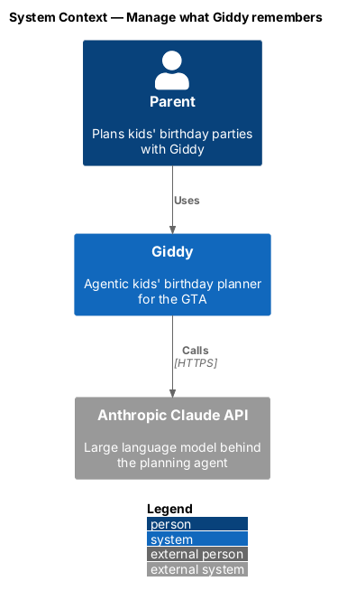
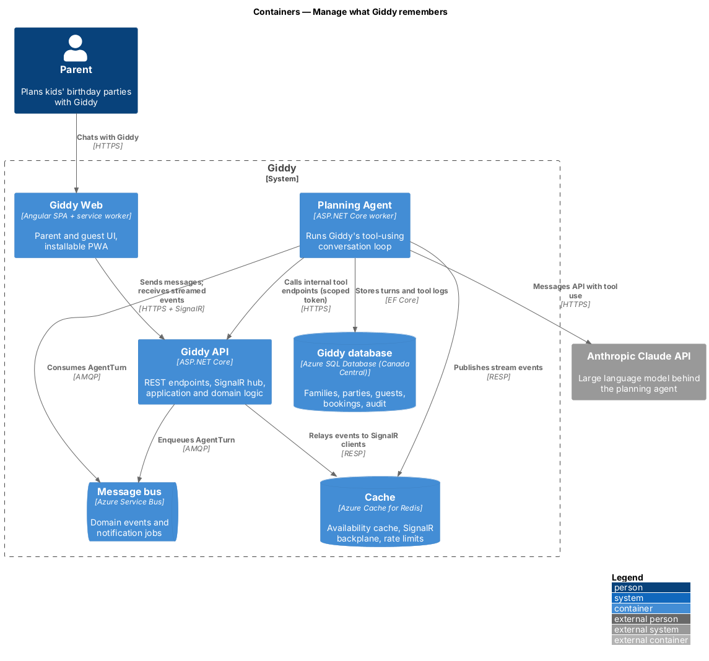
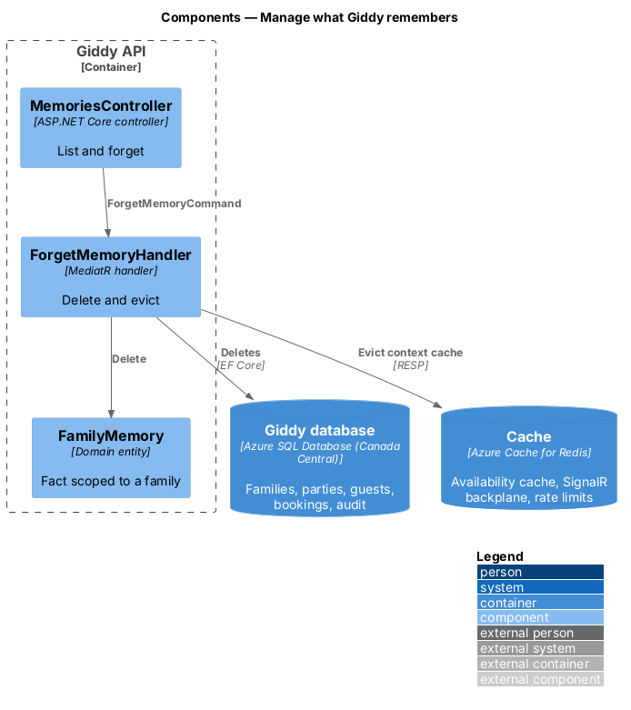
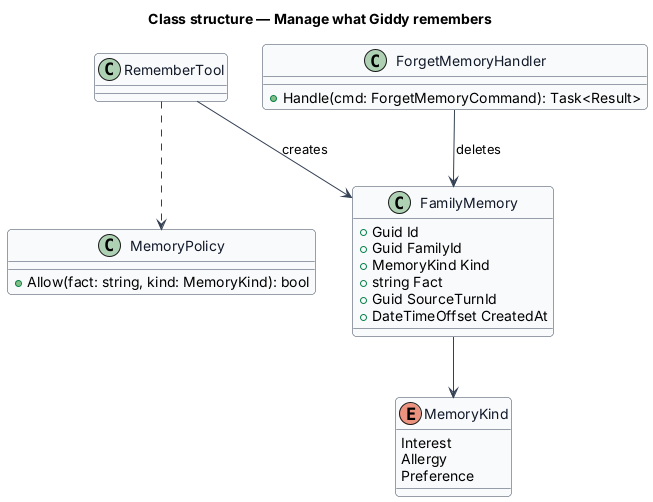
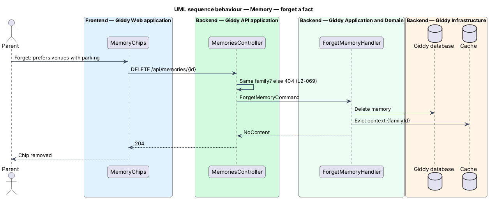

# Manage what Giddy remembers

## Overview

Giddy remembers lasting facts about a family (a child's interests, a guest's allergy, a venue preference) so later plans start better. Parents see these *memories* in the chat and in Settings and can remove any of them.

- **memory** — short fact with a source turn, scoped to one family, injected into the agent's context for that family only

This feature belongs to the **Planning agent** subsystem. It is designed from the screens in [`docs/mocks`](../../../mocks/README.md) and the L2 requirements listed below.

## Description

The feature is a vertical slice from the Angular web application through the Giddy API to storage and any external services.

**Planning Agent**

- **`RememberTool`** — Tool the model calls to store a fact; facts go through `MemoryPolicy` first.
- **`MemoryPolicy`** — Allows facts about preferences, interests and allergies; rejects contact details, payment data and anything about other families.

**Backend (Giddy API)**

- **`MemoriesController`** — `GET /api/memories`, `DELETE /api/memories/{id}`.
- **`ForgetMemoryHandler`** — Deletes the memory and evicts agent context caches.

**Frontend (Giddy Web)**

- **`GiddyKnowsCard`** — Chat aside list.
- **`MemoryChips`** — Settings chips with “Forget: …” buttons.

## Requirements

The feature realizes the following level-2 (L2) requirements. Each L2 requirement refines the level-1 (L1) requirement cited beside it; the full acceptance criteria are in [`docs/specs/L2.md`](../../../specs/L2.md).

| L2 ID | Refines (L1) | Requirement |
|-------|--------------|-------------|
| `L2-021` | `L1-004` | **Agent memory.** Given a parent states a lasting preference or fact (a child's interest, a guest's allergy, a venue preference), when Giddy stores it, then it appears in "Giddy knows" in the chat and in Settings under "What Giddy remembers". |
| `L2-066` | `L1-017` | **Manage what Giddy remembers.** Given Settings, when the parent views "What Giddy remembers", then every stored memory is listed as a removable chip, each remove button named "Forget: <memory>". |

## Diagrams

### System context

Memories inform the prompts Giddy sends to the Claude API for that family only.

### Containers

Memories are stored in the database and cached as part of the agent's per-family context.

### Components

Forgetting deletes the row and evicts the cache entry in one handler.

### Class structure

Each memory has a kind and the turn it came from.

### Behaviour — forget a fact

Deletion removes the row and evicts cached agent context, so Giddy stops using the fact at once and within the 24-hour deadline at the latest (`L2-021`, `L2-066`).

