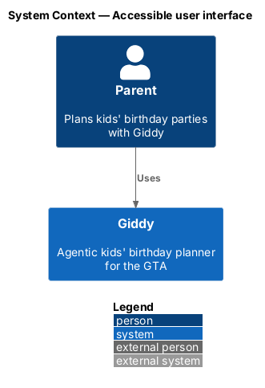
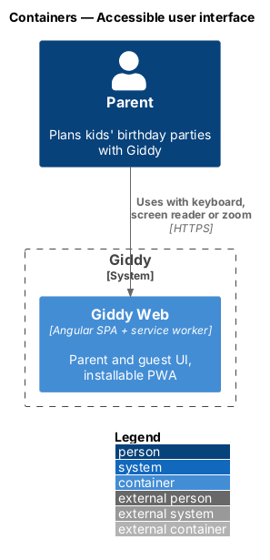
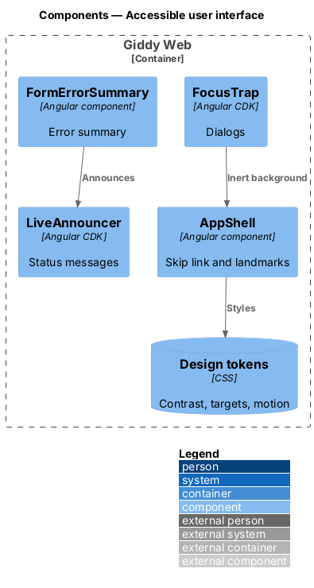
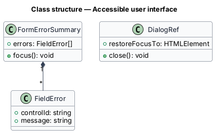
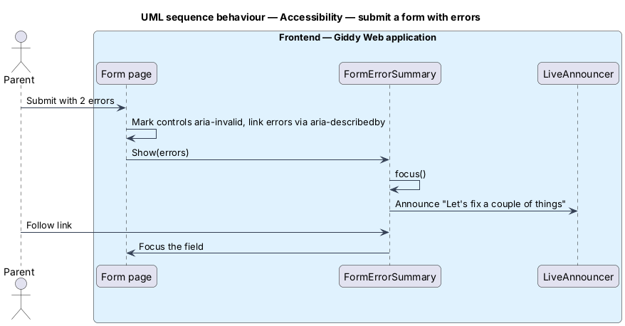

# Accessible user interface

## Overview

Giddy conforms to WCAG 2.2 AA. The design system already encodes most rules (contrast-checked tokens, one focus ring, 24/44 px targets, reduced motion); this feature describes how the Angular app applies them and how CI proves it.

- **APG** — WAI-ARIA Authoring Practices Guide, the reference for widget keyboard behaviour

This feature belongs to the **Platform and cross-cutting concerns** subsystem. It is designed from the screens in [`docs/mocks`](../../../mocks/README.md) and the L2 requirements listed below.

## Description

The feature is a vertical slice from the Angular web application through the Giddy API to storage and any external services.

**Frontend (Giddy Web)**

- **`SkipLink + Landmarks`** — Shell template with skip link, header, nav, main, footer; route titles set per page.
- **`FocusTrap`** — Angular CDK `cdkTrapFocus` for dialogs; focus restore on close.
- **`LiveAnnouncer`** — Angular CDK announcer for toasts and chat.
- **`FormErrorSummary`** — Component that collects control errors, links to fields and receives focus on submit.
- **`ReducedMotion`** — Tokens zero durations; components avoid JS animation under `prefers-reduced-motion`.

**CI**

- **`axe-core (Playwright)`** — Runs on every route and mock state; fails on serious or critical issues.
- **`check_contrast.py`** — Verifies every pair in `contrast-pairs.json` in both themes.

## Requirements

The feature realizes the following level-2 (L2) requirements. Each L2 requirement refines the level-1 (L1) requirement cited beside it; the full acceptance criteria are in [`docs/specs/L2.md`](../../../specs/L2.md).

| L2 ID | Refines (L1) | Requirement |
|-------|--------------|-------------|
| `L2-079` | `L1-020` | **Keyboard and screen-reader access.** Given any page, when it loads, then a "Skip to content" link is the first focusable element, landmarks (header, navigation, main, footer) are present, there is exactly one `h1`, and heading levels do not skip. |
| `L2-080` | `L1-020` | **Contrast, colour and text.** Given text, when it is shown in either theme, then it has a contrast ratio of at least 4.5:1 (3:1 for large text), and input borders, icons that carry meaning and focus indicators have at least 3:1; `check_contrast.py` passes for every pair in `docs/design-system/tokens/contrast-pairs.json`. |
| `L2-081` | `L1-020` | **Forms and errors are accessible.** Given any form control, when it is rendered, then it has a visible label, optional fields say "(optional)", and help and error text are linked with `aria-describedby`. |
| `L2-082` | `L1-020` | **Motion and timing.** Given the operating system's reduced-motion setting is on, when any page is used, then transitions and decorative animations do not run, skeleton shimmer is static, and only status indicators (spinners) move. |
| `L2-083` | `L1-020` | **Touch targets.** Given any interactive target, when measured, then it is at least 24 by 24 CSS pixels, and primary actions and navigation items on touch screens are at least 44px tall. |

## Diagrams

### System context

Accessibility is internal to the web application.

### Containers

Only Giddy Web is involved.

### Components

Shared Angular components implement the WCAG commitments once.

### Class structure

The summary holds one `FieldError` per invalid control.

### Behaviour — submit a form with errors

Invalid fields get `aria-invalid`, the summary receives focus and links to each field (`L2-081`).

