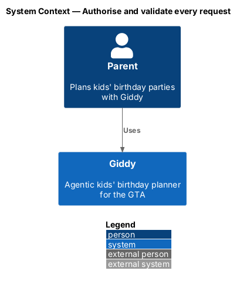
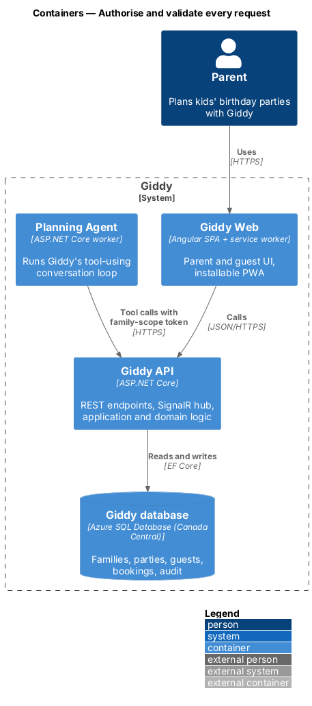
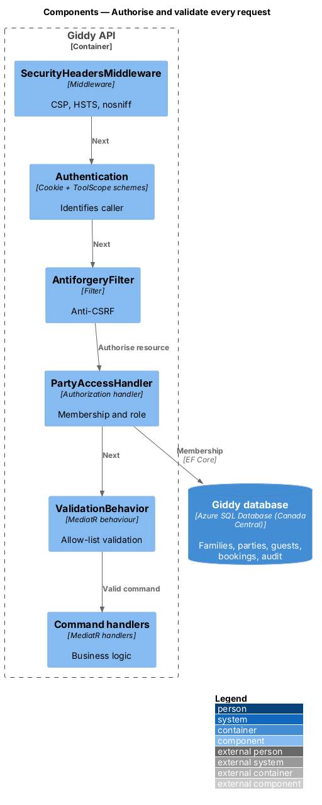
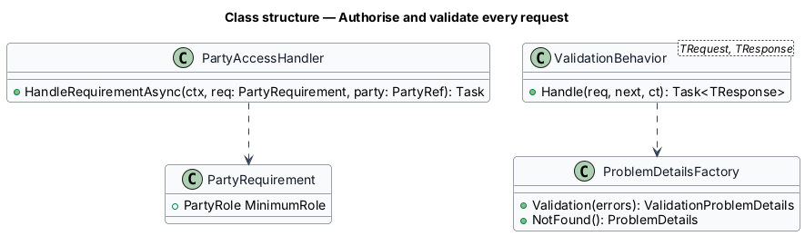
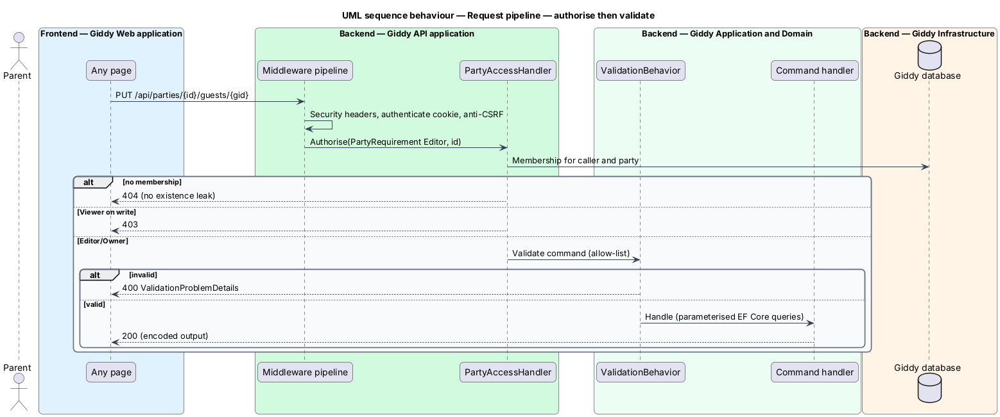

# Authorise and validate every request

## Overview

Every party-scoped request is checked against the caller's *membership* of that party and its role before any data is read or written. Every input is validated on the server against an allow-list schema, and every output is encoded. The same pipeline applies to the Planning Agent's tool calls.

- **family scope** — token issued to the Planning Agent for one turn, limited to the requesting family's parties
- **resource-based authorisation** — ASP.NET Core authorisation that evaluates a policy against the loaded resource

This feature belongs to the **Platform and cross-cutting concerns** subsystem. It is designed from the screens in [`docs/mocks`](../../../mocks/README.md) and the L2 requirements listed below.

## Description

The feature is a vertical slice from the Angular web application through the Giddy API to storage and any external services.

**Backend (Giddy API)**

- **`PartyAccessHandler`** — `AuthorizationHandler<PartyRequirement, PartyRef>`; resolves membership and role; returns 404 when the caller cannot know the party exists, 403 when revealed by a link.
- **`ValidationBehavior`** — MediatR pipeline behaviour running FluentValidation allow-list validators; returns 400 with field errors.
- **`SecurityHeadersMiddleware`** — Adds CSP without `unsafe-inline` scripts, HSTS, `nosniff`, `Referrer-Policy`.
- **`AntiforgeryFilter`** — Validates anti-CSRF tokens on state-changing requests.
- **`ToolScopeAuthenticationHandler`** — Authenticates the agent's family-scope token and maps it to the same policies.

**Frontend (Giddy Web)**

- **`Angular DomSanitizer`** — Default template encoding; no `innerHTML` with user text.
- **`XsrfInterceptor`** — Sends the anti-forgery header.

**Open points**

- Automated IDOR test generation approach in CI `<TO SUPPLY>`

## Requirements

The feature realizes the following level-2 (L2) requirements. Each L2 requirement refines the level-1 (L1) requirement cited beside it; the full acceptance criteria are in [`docs/specs/L2.md`](../../../specs/L2.md).

| L2 ID | Refines (L1) | Requirement |
|-------|--------------|-------------|
| `L2-069` | `L1-018` | **Authorisation on every request.** Given any API request for a party, guest, booking or conversation, when it is processed, then the server checks that the signed-in parent is the owner, a co-planner or a viewer of that party, and applies their role; otherwise it returns HTTP 404 for resources they cannot know about or 403 where access is revealed by a link. |
| `L2-071` | `L1-018` | **Input validation and output encoding.** Given any input, when the server receives it, then it is validated against an allow-list schema (type, length, format) regardless of client-side validation, and invalid input returns HTTP 400 with field errors. |

## Diagrams

### System context

Authorisation is internal to Giddy; no external system is involved.

### Containers

Both the web app and the Planning Agent pass through the same API authorisation.

### Components

The request pipeline runs headers, authentication, anti-CSRF, resource authorisation and validation in that order.

### Class structure

One requirement type covers every party-scoped endpoint.

### Behaviour — authorise then validate

A request for another family's party returns 404 before any handler runs; viewers get 403 on writes; invalid input never reaches a handler (`L2-069`, `L2-071`).

