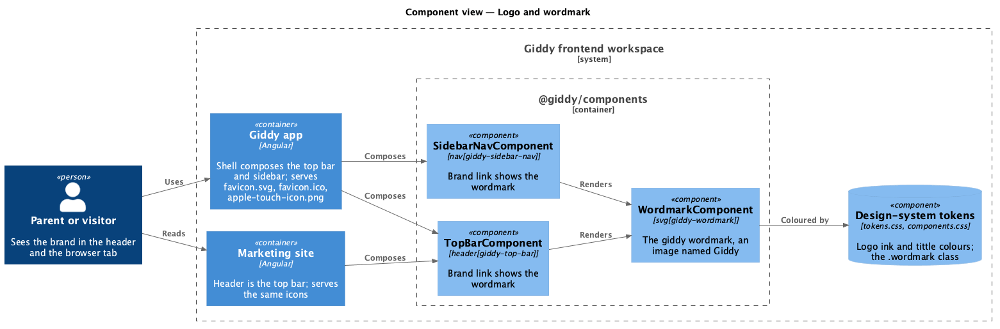
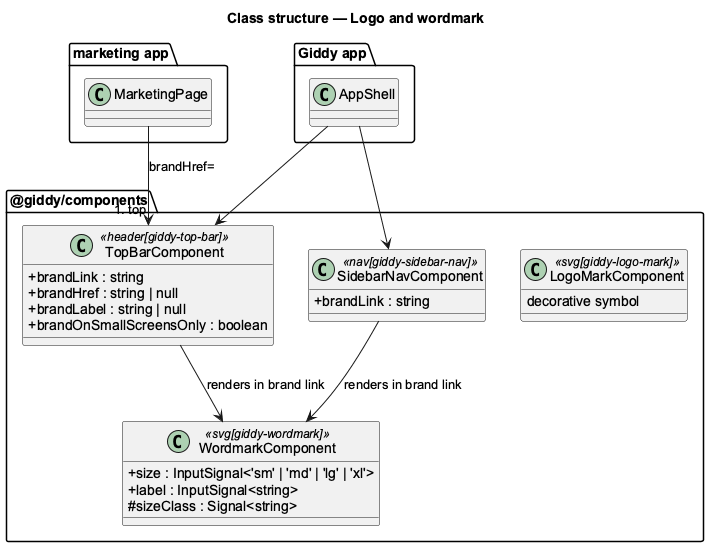

# Logo and wordmark

## Overview

Giddy's brand moves from a small balloon beside the word "Giddy" to the lowercase **giddy** wordmark: one round monoline stroke whose i is dotted with a balloon that has just let go. The balloon on its own is the **symbol**, and the symbol on a grape tile is the **app icon**. The design comes from the Magic Patterns frame "Giddy Logo & Wordmark", recorded in the design system's [Logo](../../../design-system/foundations/logo.html) foundation.

- **wordmark**: the primary logo, 272 × 132 units, letters in `--color-logo-ink`, balloon in `--color-logo-tittle`
- **symbol**: the balloon alone (48 × 64 units), for places the wordmark will not fit
- **app icon**: the symbol in cream on a grape tile, served as the favicon and the touch icon
- **colourway**: one of four approved colour pairs (Primary, Reversed, Night, One colour); the product uses Primary in the light theme and Night in the dark theme through the tokens

This feature belongs to the **Platform and cross-cutting concerns** subsystem, beside the [responsive, themed application shell](../responsive-themed-shell/README.md). It changes no API and no data.

## Description

The feature is a frontend-only change: two tokens, one new library component, two changed library components and new static icons.

**Design system (`docs/design-system`)**

- **Tokens.** `--color-logo-ink` (grape 700 light, cream 50 dark) and `--color-logo-tittle` (pink 400 in both themes), in `tokens.css` and `tokens.json`. Their contrast pairs, which are held to 3:1, are in `contrast-pairs.json`.
- **`components.css`.** The `.wordmark` class with the sizes `--sm` (24 px, the smallest on screen), the default (32 px, the top bar), `--lg` (48 px) and `--xl` (80 px), plus `__ink`, `__tittle` and `__string`, and `CanvasText` in forced-colours mode. `.logo-mark` is redrawn as the new symbol.
- **`assets/brand/`.** `app-icon.svg` (with face) and `favicon.svg` (no face), the sources of the shipped icons.
- **`foundations/logo.html`.** The logo sheet: the wordmark, its construction, the symbol, the app icon, colourways, clear space, minimum sizes, misuse, accessibility, tokens and code.

**Frontend: components library (`frontend/projects/components`)**

- **`WordmarkComponent`.** New, `svg[giddy-wordmark]`. Its host is the SVG itself, with `role="img"`, `aria-label` from the `label` input (default "Giddy"), `viewBox="0 4 272 132"` and the classes `wordmark` and `wordmark--{size}`, where the `size` input is `sm | md | lg | xl` and defaults to `md`. It draws the paths with no colour of its own; colour comes from the tokens through `components.css`, so it themes without inputs (`L2-096` AC3).
- **`TopBarComponent`.** The brand template becomes `<svg giddy-wordmark>`. The visible "Giddy" text goes, and the image names the link "Giddy". `brandLabel` still overrides the name, for example "Giddy, back to the top" (AC1–AC2).
- **`SidebarNavComponent`.** Its brand link shows the wordmark the same way (AC1).
- **`LogoMarkComponent`.** Redrawn as the new symbol (`viewBox="0 0 48 64"`, decorative). No screen uses it after this change; it stays the library's symbol for later avatar and icon uses.

**Frontend: apps (`frontend/src`, `frontend/projects/marketing`)**

- **`public/`.** Each app gets `favicon.svg` and `apple-touch-icon.png` (180 px, rendered from `app-icon.svg`), and `favicon.ico` is regenerated from the symbol (16, 32 and 48 px).
- **`index.html`.** Declares `<link rel="icon" href="favicon.svg" type="image/svg+xml">`, keeps `favicon.ico` as the fallback (`sizes="48x48"`) and adds `<link rel="apple-touch-icon" href="apple-touch-icon.png">` (AC4).

**e2e (`frontend/e2e`)**

- `AppShellPage` and `MarketingPage` expose the brand link and the wordmark image inside it. A new page object, `SiteIconsPage`, reads the declared icon links and fetches each one.
- `e2e/brand.spec.ts` holds the acceptance tests: the brand image in the app's top bar and sidebar, in the marketing header, and the icons in both apps. The existing axe checks on the shell and the marketing page cover AC5.

**Decisions.**

- **The wordmark is an image, not text.** The lowercase "giddy" is drawn, not typed, so it is one image named "Giddy". Body copy still writes "Giddy".
- **Colour comes from tokens, not inputs.** The light and dark colourways follow the theme with no code. Reversed and One colour are documented for art and print but are not component variants until a screen needs one.
- **The mascot is unchanged.** The brand guidelines frame also draws the mascot. The library's `svg[giddy-mascot]` already covers its four moods, so it is out of scope here.
- **The auth pages keep their layout.** In the app they sit under the shell's top bar, which now shows the wordmark. The mocks' larger wordmark above the auth card is mock-only chrome, the same as before this change.
- **Deferred:** a web app manifest with maskable icons, email and invitation templates, and the "Planned with giddy" invitation footer.

## Requirements

The feature realizes the following level-2 (L2) requirement. It refines the level-1 (L1) requirement cited beside it; the full acceptance criteria are in [`docs/specs/L2.md`](../../../specs/L2.md).

| L2 ID | Refines (L1) | Requirement |
|-------|--------------|-------------|
| `L2-096` | `L1-021` | **Logo and wordmark.** The brand link in the app and on the marketing site shows the giddy wordmark, named "Giddy", coloured by the logo tokens in both themes; both apps serve the app icon as their favicon and touch icon. |

## Diagrams

### Components

The library's wordmark is drawn by the top bar and the sidebar. Both apps compose those, and their icons are static files.

### Class structure

`WordmarkComponent` is new. `TopBarComponent` and `SidebarNavComponent` render it in place of the old mark and text.

