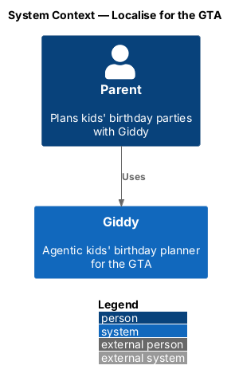
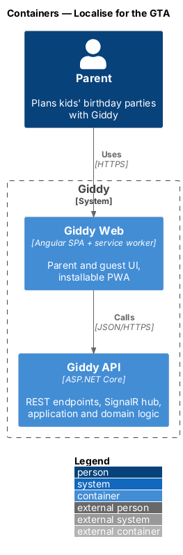
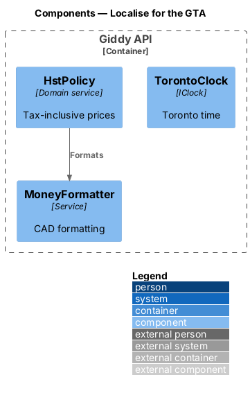
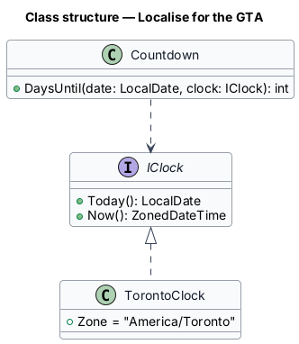
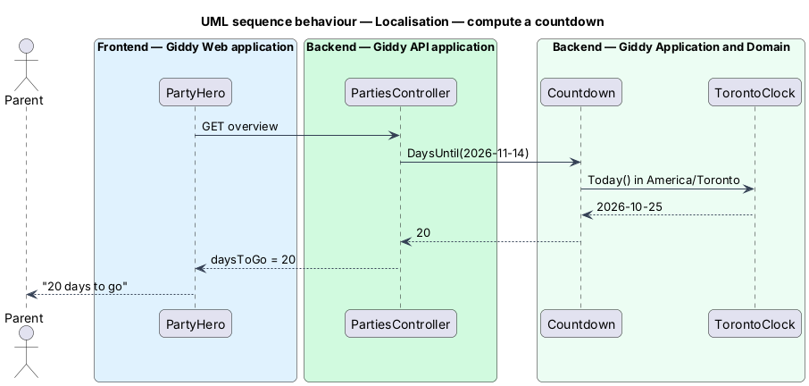

# Localise for the GTA

## Overview

Giddy speaks Canadian English, shows Canadian dollars including 13% HST, and calculates every date, countdown and deadline in the America/Toronto time zone, including across daylight-saving changes.

- **calendar day** — date in America/Toronto, used for countdowns, overdue checks and locking

This feature belongs to the **Platform and cross-cutting concerns** subsystem. It is designed from the screens in [`docs/mocks`](../../../mocks/README.md) and the L2 requirements listed below.

## Description

The feature is a vertical slice from the Angular web application through the Giddy API to storage and any external services.

**Backend**

- **`TorontoClock`** — `IClock` returning `ZonedDateTime` in America/Toronto (NodaTime).
- **`MoneyFormatter`** — en-CA currency formatting; whole dollars unless cents are needed.
- **`HstPolicy`** — Ensures stored prices are tax-inclusive.

**Frontend (Giddy Web)**

- **`Locale en-CA`** — Angular `LOCALE_ID`.
- **`RelativeDatePipe`** — “Tomorrow”, “in 20 days”, “Sat 14 Nov” with exact timestamp in `title`/tooltip.

## Requirements

The feature realizes the following level-2 (L2) requirements. Each L2 requirement refines the level-1 (L1) requirement cited beside it; the full acceptance criteria are in [`docs/specs/L2.md`](../../../specs/L2.md).

| L2 ID | Refines (L1) | Requirement |
|-------|--------------|-------------|
| `L2-091` | `L1-023` | **Language, currency, dates and times.** Given any page, when it is shown, then copy is Canadian English in sentence case, matching the content rules in the design system. |

## Diagrams

### System context

Localisation is internal to Giddy.

### Containers

Both web and API apply the same locale and zone.

### Components

A single clock abstraction removes time-zone bugs.

### Class structure

Every date rule depends on `IClock`.

### Behaviour — compute a countdown

Countdowns use calendar days in Toronto, so daylight-saving changes never shift them (`L2-091`).

