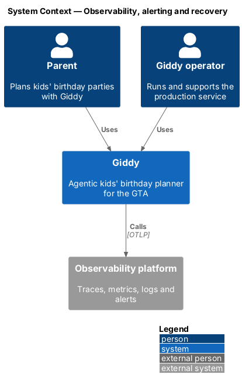
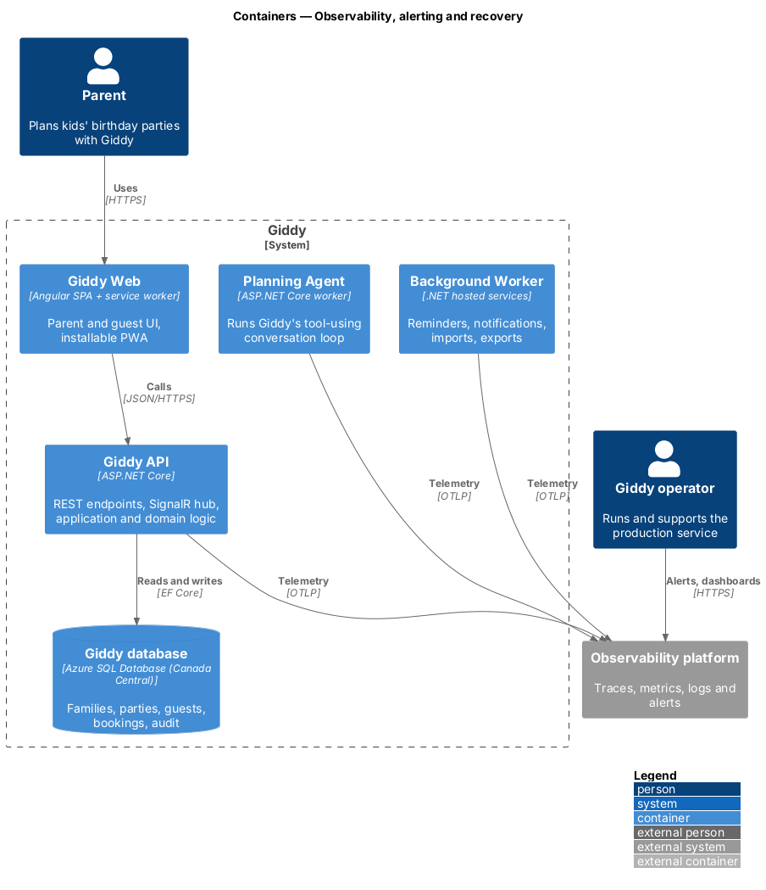
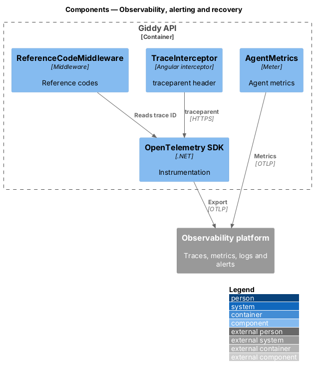
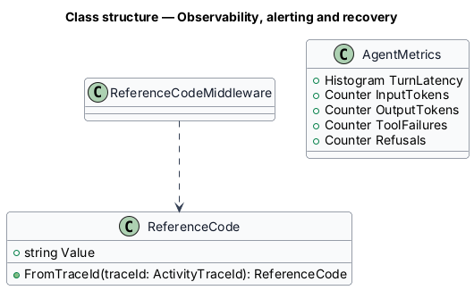
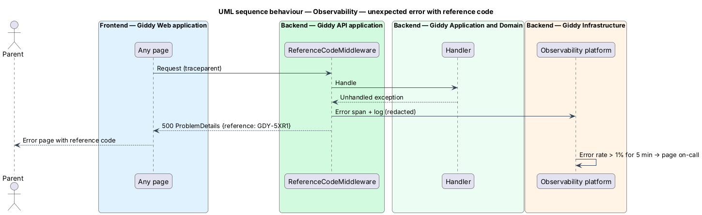

# Observability, alerting and recovery

## Overview

Every request carries a *trace ID* from the browser through the API, workers and agent tool calls. Unexpected errors show a reference code that maps to the trace. Alerts fire on error rate and latency, and the database can be restored to any point in the last 14 days.

- **reference code** — short code shown to the parent (for example GDY-5XR1) derived from the trace ID
- **RTO** — recovery time objective, 4 hours

This feature belongs to the **Platform and cross-cutting concerns** subsystem. It is designed from the screens in [`docs/mocks`](../../../mocks/README.md) and the L2 requirements listed below.

## Description

The feature is a vertical slice from the Angular web application through the Giddy API to storage and any external services.

**Backend**

- **`OpenTelemetry SDK`** — Traces, metrics and logs from ASP.NET Core, EF Core, HTTP clients and Service Bus, exported over OTLP.
- **`ReferenceCodeMiddleware`** — Adds the reference code to ProblemDetails responses.
- **`AgentMetrics`** — Latency, tokens, tool failures and refusals per day.
- **`Alert rules`** — Error rate > 1% or p95 over target for 5 minutes pages on-call.
- **`Backups`** — Azure SQL point-in-time restore, 14 days; quarterly restore test.

**Frontend (Giddy Web)**

- **`TraceInterceptor`** — Adds `traceparent` headers; records Core Web Vitals.

**Open points**

- Observability platform vendor `<TO SUPPLY>`
- On-call rota and escalation `<TO SUPPLY>`

## Requirements

The feature realizes the following level-2 (L2) requirements. Each L2 requirement refines the level-1 (L1) requirement cited beside it; the full acceptance criteria are in [`docs/specs/L2.md`](../../../specs/L2.md).

| L2 ID | Refines (L1) | Requirement |
|-------|--------------|-------------|
| `L2-077` | `L1-019` | **Observability.** Given any request, when it is processed, then a trace ID is propagated from the browser through the .NET API, background jobs and agent tool calls, and appears in structured logs. |
| `L2-078` | `L1-019` | **Backups and recovery.** Given the production database, when backups run, then point-in-time recovery to any moment in the last 14 days is possible, and a restore is tested every quarter with a recovery time of 4 hours or less. |

## Diagrams

### System context

Operators work from the observability platform.

### Containers

All containers export telemetry over OTLP.

### Components

Instrumentation is shared; reference codes are derived from trace IDs.

### Class structure

`ReferenceCode` is a pure function of the trace ID.

### Behaviour — unexpected error with reference code

The parent sees a code; support finds the trace from it (`L2-077`).

