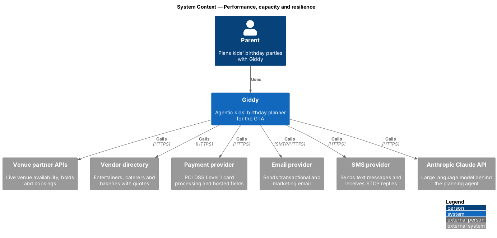
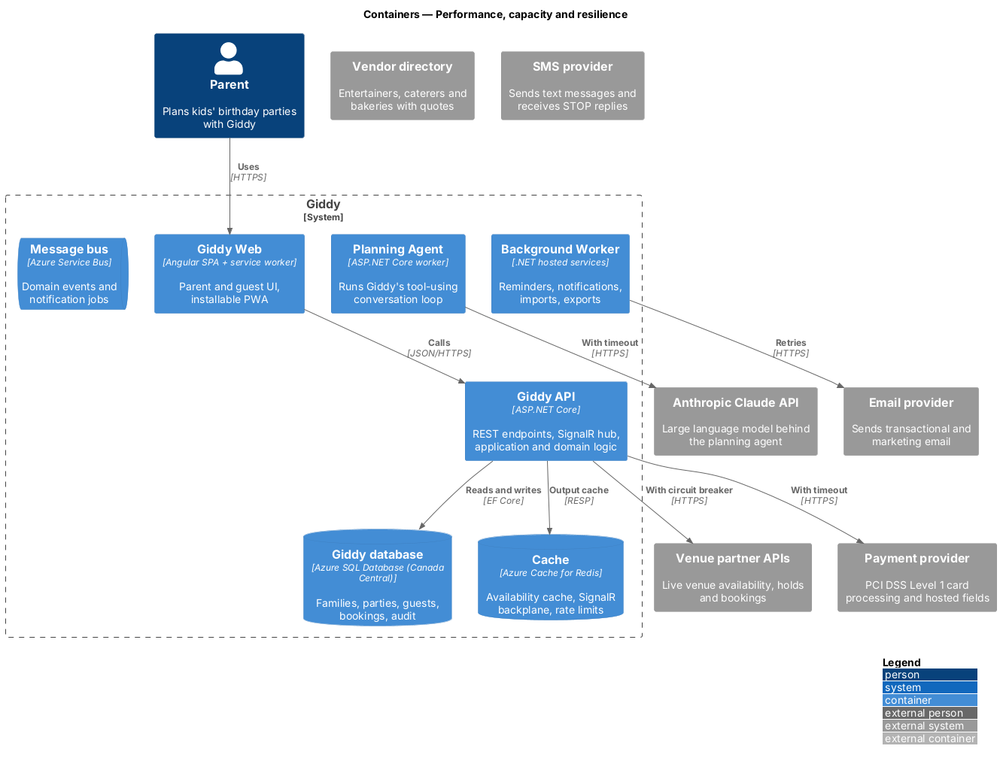
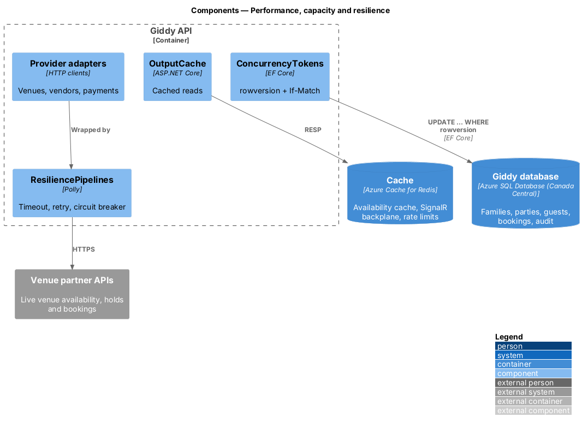
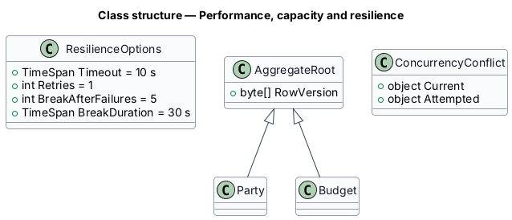
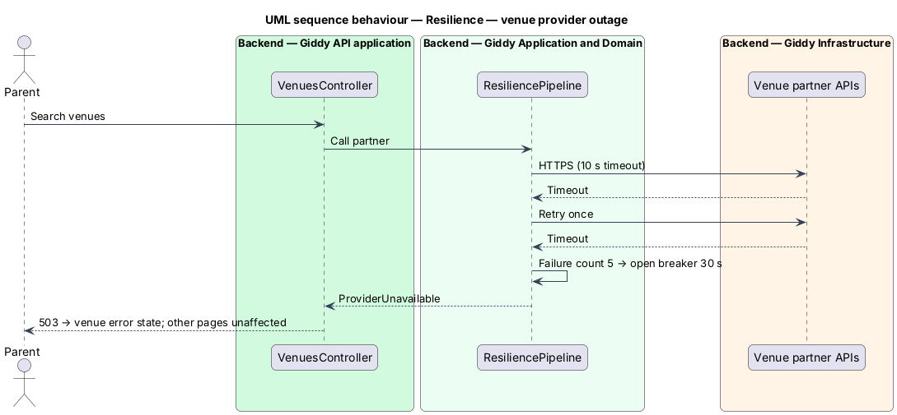

# Performance, capacity and resilience

## Overview

Giddy targets fast pages on mid-range phones over 4G, quick API responses, 99.9% availability, and graceful behaviour when any external provider fails. Concurrent edits never silently overwrite each other.

- **p95** — 95th percentile latency
- **circuit breaker** — Polly policy that stops calling a failing provider for 30 s after repeated failures
- **ETag** — version tag used for optimistic concurrency

This feature belongs to the **Platform and cross-cutting concerns** subsystem. It is designed from the screens in [`docs/mocks`](../../../mocks/README.md) and the L2 requirements listed below.

## Description

The feature is a vertical slice from the Angular web application through the Giddy API to storage and any external services.

**Frontend (Giddy Web)**

- **`Lazy routes`** — Every feature route is lazy-loaded; initial JS budget 250 KB compressed enforced in `angular.json`.
- **`Skeleton-first rendering`** — Layout-matching skeletons keep CLS ≤ 0.1.

**Backend**

- **`ResiliencePipelines`** — Polly: 10 s timeout, one retry with jitter, circuit breaker per provider.
- **`OutputCache`** — ASP.NET Core output cache and Redis for read-heavy endpoints.
- **`ConcurrencyTokens`** — `rowversion` on aggregates; `If-Match` on writes; 412 on mismatch.
- **`Autoscale`** — Azure Container Apps scale rules on HTTP concurrency and queue length.

**Open points**

- Load-test tool and environment `<TO SUPPLY>`
- Real User Monitoring provider for Core Web Vitals `<TO SUPPLY>`

## Requirements

The feature realizes the following level-2 (L2) requirements. Each L2 requirement refines the level-1 (L1) requirement cited beside it; the full acceptance criteria are in [`docs/specs/L2.md`](../../../specs/L2.md).

| L2 ID | Refines (L1) | Requirement |
|-------|--------------|-------------|
| `L2-074` | `L1-019` | **Page and API performance.** Given a mid-range phone on a 4G connection, when any signed-in page loads, then Largest Contentful Paint is 2.5 s or less and Interaction to Next Paint is 200 ms or less at the 75th percentile, and Cumulative Layout Shift is 0.1 or less (loading skeletons match final layout). |
| `L2-075` | `L1-019` | **Capacity and availability.** Given production, when measured monthly, then availability of sign-in, planning pages and RSVP pages is at least 99.9%. |
| `L2-076` | `L1-019` | **Data freshness and consistency.** Given venue availability, when it is shown, then it is no older than 15 minutes and is re-checked with the venue at booking time. |

## Diagrams

### System context

Every external provider is called behind resilience policies.

### Containers

Each container scales independently on load and queue depth.

### Components

Provider adapters are wrapped by Polly pipelines.

### Class structure

Aggregates carry a `RowVersion` for optimistic concurrency.

### Behaviour — venue provider outage

Timeouts and the breaker keep a provider outage to the affected feature's error state (`L2-075`).

