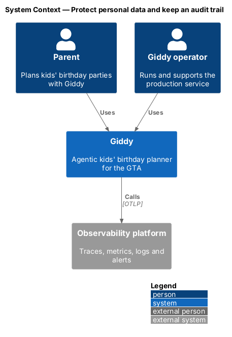
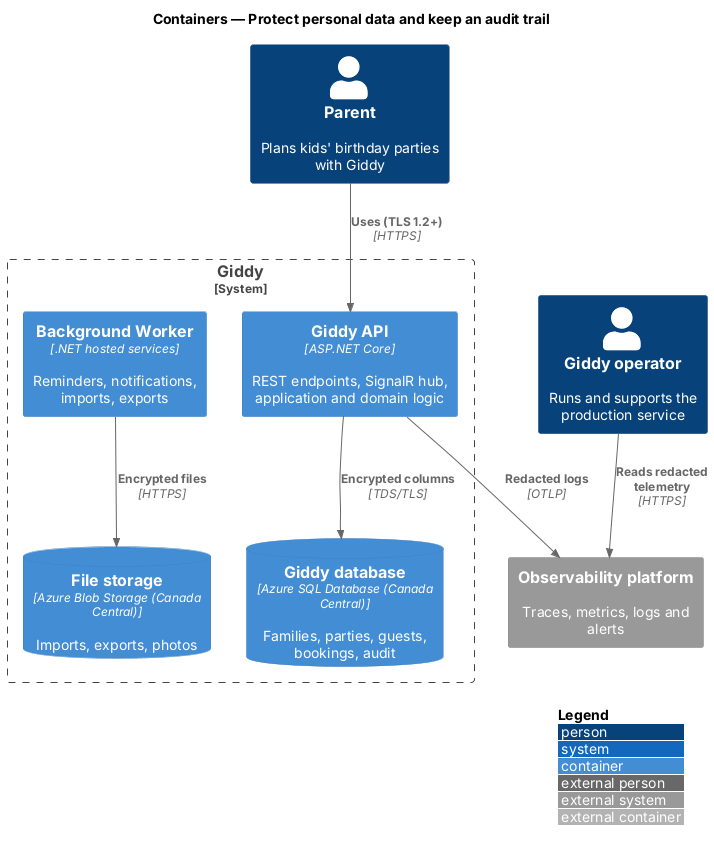
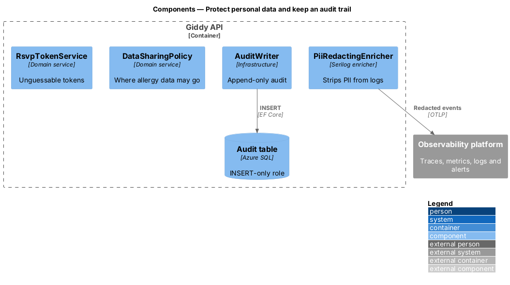
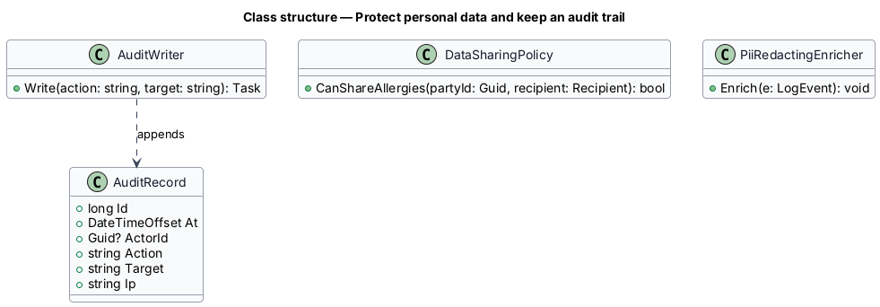
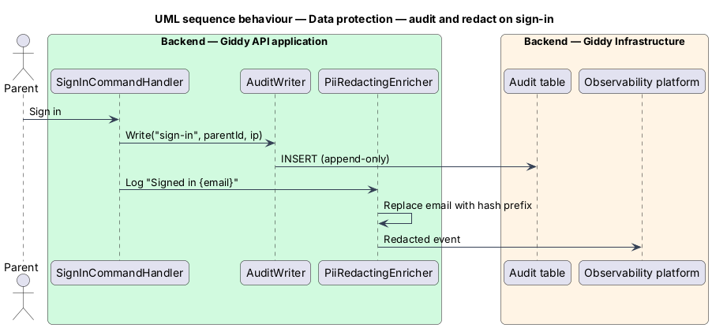

# Protect personal data and keep an audit trail

## Overview

Giddy stores children's first names, birthdays, interests and allergies, and parents' contact details. Data stays in Canadian data centres, is encrypted at rest and in transit, is minimised, never appears in logs, and is shared only as the parent directs. Security-relevant events go to an append-only *audit trail*.

- **PIPEDA** — Canada's Personal Information Protection and Electronic Documents Act
- **audit record** — immutable entry with time, actor, action, target and IP, kept 1 year

This feature belongs to the **Platform and cross-cutting concerns** subsystem. It is designed from the screens in [`docs/mocks`](../../../mocks/README.md) and the L2 requirements listed below.

## Description

The feature is a vertical slice from the Angular web application through the Giddy API to storage and any external services.

**Backend (Giddy API)**

- **`PiiRedactingEnricher`** — Serilog enricher that removes emails, phone numbers, allergies and message text from log events.
- **`AuditWriter`** — Writes audit records to an append-only table whose application role has INSERT only.
- **`RsvpTokenService`** — 128-bit random tokens; hashes stored; revocable.
- **`DataSharingPolicy`** — Allows allergy data to leave Giddy only to planners and venues or vendors the host sends it to.

**Infrastructure**

- **`Azure SQL TDE + Always Encrypted`** — Encryption at rest; allergy and phone columns use column encryption.
- **`Key Vault`** — Keys and secrets with managed identities.
- **`TLS 1.2+`** — Enforced at Front Door and between services.

**Open points**

- Data processing agreements with each external provider `<TO SUPPLY>`
- Breach-response runbook owner `<TO SUPPLY>`

## Requirements

The feature realizes the following level-2 (L2) requirements. Each L2 requirement refines the level-1 (L1) requirement cited beside it; the full acceptance criteria are in [`docs/specs/L2.md`](../../../specs/L2.md).

| L2 ID | Refines (L1) | Requirement |
|-------|--------------|-------------|
| `L2-072` | `L1-018` | **Protect personal data and children's data.** Given personal data, when it is stored, then it is encrypted at rest in Canadian data centres and in transit with TLS 1.2 or later. |
| `L2-073` | `L1-018` | **Audit trail.** Given security-relevant events (sign-in, failed sign-in, password change, email change, sharing changes, booking, payment, deletion, data export), when they occur, then an audit record with time, actor, action, target and IP is written and kept for 1 year, and cannot be changed by application users. |

## Diagrams

### System context

Operators see only redacted telemetry in the observability platform.

### Containers

All data stores are in Azure Canada Central and encrypted.

### Components

Redaction, audit and sharing rules are small, separate components.

### Class structure

Audit records are append-only.

### Behaviour — audit and redact on sign-in

Security events produce an audit record; the log event is redacted before export (`L2-073`, `L2-072`).

