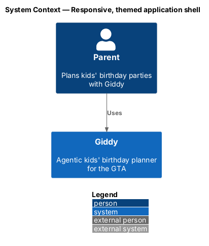
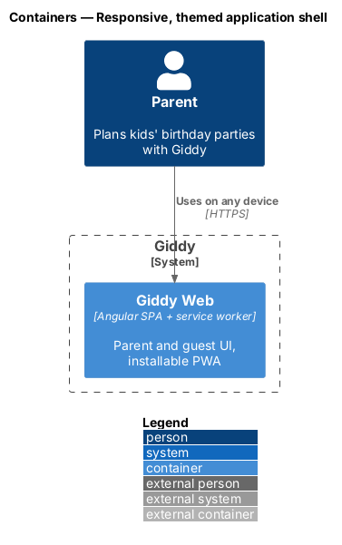
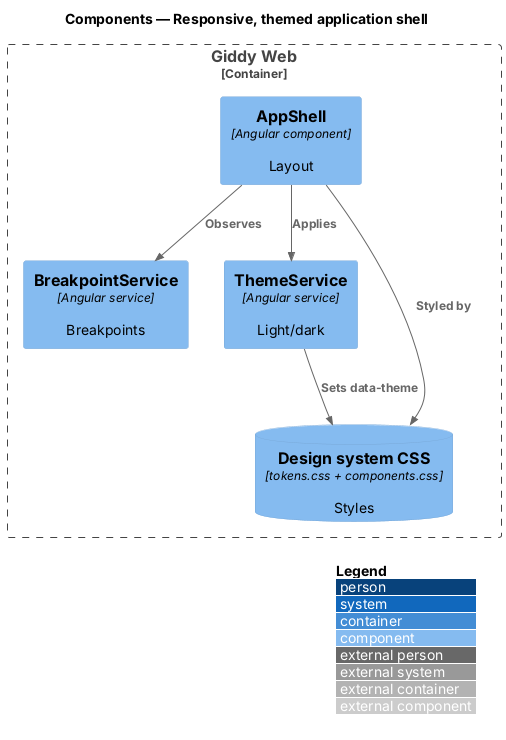
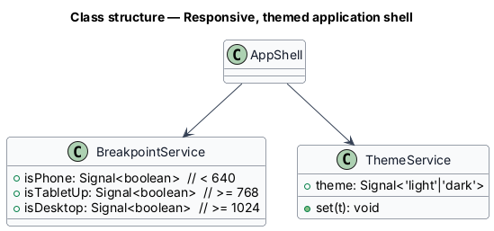
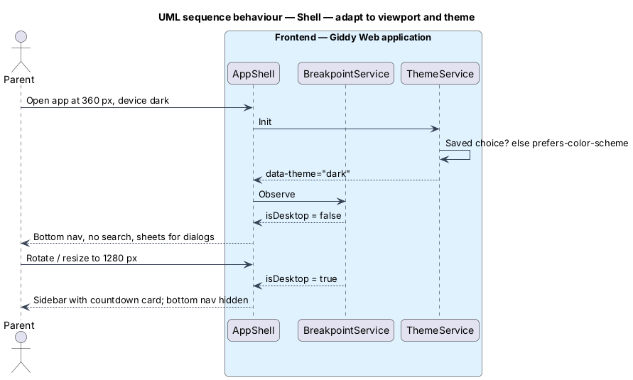

# Responsive, themed application shell

## Overview

One shell serves every signed-in page: a sidebar from 1024 px, a bottom tab bar below it, a top bar with search from 768 px, and dialogs that become bottom sheets under 640 px. Light and dark themes follow the device unless the parent chooses, and every style comes from the design system.

- **design system** — tokens and component CSS in `docs/design-system`, the single source of styling

This feature belongs to the **Platform and cross-cutting concerns** subsystem. It is designed from the screens in [`docs/mocks`](../../../mocks/README.md) and the L2 requirements listed below.

## Description

The feature is a vertical slice from the Angular web application through the Giddy API to storage and any external services.

**Frontend (Giddy Web)**

- **`AppShell`** — Sidebar, top bar, bottom nav, banner host and toast region.
- **`BreakpointService`** — Angular CDK `BreakpointObserver` with the design-system breakpoints (640, 768, 1024, 1280 px).
- **`ThemeService`** — Applies `data-theme` from saved choice or `prefers-color-scheme`.
- **`Stylelint rules`** — Reject raw colours and z-index values in component styles.
- **`Visual regression`** — Playwright screenshots vs mocks at 360 and 1280 px in both themes.

## Requirements

The feature realizes the following level-2 (L2) requirements. Each L2 requirement refines the level-1 (L1) requirement cited beside it; the full acceptance criteria are in [`docs/specs/L2.md`](../../../specs/L2.md).

| L2 ID | Refines (L1) | Requirement |
|-------|--------------|-------------|
| `L2-084` | `L1-021` | **Responsive layouts at every viewport.** Given any page, when viewed at 360, 600, 800, 1000 and 1280px wide (XS, SM, MD, LG, XL), then there is no horizontal page scrolling; only data tables scroll sideways inside their frame. |
| `L2-085` | `L1-021` | **Light and dark themes.** Given the device prefers dark colours, when Giddy loads, then the dark theme is used unless the parent has chosen light; the parent's choice is remembered. |
| `L2-086` | `L1-021` | **Design-system conformance.** Given the Angular app, when it is built, then it uses `docs/design-system/tokens/tokens.css` (or code generated from `tokens.json`) and the component classes in `docs/design-system/assets/components.css`, and a lint check rejects raw colour values and raw z-index values in component styles. |

## Diagrams

### System context

The shell is internal to the web application.

### Containers

Only Giddy Web is involved.

### Components

The shell reads breakpoints and theme from two small services.

### Class structure

Breakpoint signals mirror the design-system breakpoints.

### Behaviour — adapt to viewport and theme

Navigation moves between sidebar and bottom bar at 1024 px; the theme follows the saved choice or the device (`L2-084`, `L2-085`).

