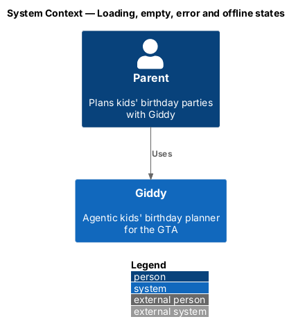
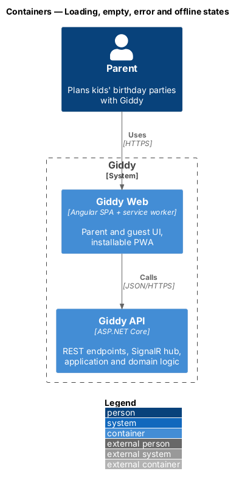
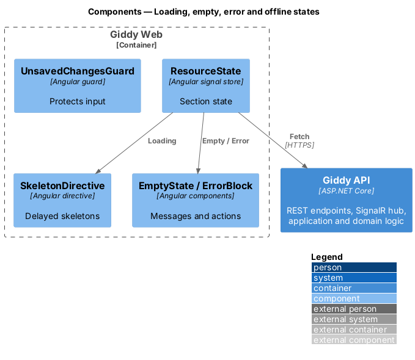
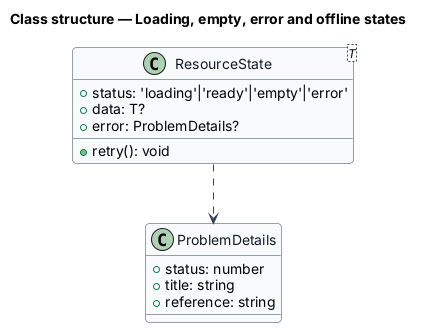
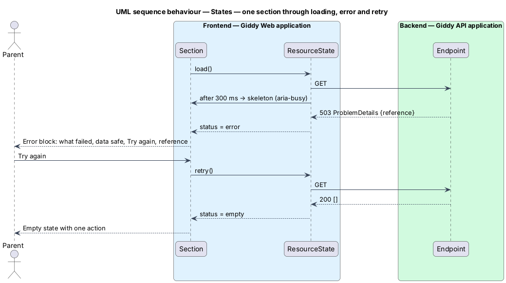

# Loading, empty, error and offline states

## Overview

Every page handles the same situations the same way: skeletons while loading, an explanatory empty state, an error block that keeps the shell, isolated section failures, and dedicated 404, 403, 500 and offline pages. No failure discards what the parent typed.

- **resource state** — one of Loading, Ready, Empty, Error for a page section

This feature belongs to the **Platform and cross-cutting concerns** subsystem. It is designed from the screens in [`docs/mocks`](../../../mocks/README.md) and the L2 requirements listed below.

## Description

The feature is a vertical slice from the Angular web application through the Giddy API to storage and any external services.

**Frontend (Giddy Web)**

- **`ResourceState<T>`** — Signal-based wrapper used by every section.
- **`SkeletonDirective`** — Renders layout-matching skeletons after 300 ms.
- **`EmptyState / ErrorBlock`** — Design-system components with mascot moods.
- **`UnsavedChangesGuard`** — `CanDeactivate` guard prompting before leaving dirty forms.
- **`Error routes`** — `/404`, `/403`, `/500`, `/offline`.

**Backend (Giddy API)**

- **`ProblemDetails`** — RFC 7807 responses with reference codes.

## Requirements

The feature realizes the following level-2 (L2) requirements. Each L2 requirement refines the level-1 (L1) requirement cited beside it; the full acceptance criteria are in [`docs/specs/L2.md`](../../../specs/L2.md).

| L2 ID | Refines (L1) | Requirement |
|-------|--------------|-------------|
| `L2-087` | `L1-022` | **Loading, empty and error states.** Given a page whose data takes longer than 300 ms, when it loads, then skeletons shaped like the final layout are shown, the region has `aria-busy="true"`, and no spinner covers a blank page. |
| `L2-088` | `L1-022` | **Not found, no access, server error and offline pages.** Given an unknown route or deleted party, when it is requested, then a 404 page explains it in plain words and links to Home and Help, with HTTP status 404. |
| `L2-089` | `L1-022` | **Never lose the parent's work.** Given any form or message, when a save or send fails, then everything the parent entered stays in place and can be retried. |

## Diagrams

### System context

States are handled in the web application.

### Containers

The web app interprets API ProblemDetails consistently.

### Components

One state model and shared components keep every page consistent.

### Class structure

`ResourceState` is the single state model.

### Behaviour — one section through loading, error and retry

Skeletons appear only after 300 ms; errors keep the shell and offer Try again with a reference code (`L2-087`).

