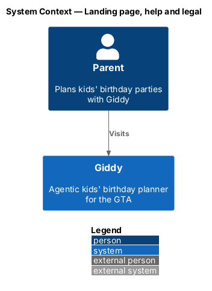
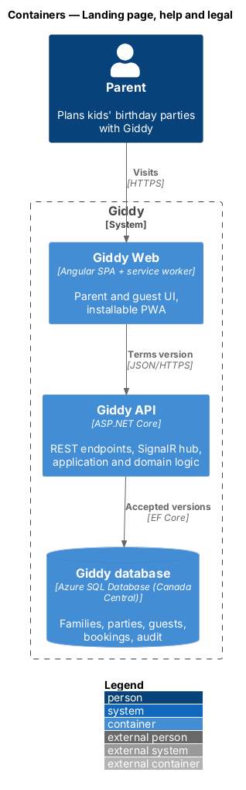
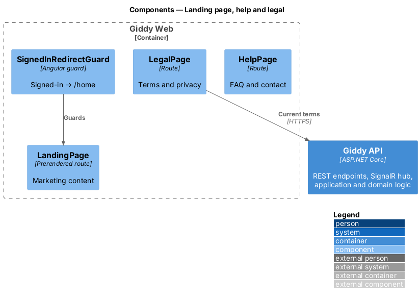
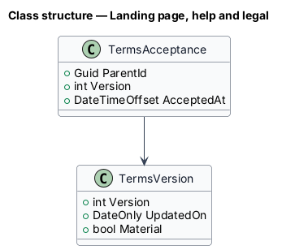
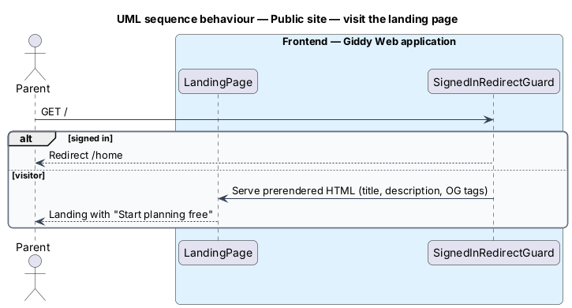

# Landing page, help and legal

## Overview

Visitors meet Giddy on the public landing page, find answers in the help centre, and read plain-language terms and privacy. These pages are server-rendered for speed and search engines.

- **prerendering** — Angular SSR/SSG producing HTML at build time so content renders without JavaScript

This feature belongs to the **Public website** subsystem. It is designed from the screens in [`docs/mocks`](../../../mocks/README.md) and the L2 requirements listed below.

## Description

The feature is a vertical slice from the Angular web application through the Giddy API to storage and any external services.

**Frontend (Giddy Web)**

- **`LandingPage`** — Prerendered route `/` with Open Graph tags; signed-in visitors redirect to `/home`.
- **`HelpPage`** — Route `/help`; FAQ accordion with search; contact details.
- **`LegalPage`** — Route `/legal`; last-updated date.

**Backend (Giddy API)**

- **`TermsController`** — `GET /api/terms/current`; sign-in checks accepted version and prompts on material change.

## Requirements

The feature realizes the following level-2 (L2) requirements. Each L2 requirement refines the level-1 (L1) requirement cited beside it; the full acceptance criteria are in [`docs/specs/L2.md`](../../../specs/L2.md).

| L2 ID | Refines (L1) | Requirement |
|-------|--------------|-------------|
| `L2-092` | `L1-024` | **Landing page.** Given a visitor, when the landing page loads, then it explains what Giddy does, how it works in three steps, popular themes, parent testimonials and the GTA areas covered, with "Start planning free" as the primary action and "Sign in". |
| `L2-093` | `L1-024` | **Help centre.** Given the help centre, when it loads, then common questions are shown as an expandable list, the first expanded, with a search box and contact details (email and phone with hours). |
| `L2-094` | `L1-024` | **Terms and privacy.** Given the Terms & privacy page, when it loads, then it explains in plain language what is collected, what is never done, where data is stored, what is shared with venues and vendors, invitation open tracking, and how to contact the privacy team, with the date it was last updated. |

## Diagrams

### System context

Visitors use the public pages before creating an account.

### Containers

Public pages are prerendered by the web container.

### Components

A guard redirects signed-in visitors.

### Class structure

Terms versions track material changes.

### Behaviour — visit the landing page

Prerendered HTML serves visitors and crawlers; signed-in parents go straight to Home (`L2-092`).

