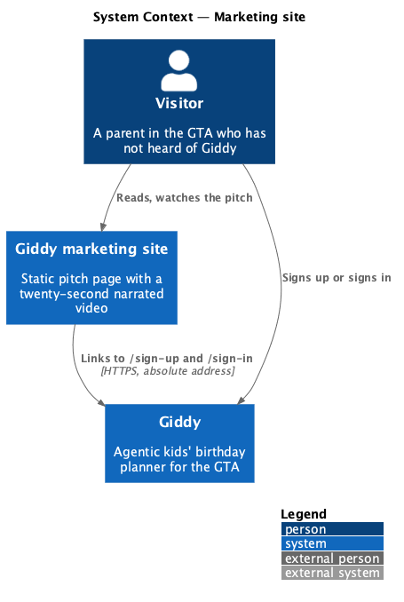
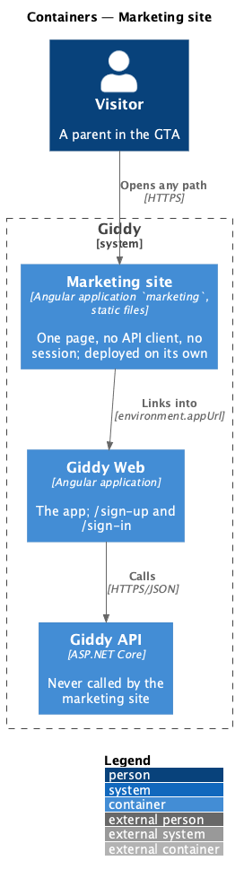
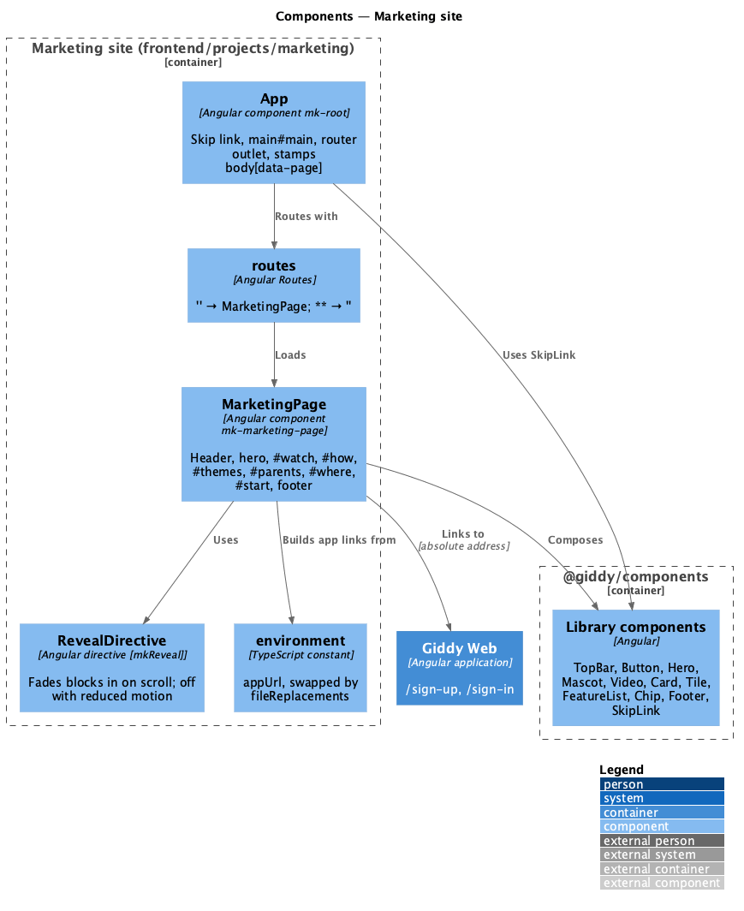
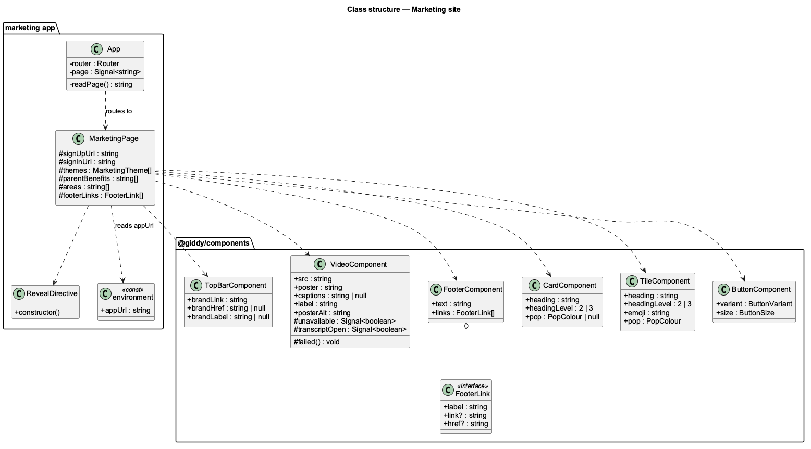
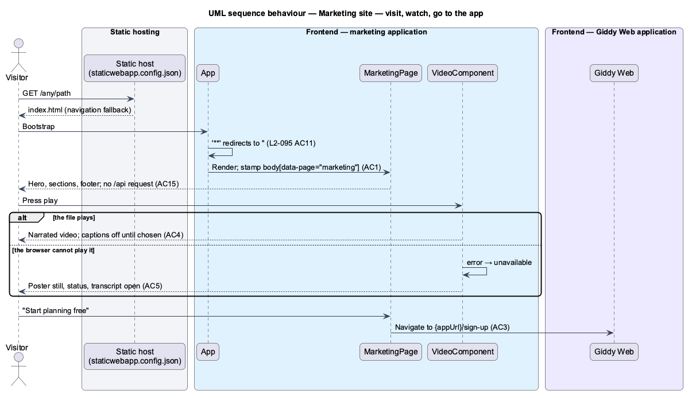

# Marketing site

## Overview

A parent who has never heard of Giddy lands on one public page that explains Giddy in a glance and hands them into the app: a hero, a twenty-second narrated pitch video, how it works in three steps, popular themes, what parents get, the GTA areas covered and a closing call to action. The page never needs a session.

The page is its own Angular application, `marketing`, in the existing workspace. It builds and deploys apart from the app and carries none of the app's session, API client or guards. It composes its screen from the `@giddy/components` library and links into the app by an absolute address from its environment.

- **marketing site** — the `marketing` application: one route, one page, no API
- **app URL** — `environment.appUrl`, the origin of the Giddy app the site links into for `/sign-up` and `/sign-in`
- **section anchors** — `#top`, `#watch`, `#how`, `#themes`, `#parents`, `#where`, `#start`: the in-page targets of the header navigation, the hero's secondary link and the footer
- **pitch video** — `docs/videos/16-meet-giddy/`, about 20 s: 1.5 s of soca lead-in, the narration, a short music tail; copied into the site as `meet-giddy.mp4` with its poster and captions

This feature belongs to the **Public website** subsystem. It is designed from [`pages/marketing`](../../../mocks/pages/marketing/default.html) and supersedes the in-app landing page of [landing, help and legal](../landing-help-and-legal/README.md).

## Description

The feature is a frontend-only slice: a second application in the workspace and small additions to the components library.

**Frontend — marketing application (`frontend/projects/marketing`)**

- **`App`** — Shell component (`app.ts`, `app.html`), selector `mk-root`. It renders `a[giddy-skip-link]` and the `router-outlet`, and stamps `<body data-page>` from route data. The page owns its header, `main#main` and footer, so the three are landmarks side by side. The stamping routine is a few lines kept in the site, because the site must not import the app or `@giddy/core`.
- **`routes`** — `app.routes.ts`: `''` lazy-loads `MarketingPage` with `data: { page: 'marketing' }`; `**` redirects to `''` (`L2-095` AC11).
- **`appConfig`** — `provideRouter(routes, withInMemoryScrolling({ anchorScrolling: 'enabled', scrollPositionRestoration: 'enabled' }))` and the global error listeners. No `HttpClient`, so the site cannot call an API.
- **`MarketingPage`** — `pages/marketing/marketing-page.ts|html|css`, selector `mk-marketing-page`. The template is the mock section by section, composed from the library as [`docs/screen-composition.md`](../../../screen-composition.md) lists. App links are built from `environment.appUrl`; themes, benefits, areas and footer links are typed constants.
- **`RevealDirective`** — `[mkReveal]`: adds `is-in` when the element scrolls into view through `IntersectionObserver`; adds it at once when the viewer prefers reduced motion or the browser has no observer (`L2-095` AC13).
- **`environment.ts` / `environment.prod.ts`** — `appUrl`: `http://127.0.0.1:4200` in development; `https://app.giddy.party` in production, a placeholder until hosting lands, swapped by `fileReplacements`.
- **`styles.css`** — Imports the design-system tokens and `components.css` through `projects/components/src/styles/giddy.css`, as the app does. The page's one-off layout lives in `marketing-page.css`, by token role only.
- **`public/`** — `meet-giddy.mp4`, `meet-giddy.jpg`, `meet-giddy.vtt` (copied from `docs/videos/16-meet-giddy/`), `favicon.ico` and `staticwebapp.config.json`.

**Frontend — components library (`frontend/projects/components`)**

- **`VideoComponent`** — New, `figure[giddy-video]`. Inputs `src`, `poster`, `captions`, `label`, `posterAlt`; renders a native `<video controls playsinline preload="metadata">` with the poster and exactly one English `<track kind="captions">` without `default`, so captions stay off until chosen. The projected content is the transcript inside a `
` "Read the transcript". When the video raises `error`, `unavailable` turns on: the poster shows as an image with a status "This browser can’t play the video." and a link to the transcript, and the transcript opens (`L2-095` AC4–AC5).
- **`TopBarComponent`** — Gains `brandHref` and `brandLabel`. With `brandHref` the brand renders a plain `href` instead of a router link, labelled by `brandLabel` ("Giddy, back to the top"). A `[giddyTopBarNav]` slot before the spacer holds section links.
- **`FooterComponent`** — `FooterLink` gains an optional `href`; such a link renders a plain address (an anchor or another application) instead of a router link.
- **`CardComponent`** and **`TileComponent`** — Gain `headingLevel` (2 or 3, default 2) so cards inside a section take a level-three heading; `CardComponent` also accepts `li[giddy-card]` for cards in a list.
- **`ButtonComponent`** — Unchanged: `a[giddy-button]` already takes a plain `href` for in-page and external addresses.

**Workspace and tooling**

- **`angular.json`** — The `marketing` application: prefix `mk`, CSS, `@angular/build:application`, `browser` `projects/marketing/src/main.ts`, assets from `projects/marketing/public`, styles `projects/components/src/styles/giddy.css` and `projects/marketing/src/styles.css`, production budgets and the environment file replacement; a `serve` target. The app's `tsconfig.app.json` excludes `projects/marketing`.
- **`package.json`** — `start:marketing` serves the site on port 4300 beside the app on 4200.
- **ESLint** — The `mk` prefix is allowed for selectors in `projects/marketing`.
- **CI** — The `web` job also runs `npx ng build marketing --configuration production`.
- **e2e** — `playwright.config.ts` starts the site as a second web server on 4300; `e2e/pages/marketing.page.ts` owns the selectors and opens paths on the marketing origin; `e2e/marketing.spec.ts` holds the acceptance tests. The fake API's `**/api/**` route catches any API request from the site, and the page object records requests to `/api/` so a test fails loudly on one.
- **Deployment** — Static files from `dist/marketing/browser`. `public/staticwebapp.config.json` rewrites every path that is not a file to `/index.html`; no hosting, DNS or deploy workflow is created.

**Decisions.**

- A separate application rather than a route in the app: the page is public, must not pull the app's auth, API or guards, and deploys on its own cadence.
- The app address lives in the build environment, not in a runtime config call, because the site has no API to ask.
- `L2-092`'s in-app landing page is **superseded** by this site, not kept as a redirect: the app's `/` stays Home behind sign-in, so no app route changes. [Landing, help and legal](../landing-help-and-legal/README.md) records this.
- Library additions (`VideoComponent`, `brandHref`, `FooterLink.href`, `headingLevel`) rather than markup in the page, so the site reuses the design system as `AGENTS.md` requires.
- The transcript is projected content of the video component, not an input, so the site keeps the words and the component stays free of copy.
- Kokoro-82M `af_heart` at speed 1.0 narrates the pitch; at 0.9 the narration ran past 18 s. The soca bed starts 20 s into the track at −15 dB, about 4 dB under the voice.
- Deferred: hosting, DNS and a deploy workflow; help and legal pages on the site; prerendering or SSR; visual regression tests; burned-in captions and other languages.

## Requirements

The feature realizes the following level-2 (L2) requirements. Each L2 requirement refines the level-1 (L1) requirement cited beside it; the full acceptance criteria are in [`docs/specs/L2.md`](../../../specs/L2.md).

| L2 ID | Refines (L1) | Requirement |
|-------|--------------|-------------|
| `L2-095` | `L1-024` | **Marketing site.** One public page sells Giddy to a parent who has never heard of it and links into the app's `/sign-up` and `/sign-in`; it is its own application, built and deployed apart from the app, and makes no request to the Giddy API. |

## Diagrams

### System context

A visitor reads the marketing site; it hands them to the Giddy app and talks to nothing else.

### Containers

The site is a static Angular build beside the app, with no API behind it.

### Components

One route, one page, the library components it composes, and the environment that names the app.

### Class structure

`MarketingPage` builds its links from `environment.appUrl` and composes the library; `VideoComponent` is new, and `TopBarComponent`, `FooterLink`, `CardComponent` and `TileComponent` gain small inputs.

### Behaviour — visit, watch and go to the app

Any path serves the page (`L2-095` AC11); the video plays or falls back to the transcript (AC4–AC5); "Start planning free" leaves for the app (AC3).

